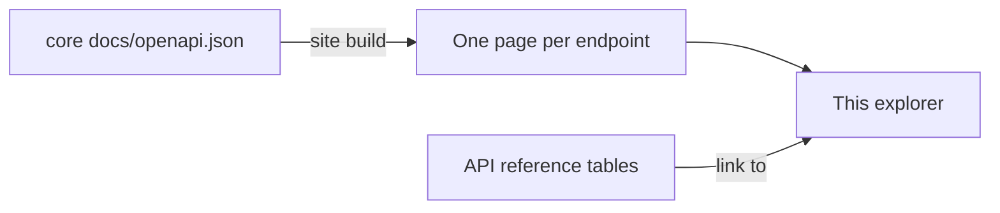

This explorer has one page per core-pipeline endpoint. The pages are generated from core's `docs/openapi.json` on every site build, so they always match the API.

:::warning[Read-only reference]
You can't send requests from these pages. The site is static and sits behind Cloudflare Access, and the API is only reachable inside the cluster. To call a running API, open its own FastAPI docs at `/docs`, for example `http://localhost:8000/docs` for a local instance.
:::

## What each page shows

| Section | Content |
|---|---|
| Parameters | Path, query and header inputs, with types and whether they're required. |
| Request body | The JSON schema and an example payload. |
| Responses | Status codes, response schemas and examples. |
| Code samples | `curl`, Python and JavaScript, using placeholder values. |

## Where do I find an endpoint?

Endpoints are grouped in the sidebar. Use the search box to find one by path or summary.

## Related

- [API reference](/core/api-reference): which endpoints need an `X-API-Key` and which queues they publish to.
- [Queue publishing](/core/queue-publishing): payloads and idempotency keys for the queues the API feeds.
