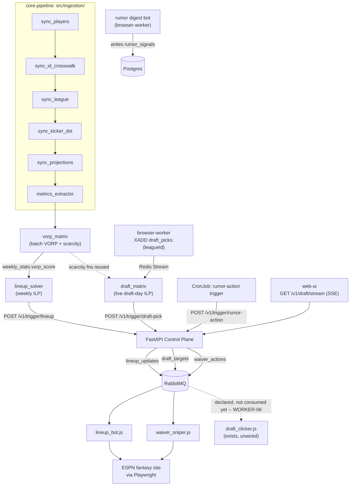
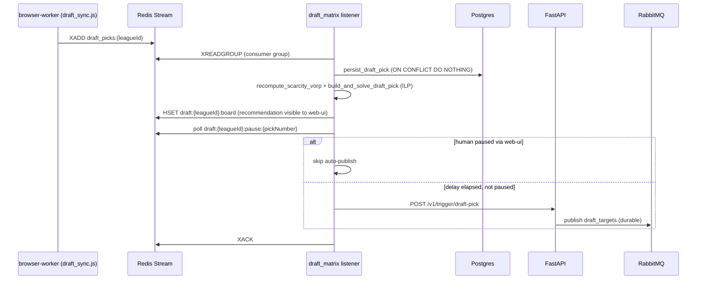

# Architecture

!!! note
    This is a living doc. Update it as part of resolving wayfinder tickets on the [map](https://github.com/cvillarr23/fantasy-project/issues/1) — don't let it drift from what's actually been decided there.

!!! warning
    Three of the four repos' READMEs (`fantasy-infra`, `fantasy-browser-worker`, and previously `fantasy-core-pipeline` itself) link to `fantasy-core-pipeline/ARCHITECTURE.md` as "the" cross-repo architecture doc. That file does not exist in the repo — never committed. This page is written to become that missing doc; the dead links in the other three repos should eventually point here instead.

## System overview

Four services, one shared Postgres/Redis/RabbitMQ backing:

| Repo | Role | Language |
|---|---|---|
| `fantasy-core-pipeline` | Control plane: ingestion, VORP/optimization math, FastAPI gateway, the only thing that publishes to RabbitMQ | Python (FastAPI) |
| `fantasy-browser-worker` | Execution layer: RabbitMQ consumers that drive ESPN's site via Playwright, plus the LLM-backed rumor digest/trade bots | Node.js (Playwright) |
| `fantasy-web-ui` | Draft-day monitoring dashboard (SSE client), the first slice of a planned fuller console | React/TypeScript (Vite) |
| `fantasy-infra` | GitOps: all four services' Kubernetes manifests, CronJob schedules, secrets wiring, dashboards | Kustomize, deployed via Argo CD from `homelab-deployment` |

Shared stores (all in `fantasy-infra/base/databases/`): Postgres/TimescaleDB (`bot_admin` read-write, `grafana_reader` read-only role for dashboards — never the reverse), Redis (draft-day pub/sub + streams, idempotency, pause signaling), RabbitMQ (the only inter-service message bus — durable queues: `lineup_updates`, `waiver_actions`, `draft_targets`, `trade_evaluations`, `trade_negotiations`, and `llm_requests` (WORKER-16, browser-worker#34) — the last has no publisher yet, added ahead of a real caller).

A shared, scale-to-zero Ollama deployment (`fantasy-infra/base/ollama/`) serves as the last-resort LLM tier for `fantasy-browser-worker` and doubles as the backend for the external `roo-coder` MCP server — both reach it through `homelab-deployment`'s KEDA HTTP Add-on interceptor via the same `Host` header, never scaling or calling it directly.

## How the pieces talk to each other

**Only `fantasy-core-pipeline` publishes to RabbitMQ.** Neither optimization module (`lineup_solver`, `draft_matrix`) publishes directly — both hand off through the FastAPI control plane, so `fantasy-browser-worker`'s bots only ever react to messages that passed through one API surface. This is the main architectural chokepoint and also the main safety property: there's exactly one place that decides "this action should actually execute against ESPN."

**Player id spaces do not match.** `players.player_id` is Sleeper's internal id; ESPN's id is a separate, numerically-overlapping namespace (`players.espn_id` is the crosswalk, ~845/1027 covered). `api/routes.py`'s `_reject_internal_player_id` exists specifically because the two spaces collide silently — ESPN id 12483 is Matthew Stafford, internal id 12483 is Jack Bech. Any code passing an id into browser-worker's ESPN-facing bots (`waiver_sniper.js`, `lineup_bot.js`) must translate through `espn_id` first; there's no runtime guard on the browser-worker side, only the one check in `core-pipeline`.

**LLM fallback chain** (`browser-worker/src/lib/llm_client.js`): Groq → Gemini → Ollama, in priority order, falling through on rate limit or failure. The Ollama leg deliberately uses `node:http`/`https` instead of `fetch` — `fetch` silently drops the `Host` header the KEDA interceptor needs to route/scale it.

`llm_client.js` also exports `startOllama()` (fires a cheap GET through the interceptor to trigger scale-up ahead of a known usage window, without blocking on the cold-start round trip) and `isOllamaReady()` (a passive readiness probe that deliberately *bypasses* the interceptor and hits the Ollama Service directly — routing a readiness check through the interceptor would itself trigger/extend scale-up). A separate module, `llm_async_queue.js`, layers a reusable async request/response interface on top — `requestLlmAsync()` / `getLlmRequestResult()` / `waitForLlmResult()` / `processAsyncLlmRequest()` — publishing onto the `llm_requests` queue and replying via a polled Postgres table (`llm_async_requests`, DDL owned by `fantasy-core-pipeline`) rather than an AMQP `replyTo` convention. Cross-repo contract for a Python publisher: `{ request_id: uuid, prompt: string, opts: {...} }` onto `llm_requests`, then poll `llm_async_requests` by `request_id`. This was built for WORKER-15's Discord chat interface, which closed `not_planned` and was rescoped to a web-UI panel (`core-pipeline#153`/`web-ui#97`) instead — so as of this writing, `llm_requests` has no publisher; see `browser-worker`'s WORKER-16 (CLAUDE.md) for the full rationale.

## Data flow: draft day

`draft_targets` is declared in RabbitMQ and `draft_clicker.js` already exists in `fantasy-browser-worker`, but the two aren't wired together yet (WORKER-06/INFRA-07) — publishes to that queue currently have no consumer.

## Auth & exposure

`fantasy-web-ui` sits behind an `oauth2-proxy` deployment (`fantasy-infra/base/oauth2-proxy/`) — not open to the internet unauthenticated. `fantasy-core-pipeline`'s FastAPI control plane has no equivalent auth layer of its own visible in this repo; anything that can reach the in-cluster Service can call `/v1/trigger/*`.

## Known fragility (already load-bearing, documented where it bit before)

- **RabbitMQ user provisioning**: `RABBITMQ_DEFAULT_USER`/`_PASS` env vars do **not** create a user on this image once `management.load_definitions` is in play — the broker previously booted with zero users and refused every connection (`/v1/health` → 403 `ACCESS_REFUSED`) until `render-definitions.py` (an initContainer) was added to merge a freshly-computed password hash into the queue definitions on every boot.
- **Kubernetes API calls with no timeout**: several `fantasy-core-pipeline` draft endpoints call the Kubernetes apiserver directly (`src/api/draft.py`); `web-ui`'s own `client.ts` already wraps its calls in `AbortSignal.timeout` specifically because "the control plane degrades and they simply never respond" is a real observed failure mode, not a hypothetical.
- **`src/api/routes.py` and `src/api/draft.py`** mix AMQP publish, Redis idempotency, and Kubernetes Job orchestration inline rather than going through a service layer like every other router — self-documented in `fantasy-core-pipeline/CLAUDE.md` as a known gap needing "its own design pass." Tracked as [fantasy-project#5](https://github.com/cvillarr23/fantasy-project/issues/5).
- **ESPN itself**: the entire execution layer depends on an undocumented, reverse-engineered protocol (`fantasy-browser-worker/docs/espn-reverse-engineering.md`) that ESPN can change without notice. This is the single largest external risk in the system and isn't mitigated by anything short of ongoing vigilance.
