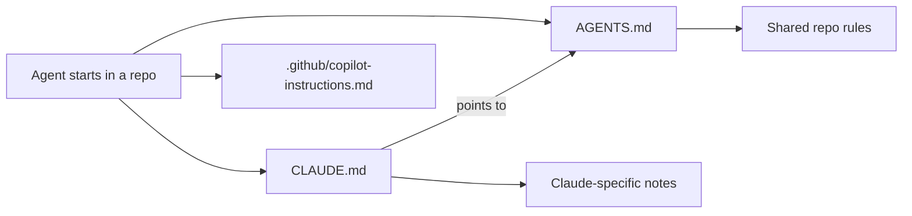

Coding agents are first-class contributors here. Each repo tells them how to behave through plain Markdown files checked into the repo, so humans and agents follow the same rules.

## Which file does what

| File | Read by | Holds |
|---|---|---|
| `AGENTS.md` | Any coding agent | Shared rules for the repo: documentation scope, naming conventions, what to check before submitting. This is the source of truth. |
| `CLAUDE.md` | Claude Code | Claude-specific guidance. It should link to `AGENTS.md` rather than copy it. In core-pipeline it also carries testing and API conventions. |
| `.github/copilot-instructions.md` | GitHub Copilot | Architecture and stack conventions for review and suggestions. |

:::info[Where each file exists]
Not every repo has all three. Check the repo root. When a repo has both `AGENTS.md` and `CLAUDE.md`, keep shared rules in `AGENTS.md` only.
:::

## Rules that recur across repos

| Rule | Why |
|---|---|
| No ticket or issue numbers in code comments, except in a `TODO`. | Comments should explain why. Issue references belong in commits and PR bodies. |
| No project tracking or implementation history in a README. | READMEs describe current behavior. |
| Name numeric constants and put units in the name. | Intent stays clear. |
| Keep cross-repo plans and rollout notes in `fantasy-project`. | Repo docs stay public-facing. |
| Never put secrets or personal data in code, docs, tests or logs. | Everything here is public. |
| Run the repo's lint and tests before declaring work done. | See [Checks and tests](./checks.md). |

## Contributing to the guidance files

- Keep each file short and specific to the repo. Link to docs instead of copying them.
- Add a rule when a mistake repeats, and say why the rule exists.
- Don't put credentials, internal hostnames or personal paths in them.
- Describe a rule once. If `CLAUDE.md` and `AGENTS.md` disagree, fix both in the same PR.

## Working with an agent

1. Point the agent at the issue and let it read the repo's guidance files first.
2. Ask for tests before code.
3. Review the diff yourself. You are accountable for what you submit, whether or not an agent wrote it.
