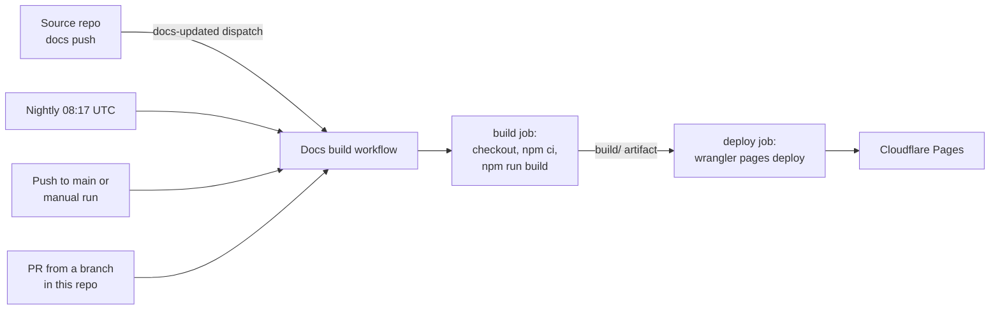

This site is served by the Cloudflare Pages project `fantasy-project`, behind Cloudflare Access. Only the owner's identity can read it. Use this page to understand a deploy, rotate its credentials, roll back or build locally.

| Hostname | What it serves |
|---|---|
| `<docs-hostname>` | Production, from `main`. This is the canonical URL in `docusaurus.config.ts`. |
| `<pages-subdomain>.pages.dev` | Production, on the Pages subdomain. |
| `<hash>.<pages-subdomain>.pages.dev` | One specific deployment. |
| `<branch>.<pages-subdomain>.pages.dev` | The latest preview of a branch. |

:::note[The Pages subdomain isn't the project name]
Pages appends a suffix when the plain name is taken, because `fantasy-project.pages.dev` belongs to another account. Copy the subdomain from the project, not from its name.
:::

## How do deploys work?

The **Docs build** workflow (`.github/workflows/docs-build.yml`) deploys from GitHub Actions.



| Job | What it does |
|---|---|
| `build` | Checks out each source repo's `docs/` at its default branch using `DOCS_REPOS_READ_TOKEN`. Runs `npm ci` and `npm run build`, then uploads `build/` as an artifact. It has no deployment credentials and is the required check. |
| `deploy` | Downloads the artifact and runs `wrangler pages deploy`, using the `wrangler` version pinned in `package.json`. |

| Trigger | Result |
|---|---|
| Push to `main`, a `docs-updated` repository dispatch, the nightly build or a manual run on `main` | Deploys to production. |
| PR from a branch in this repository | Deploys a preview for that branch. The job posts the deployment URL and branch alias on the PR and updates that comment on each push. |
| Fork or Dependabot PR | Builds only the site pages and local section placeholders. It doesn't check out private docs or deploy. The full cross-repo link check runs on trusted branches and `main`. |

### Deploy secrets

The deploy job uses two repository Actions secrets.

| Secret | Value |
|---|---|
| `CLOUDFLARE_API_TOKEN` | An API token with **Account → Cloudflare Pages → Edit**, limited to the one account that owns `fantasy-project`. |
| `CLOUDFLARE_ACCOUNT_ID` | That account's ID, from the dashboard's account overview. |

:::warning[The token can edit every Pages project]
Pages tokens can't be limited to one project. Keep this token in GitHub secrets only, and roll it in the dashboard if it leaks.
:::

### Why automatic builds are off

The project was created with Cloudflare's Git integration, and a Git-connected project can't be converted to Direct Upload. Actions is the only deploy path, so automatic builds are turned off.

Under **Settings → Builds → Branch control**, production deployments are off and preview branches are set to **None**. Don't turn them back on: the Git integration can't check out the other private repositories, so its builds would leave out their docs.

### Deploy by hand

From a local build, with Node from `.nvmrc`:

```bash
npm ci && npm run build
CLOUDFLARE_API_TOKEN=<token> CLOUDFLARE_ACCOUNT_ID=<account-id> \
  npx wrangler pages deploy build --project-name fantasy-project --branch main
```

## Source repository credentials

These credentials are separate from the Cloudflare deploy token and the build's repository-scoped `GITHUB_TOKEN`.

| Secret | Stored in | Fine-grained PAT access |
|---|---|---|
| `DOCS_REPOS_READ_TOKEN` | fantasy-project | Contents: read, limited to core-pipeline, browser-worker, web-ui and infra |
| `DOCS_SITE_DISPATCH_TOKEN` | Each of the four source repos | Contents: write, limited to fantasy-project only |

### Create and store the tokens

1. Open **GitHub Settings → Developer settings → Personal access tokens → Fine-grained tokens**.
2. Create two fine-grained PATs. Select resource owner `cvillarr23`, only the repositories and permissions in the table, and an expiration date.
3. Store each token with `gh secret set <name> --repo cvillarr23/<repo>` and paste it at the hidden prompt. Use the same dispatch token in all four source repos.
4. Renew the tokens and replace the secrets before they expire.

:::warning[Use dedicated tokens]
Never reuse the broader CLI login token for these automations. The dispatch endpoint requires Contents: write, and the source workflows have no permissions on their own `GITHUB_TOKEN`.
:::

The checkout actions don't persist the read credential in git configuration.

### How the notification works

Each source repo has `.github/workflows/docs-site-dispatch.yml`. It calls the shared composite action `cvillarr23/fantasy-project/.github/actions/dispatch-docs`, pinned to a full commit SHA, and passes only `DOCS_SITE_DISPATCH_TOKEN` as its `token` input.

After a docs change lands on a source repo's default branch (`master` for web-ui, `main` for the others), the action sends `docs-updated` with the caller's repository and commit SHA. These fields are diagnostic only: the build always checks out all four default branches and doesn't execute payload values. You can run a source workflow manually to retry a notification.

Because fantasy-project is private, its **Settings → Actions → General → Access** is set to **Accessible from repositories owned by cvillarr23**. GitHub supplies a short-lived read credential to download the shared action, and the dispatch PAT is used only for sending the event. This sharing setting applies to private repos owned by the same user.

To change the shared action:

1. Validate with `npm run test:actions`.
2. Merge its site PR.
3. Update the pinned SHA in the four source workflows.

The caller workflows keep the branch and path filters, so dispatch behavior lives in one place.

## How do I rebuild or build locally?

The site rebuilds nightly at **08:17 UTC** even without a notification. To rebuild immediately, select **Actions → Docs build → Run workflow → main**, or run:

```bash
gh workflow run docs-build.yml --repo cvillarr23/fantasy-project --ref main
```

Trusted builds fail if the read secret or any source checkout is missing. A local checkout without a sibling repo shows a placeholder for that section.

To validate all four sections locally, clone or update the sibling repos and run:

```bash
FANTASY_DOCS_REQUIRED=true npm run build
# For checkouts in another directory:
FANTASY_DOCS_ROOT=/path/to/checkouts FANTASY_DOCS_REQUIRED=true npm run build
```

## Roll back

Every deploy stays available at its own `<hash>.<pages-subdomain>.pages.dev` URL, so rolling back doesn't need a rebuild.

| Method | Steps |
|---|---|
| Dashboard | In **Workers & Pages → fantasy-project → Deployments**, open the menu on an earlier production deployment and choose **Rollback to this deployment**. |
| CLI | List deployments with `npx wrangler pages deployment list --project-name fantasy-project --environment production`. Then roll back by ID through the API. |

```bash
curl -X POST -H "Authorization: Bearer <token>" \
  "https://api.cloudflare.com/client/v4/accounts/<account-id>/pages/projects/fantasy-project/deployments/<deployment-id>/rollback"
```

:::note[A rollback is temporary]
It lasts until the next push to `main`. To make it stick, revert the bad commit on `main` as well.
:::

## Cloudflare Access

A single Access application, with an allow policy for the owner's identity only, covers all three hostname patterns:

- `<docs-hostname>`
- `<pages-subdomain>.pages.dev`
- `*.<pages-subdomain>.pages.dev`

:::warning[Two pages.dev gotchas]
- The **access policy** switch in the Pages project settings only protects the `*.` preview hostnames. The bare `<pages-subdomain>.pages.dev` hostname also serves production, so add it to the Access application separately. Otherwise production is public on the Pages subdomain even while the custom domain is protected.
- The subdomain is whatever Pages assigned when the project was created. Copy it from the project, not from the project name, when adding Access hostnames or redirects.
:::

To check Access, open each hostname in a private window, including a deep link such as `/overview/` and `/search-index.json`. Every request should redirect to the Access login.

Making the site public means deleting the Access application. The go-public ticket covers that.
