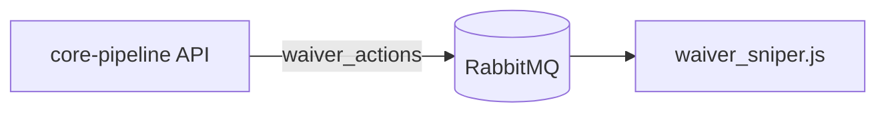

:::tip[The short version]
Lead with the answer. Show it with a diagram or table. Cut every sentence the reader doesn't need.
:::

This site follows the [Google developer documentation style guide](https://developers.google.com/style) for voice and grammar. It organizes pages by the [Diátaxis](https://diataxis.fr/) page types. The rules below take precedence where they differ.

## Write for scanning

Readers skim. Shape every page so they can find what they need without reading every paragraph.

| Do | Don't |
|---|---|
| Open with one or two sentences saying what the page covers and when you'd need it. | Open with background or history. |
| Keep paragraphs to three sentences or fewer. | Write blocks of five or more sentences. |
| Use a list for steps, options or anything with three or more parts. | Chain items in a sentence with commas. |
| Use a table to compare things or to list fields, flags, settings or env vars. | Describe each field in its own paragraph. |
| Use a diagram for any flow, sequence, architecture or state machine. | Narrate a flow step by step in prose. |
| Add a `##` heading every few paragraphs, phrased as the reader's question or task. | Use long pages with one heading. |
| Cut filler such as "basically", "in order to", "it's worth noting that" and "simply". | Pad sentences. |

Voice: use second person ("you"), present tense, active voice and short sentences. Put the condition before the instruction: "To retry a trade, run…".

### Formatting toolbox

| Need | Use | Works in |
|---|---|---|
| Flow, sequence, architecture, states | Mermaid diagram (see [Diagrams](#diagrams)) | `.md`, `.mdx` |
| Fields, env vars, endpoints, comparisons | Table | `.md`, `.mdx` |
| Warnings, gotchas, prerequisites, a TL;DR | Admonition: `:::note`, `:::tip`, `:::info`, `:::warning`, `:::danger` | `.md`, `.mdx` |
| Detail most readers can skip, such as full payloads or edge cases | `<details><summary>…</summary>…</details>` | `.md`, `.mdx` |
| Commands, config, payloads | Fenced code block with a language, plus `title="path/to/file"` for files | `.md`, `.mdx` |
| Alternatives side by side, such as Docker vs Kubernetes | `<Tabs>` / `<TabItem>` | `.mdx` only |
| What a UI looks like | Screenshot with synthetic data | `.md`, `.mdx` |

`.md` files are parsed as CommonMark, so React components such as `<Tabs>` only work in `.mdx`. Rename the page to `.mdx` when you need one.

### Shape of each page type

| Type | Purpose | Shape |
|---|---|---|
| **Explanation** (architecture, pipelines) | How and why it works | Summary → diagram → one short section per component → "Related" links |
| **How-to** (install, deploy, rotate a cookie) | Get a task done | Prerequisites admonition → numbered steps, one action each → "Verify" step → troubleshooting table |
| **Reference** (API, data model, queues, config) | Look something up | Table per resource or message, generated from code where possible; little or no prose |
| **Tutorial** (first run) | Learn by doing | Numbered steps toward one visible result |

Every explanation page and every flow needs at least one diagram. A page that's more than about two screens of prose should be split, or turned into tables and diagrams.

## Frontmatter

Start every page with frontmatter. Don't repeat the title as a `#` heading; the site renders it from `title`.

```yaml
---
title: Lineup updates
description: How a lineup change travels from the API to ESPN and how it is verified.
sidebar_position: 2
---
```

| Field | Required | Purpose |
|---|---|---|
| `title` | Yes | Page heading, sidebar label and browser tab title. |
| `description` | Yes | One sentence used for search results and link previews. |
| `sidebar_position` | Yes | Order within the page's sidebar section, lowest first. |

## Where a page belongs

- **In its repo's `docs/` folder** if it describes one repository: its modules, configuration, data model, bots or runbooks. Update it in the same PR as the code change it describes.
- **In this repo** if it spans repositories: architecture, end-to-end flows, integrations, installation, contributing, and networking.

When in doubt, put the detail in the owning repo and link to it from the cross-cutting page.

Each section is a folder under `docs/` with an `index.md` landing page and a `_category_.json` that sets its sidebar label and position. Add new pages to an existing section rather than creating a top-level one.

## Links

Link to other pages by relative path to the Markdown file, such as `[Architecture](../overview/architecture.md)`, not to the site URL. The build fails on broken links, so a renamed or moved page shows up immediately.

## Diagrams

Draw diagrams in Mermaid in a fenced `mermaid` code block. Don't commit diagram images. Mermaid diagrams render in light and dark mode and can be diffed and edited in review.

````md

````

| Showing | Mermaid type |
|---|---|
| Components and how they connect | `flowchart` |
| Messages between services over time, such as API → RabbitMQ → bot → ESPN | `sequenceDiagram` |
| Lifecycle of a trade, waiver claim or job | `stateDiagram-v2` |
| Tables and their relationships | `erDiagram` |
| Scheduled jobs across a week | `gantt` or a table |

Keep each diagram to about 12 nodes or fewer. Split a bigger one into an overview plus a detail diagram per part. Label edges with what flows along them, such as a queue name, an HTTP route or an event.

Screenshots are fine for UI pages. Use synthetic fixture data in them. If Mermaid can't express something, such as an annotated UI walkthrough, commit an SVG or PNG next to the page and give it alt text.

## No secrets or personal data

Never put real credentials or personal data in examples, screenshots or logs, even ones that look expired:

- No API keys, tokens, passwords, bot keys or connection strings with real credentials. Use obvious placeholders such as `<GROQ_API_KEY>` or `changeme`.
- No ESPN cookies (`espn_s2`, `SWID`) or saved browser session state.
- No personal identifiers: real names, emails, league or team IDs that identify a person, or IP addresses and hostnames from a real deployment.

If something sensitive is committed, rotate it first. Removing it from the page does not remove it from Git history.
