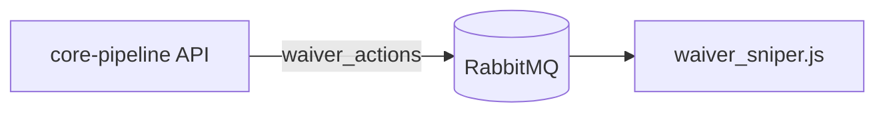

## Frontmatter

Start every page with frontmatter. Don't repeat the title as a `#` heading; the site renders it from `title`.

```yaml
---
title: Lineup updates
description: How a lineup change travels from the API to ESPN and how it is verified.
sidebar_position: 2
---
```

| Field | Required | Purpose |
|---|---|---|
| `title` | Yes | Page heading, sidebar label and browser tab title. |
| `description` | Yes | One sentence used for search results and link previews. |
| `sidebar_position` | Yes | Order within the page's sidebar section, lowest first. |

## Where a page belongs

- **In its repo's `docs/` folder** if it describes one repository: its modules, configuration, data model, bots or runbooks. Update it in the same PR as the code change it describes.
- **In this repo** if it spans repositories: architecture, end-to-end flows, integrations, installation, contributing, and networking.

When in doubt, put the detail in the owning repo and link to it from the cross-cutting page.

Each section is a folder under `docs/` with an `index.md` landing page and a `_category_.json` that sets its sidebar label and position. Add new pages to an existing section rather than creating a top-level one.

## Links

Link to other pages by relative path to the Markdown file, such as `[Architecture](../overview/architecture.md)`, not to the site URL. The build fails on broken links, so a renamed or moved page shows up immediately.

## Diagrams

Draw diagrams in Mermaid in a fenced `mermaid` code block. Don't commit diagram images. Mermaid diagrams render in light and dark mode and can be diffed and edited in review.

````md

````

Screenshots are fine for UI pages. Use synthetic fixture data in them.

## No secrets or personal data

Never put real credentials or personal data in examples, screenshots or logs, even ones that look expired:

- No API keys, tokens, passwords, bot keys or connection strings with real credentials. Use obvious placeholders such as `<GROQ_API_KEY>` or `changeme`.
- No ESPN cookies (`espn_s2`, `SWID`) or saved browser session state.
- No personal identifiers: real names, emails, league or team IDs that identify a person, or IP addresses and hostnames from a real deployment.

If something sensitive is committed, rotate it first. Removing it from the page does not remove it from Git history.
