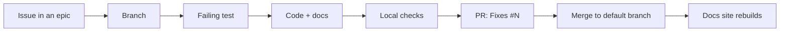

Fantasy Project is four code repositories plus this docs and planning repo. This is a personal project shown as a portfolio piece, not an open call for contributions. This section documents how the author, and any coding agent working for them, takes a change from idea to merged PR.

:::tip[The short version]
Find or open an issue → branch → write the test first → run the repo's checks → open a PR that closes the issue and updates `docs/`.
:::



| I want to… | Read |
|---|---|
| Pick up or file work | [Tracker and ticket workflow](./workflow.md) |
| Know what to run before a PR | [Checks and tests per repo](./checks.md) |
| Understand `AGENTS.md` and `CLAUDE.md` | [Agent conventions](./agents.md) |
| Write or edit a docs page | [Docs style guide](./docs-style-guide.md) |
| Deploy or preview the docs site | [Docs site deploys](./docs-site-deploys.md) |
| Check licenses before distributing builds | [Licensing and dependency notices](./licensing.md) |

## Ground rules

- Read the [disclaimer](/disclaimer): the project is unofficial, for personal use on your own leagues, and doesn't scrape ESPN. Changes that collect data about other leagues or users, or that act at scale, won't be merged.
- Never commit secrets or personal data: tokens, ESPN cookies (`espn_s2`, `SWID`), real league or member IDs, emails or hostnames from a real deployment. Use placeholders. See [No secrets or personal data](./docs-style-guide.md#no-secrets-or-personal-data).

## Working on these docs

The site is built with [Docusaurus](https://docusaurus.io/) from the `docs/` folder of this repo. From the repo root:

```bash
npm ci
npm start        # dev server with live reload
npm run build    # production build; fails on broken links
```

To build with all four source repos, set `FANTASY_DOCS_ROOT` to the directory holding the checkouts and `FANTASY_DOCS_REQUIRED=true`. See [Docs site deploys](./docs-site-deploys.md). For the default-branch ruleset and Actions settings, see [Repository security](./repository-security.md).
