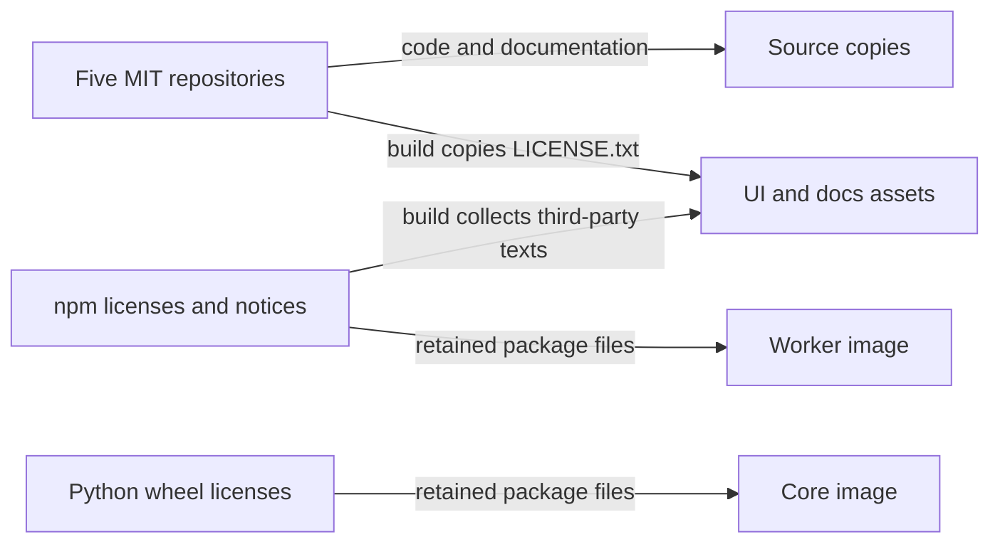

All five repositories use **MIT** for original code, configuration and documentation.
The docs use the same license as the code; there is no separate CC-BY license for project content.

:::tip[Keep the license with your copy]
Each repository has an MIT `LICENSE` with copyright held by `cvillarr23`.
Keep its copyright and permission notice when you distribute copies or substantial portions.
Third-party packages retain their own licenses.
:::

## Where the licenses travel



| Repository | License metadata | Distributed notices |
|---|---|---|
| fantasy-project | `package.json` and lockfile root | The docs build emits `LICENSE.txt` and `THIRD_PARTY_LICENSES.txt`. |
| fantasy-core-pipeline | `pyproject.toml`; dependencies still come from `requirements.txt` | The image preserves wheel license files and CBC's `coin-license.txt`. `THIRD_PARTY_NOTICES.md` describes exceptions. |
| fantasy-browser-worker | `package.json` and lockfile root | The image preserves npm license and NOTICE files. `THIRD_PARTY_NOTICES.md` describes image components outside npm. |
| fantasy-web-ui | `package.json` and lockfile root | The build emits license texts into `dist/`; the final nginx image copies them with the assets. |
| fantasy-infra | No npm or Python package manifest | Root `LICENSE`; deployed upstream images keep their own licenses. |

MIT does not require a project `NOTICE` file. Preserve upstream NOTICE files where
present, including [Apache-2.0 attribution requirements](https://www.apache.org/licenses/LICENSE-2.0#redistribution).
Download the site's [MIT license](/LICENSE.txt) and [third-party texts](/THIRD_PARTY_LICENSES.txt).

## What the dependency check found

The check ran on **2026-10-11**, using the npm lockfiles and a fresh Python 3.11
environment installed from core's requirements. The Python requirements pin direct
dependencies but leave transitive versions free to change.

| Check | Result and exceptions |
|---|---|
| Worker: `license-checker` across 459 entries | No GPL, LGPL or MPL npm packages. Includes dev dependencies, which the image installs. `caniuse-lite` is CC-BY-4.0; its license and attribution stay in `node_modules`. |
| UI: all installed npm packages | MPL-2.0 `lightningcss` and its native packages are build tools. The production dependency scan contains 176 third-party entries, all permissive; generated notices preserve their license texts. |
| Core: `pip-licenses` across 99 packages | **Copyleft is present:** LGPL psycopg2-binary; MPL certifi and pathspec; mixed MPL licenses in orjson and tqdm. The image also includes development tools. |
| Core: inspect PuLP's wheel contents | PuLP is MIT, but its bundled CBC 2.10.3 binary is **EPL-1.0**. Preserve `coin-license.txt` and provide corresponding source when distributing solver binaries. |
| Docs: production dependency scan | `lunr-languages` is MPL-1.1; source locations and license text accompany the static assets. DOMPurify offers MPL-2.0 or Apache-2.0. Lightning CSS is MPL-2.0 build tooling. |
| Docs: development tooling | Sharp's native libvips and WASM packages include LGPL-3.0-or-later components. They are not copied into the static site. |

The scanner labels private npm root packages `UNLICENSED` even when their
`license` field is MIT. The UI and docs generators exclude those roots and copy
the actual root `LICENSE` separately.

:::warning[Source checks do not certify a container image]
The npm and Python scans do not inventory OS packages, Chromium, OpenBao or
libraries embedded in wheels. Debian and Alpine base images also contain
components under separate licenses. Before distributing an image, inspect its
exact contents, preserve notices and archive the corresponding covered sources.
These are documented exceptions, not a claim that the images are copyleft-free.
:::

## Repeat the checks

From the worker and UI repositories, install the locked dependencies and scan:

```bash
npm ci
npx license-checker@25.0.1 --summary
npx license-checker@25.0.1 --production --summary
```

The worker's image includes dev dependencies, so use its full summary when
reviewing that image. For the UI, distinguish build tooling from runtime code.

For core, use a fresh environment with the Dockerfile's Python version:

```bash
python3.11 -m venv /tmp/fantasy-license-audit
/tmp/fantasy-license-audit/bin/pip install -r requirements.txt pip-licenses
/tmp/fantasy-license-audit/bin/pip-licenses --summary
/tmp/fantasy-license-audit/bin/pip-licenses --format=json --with-license-file --with-notice-file
```

Inspect wheel contents as well as metadata: bundled binaries can have different
licenses. See core's [third-party notices](https://github.com/cvillarr23/fantasy-core-pipeline/blob/main/THIRD_PARTY_NOTICES.md)
for the checked versions and source locations. For MPL-covered components,
[make covered source available and tell recipients where to obtain it](https://www.mozilla.org/en-US/MPL/2.0/FAQ/).

## Verify the distributed files

The UI and docs site run `npm run licenses:generate` before production builds.
The generator includes package license texts, additional license choices and
upstream NOTICE files; it fails on unknown licenses or missing license text.

The docs site's `scripts/license-overrides.json` maps exact package versions to
reviewed upstream text for npm archives that omit their licenses. Review those
overrides when upgrading the packages. Generated files stay out of Git and
contain upstream attribution, rather than a raw scanner report with local paths.

| Build | Verify |
|---|---|
| UI: `npm run build` | `dist/LICENSE.txt` matches root `LICENSE`; `dist/THIRD_PARTY_LICENSES.txt` contains dependency notices. |
| Docs: `FANTASY_DOCS_REQUIRED=true npm run build` | `build/LICENSE.txt` matches root `LICENSE`; `build/THIRD_PARTY_LICENSES.txt` contains dependency notices. |
| Core and worker images | Keep installed license/NOTICE files, repository licenses, system copyright files and any corresponding-source distribution materials. |

See [docs site deploys](./docs-site-deploys.md) to build with all source repositories.
