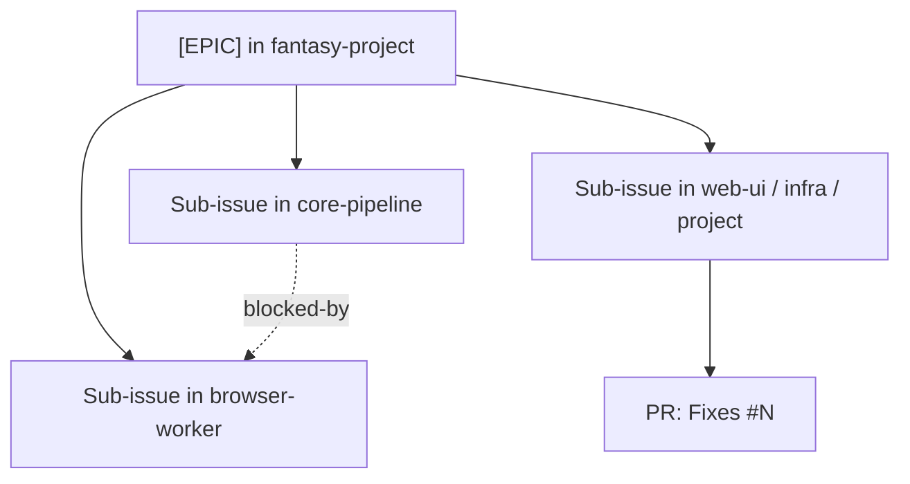
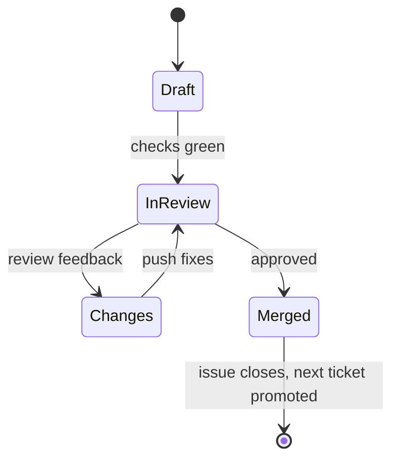

Work is tracked in GitHub Issues. Epics live in `fantasy-project`; the issues under them can live in any of the five repos. This page covers how to find work, claim it and land it.

## How the tracker fits together

| Concept | How it works |
|---|---|
| **Epic** | An issue titled `[EPIC] <name>` with the `epic` label in `fantasy-project`. |
| **Sub-issue** | Native GitHub sub-issue, across repos. Every issue has exactly one parent epic. |
| **Blocked-by** | Native GitHub "blocked by" relationship. It means the issue can't start until the blocker closes. A loose "relates to" is a cross-reference comment such as `owner/repo#N` instead. |
| `status/ready` | Vetted as the next unblocked thing to pick up. A workflow adds it to the next candidate when an issue closes. |
| `needs-epic` | Added automatically to an issue with no parent epic. Attach it to one, then remove the label. |
| `priority/blocker`, `high`, `medium`, `low` | Order of the next-ready pick. |
| `wayfinder:*` | Planning tickets: `grilling` (decision), `research`, `prototype`, `task`. |
| `good first issue`, `help wanted` | Good starting points for new contributors. |

## Pick up work

1. Browse open issues labelled `status/ready` or `good first issue` in the repo you want to work in.
2. Skip any issue with open blockers or an assignee.
3. Comment on the issue, or self-assign if you have access, before you start.
4. If your idea has no issue, open one using the issue templates. A maintainer attaches it to an epic.

:::note[Outside contributors]
You can't set parents or blockers on issues you don't own. Say in the issue what it relates to, and a maintainer wires it up.
:::

## Branches and commits

| Item | Convention |
|---|---|
| Default branch | `main` everywhere except `fantasy-web-ui`, which uses `master`. |
| Branch name | `feat/<issue>-<short-slug>` or `fix/<issue>-<short-slug>`, such as `feat/26-write-the-contributing-guide`. |
| Commit message | Short imperative subject, with the issue reference in the body or subject: `Add trade-score endpoint (#31)`. |
| Code comments | Explain behavior and rationale. Don't cite ticket numbers unless the comment is a `TODO`. |
| History | Keep PRs focused. One issue per PR. |

## Open a pull request

Every repo's PR template has four sections. Fill all four.

| Section | What to write |
|---|---|
| **Summary** | What changed and why. |
| **Validation** | The checks you ran and their results. See [Checks and tests](./checks.md). |
| **Documentation** | Tick **Docs updated?** after updating `docs/`, or say why none is needed. |
| **Linked issue** | A closing reference: `Fixes #N`, or `Fixes cvillarr23/fantasy-project#N` for a tracker issue in another repo. |

:::warning[A closing reference is required]
The **Require linked issue** check fails a PR that doesn't close an issue. Without one, it's also labelled `needs-issue-link`.
:::

## Docs ship with code

Update the repo's `docs/` folder in the same PR as the behavior, API, configuration or workflow change it describes. After a merge to the default branch that touches `docs/**`, the docs site rebuilds all four sections.

| Change | Docs to update |
|---|---|
| New or changed core API route | Regenerate `docs/openapi.json` and the API reference. See [Checks and tests](./checks.md). |
| New queue or message field | The queue docs and the AsyncAPI spec in core. |
| New env var or setting | The repo's configuration page. |
| Cross-repo behavior | The matching page in this repo, such as an [end-to-end flow](/overview/flows/). |

Follow the [docs style guide](./docs-style-guide.md).
