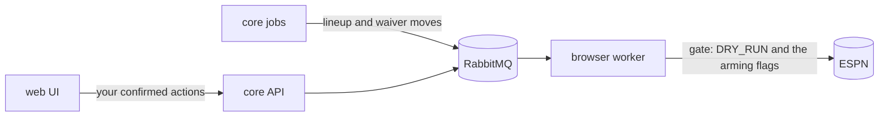

Run the whole stack against your real league without changing anything on ESPN. Do this until you trust what the bots would do. There is no single global switch: each write path has its own gate, and they don't all default to safe.

:::danger[Two writes are live by default]
- The **lineup bot** writes when `DRY_RUN` is unset.
- A **waiver claim you confirm in the UI** goes live unless you tick **Dry run** in the confirm dialog. The UI sends `dry_run: false`, which overrides the worker's `DRY_RUN`.
:::

Only the browser worker writes to ESPN. Core decides what to do and queues it; the worker carries it out.



## Checklist

| Where | Setting | Effect |
|---|---|---|
| Worker | `DRY_RUN=true` | Every bot logs and records what it would have sent instead of sending it. `dev/local.env` sets it. |
| Worker | `TRADE_DRY_RUN=true` | Trade submissions dry-run too. Production sets `TRADE_DRY_RUN=false`, so check any manifest you copy. |
| Worker | `TRADE_SUBMIT_ENABLED` and `TRADE_RESPONSE_ENABLED` unset | Trade sends and responses stay locked even if a dry-run setting is wrong. |
| Core | `AUTO_PUBLISH_IR_MOVES` unset or `false` | The waiver evaluator never queues an IR stash move on its own. |
| Core | Run `python -m src.optimization.lineup_solver --dry-run` | It computes and logs the swaps without calling the lineup trigger. |
| Core | Don't run `waiver_evaluator` by hand | It has no dry-run flag; it queues claims for the worker to carry out. |
| Core, on Kubernetes | Pause the lineup optimizer, waiver trigger and rumor action trigger | They stop queueing moves on schedule. See [below](#how-do-i-pause-the-jobs-that-act). |
| Draft | Turn off auto-publish | `POST /v1/draft/auto-publish` with `{"league_id": "<league>", "enabled": false}`, or the toggle in the UI. The listener only recommends. |
| UI | Tick **Dry run** when you confirm a waiver claim | Without it, the claim goes live. |
| UI | Don't approve outgoing trade offers or answer incoming ones | No trade write runs without an approval, whatever the flags say. |

For what each gate checks and why, see [Safety model](/overview/safety-model).

## How do I keep the worker from running at all?

Don't start it. Core still runs: ingestion, projections, the optimizers and the UI all work, and actions wait in RabbitMQ.

Queued actions run as soon as a worker starts. Purge the queues first:

```bash
for q in lineup_updates waiver_actions draft_targets trade_submissions trade_responses; do
  docker compose -f fantasy-project/dev/compose.yaml exec rabbitmq rabbitmqctl purge_queue "$q"
done
```

`sync_players` publishes injury alerts to `waiver_actions` every time it runs, so expect messages there.

## How do I pause the jobs that act?

Three scheduled jobs queue ESPN changes: the lineup optimizer, the waiver trigger and the rumor action trigger. How you pause them depends on what schedules them.

| Scheduler | Pause | Resume |
|---|---|---|
| CronJobs, as fantasy-infra deploys today | `kubectl patch cronjob <name> -p '{"spec":{"suspend":true}}'` for `fantasy-lineup-optimizer`, `fantasy-weekly-waiver-trigger` and `fantasy-rumor-action-trigger` | The same patch with `false` |
| The core job launcher, which [replaces the CronJobs](/infra/adr/unified-job-launcher) | `PUT /v1/jobs/<name>/pause` for `lineup-optimizer`, `waiver-trigger` and `rumor-action-trigger`, the catalog jobs marked `acts: true` | `DELETE /v1/jobs/<name>/pause` |

A launcher pause with no `until` lasts until you remove it:

```bash
for job in lineup-optimizer waiver-trigger rumor-action-trigger; do
  curl -X PUT "$CORE_API_BASE_URL/v1/jobs/$job/pause" \
    -H "X-API-Key: $TRIGGER_API_KEY" -H 'Content-Type: application/json' \
    -d '{"reason": "dry run while evaluating"}'
done
```

A manual launcher run with `downstream` set ignores pauses on the steps after it.

## Verify

| Check | Expect |
|---|---|
| Lineup bot log | `Starting realignment … [DRY_RUN]`. If it logs `DRY_RUN is unset, defaulting to FALSE`, it is live. |
| Waiver claim from the UI | The confirmation reads `Dry run queued. Nothing will be submitted to ESPN.` |
| Trade offers | They end in `dry_run_filled` or `submit_blocked`, never `submitted`. |

## When you're ready to go live

Open one gate at a time, in this order, and watch the result on ESPN after each:

1. Lineup: set `DRY_RUN=false`, or leave it unset on Kubernetes.
2. Waivers: confirm a claim in the UI with **Dry run** unticked.
3. Trades: set `TRADE_DRY_RUN=false` and `TRADE_SUBMIT_ENABLED=true`, then approve a single offer.

Trade responses and unattended IR moves have extra verified-path gates. See [Which flags gate live behavior?](/overview/safety-model#which-flags-gate-live-behavior) and [Unattended IR publication](/infra/auto-publish-ir-moves).
