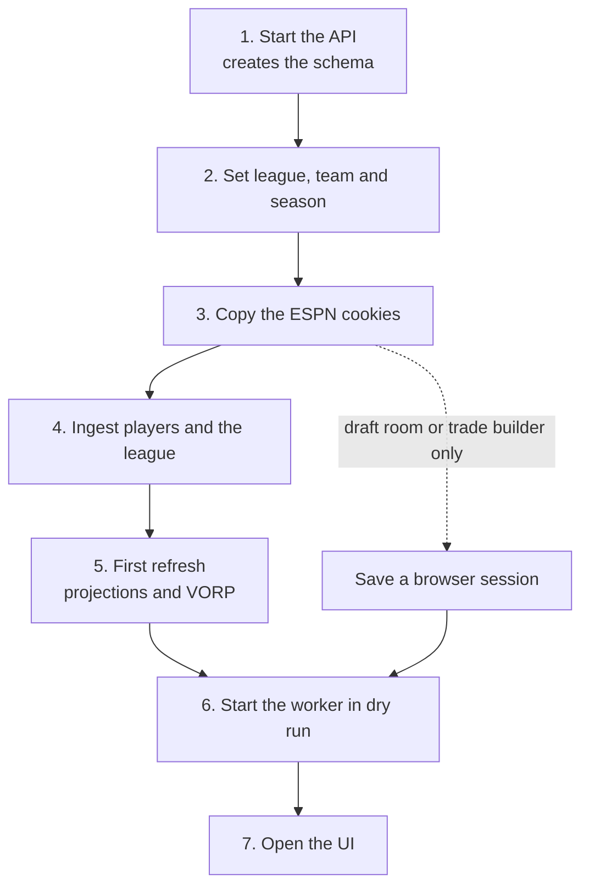

Load your league into a fresh stack and see the first recommendations, with every ESPN write still disabled. Each step depends on the one before it.

:::info[Prerequisites]
- You finished [Local development](./local-development.mdx): the containers are up and each repository is installed.
- Every terminal has `fantasy-project/dev/local.env` loaded (`set -a; . fantasy-project/dev/local.env; set +a`).
- You can log in to your ESPN fantasy league in a browser.
:::



## 1. Start the API

```bash
cd fantasy-core-pipeline && source venv/bin/activate
uvicorn src.api.main:app --host 127.0.0.1 --port 8000
```

The API creates and updates the schema every time it starts. There is no separate migration tool, version table or seed data: ingestion fills the tables. To apply the schema without starting the API, run `python -m src.migrations`. See [Migrations](/core/migrations).

**Verify:** `curl http://127.0.0.1:8000/v1/health` returns `"database":"connected","broker":"connected"`.

## 2. Set your league, team and season

Open your team in ESPN fantasy football. The URL holds both IDs: `…/team?leagueId=<league>&teamId=<team>&seasonId=<season>`. Export them in every terminal, or add them to your copy of `local.env`:

```bash
export ESPN_LEAGUE_ID=<league> ESPN_TEAM_ID=<team> CURRENT_YEAR=<season>
```

## 3. Copy the ESPN session cookies

Every ESPN read and write uses two cookies from a logged-in browser. ESPN's login sits behind reCAPTCHA, so nothing can script it; you copy the cookies by hand and refresh them when they expire.

1. Log in at `fantasy.espn.com`.
2. Open the developer tools and find the `espn.com` cookies: **Application → Cookies** in Chrome, **Storage → Cookies** in Firefox.
3. Copy `espn_s2` and `SWID`, including the braces around `SWID`.
4. Export them. Core and the worker read `SWID` under different names, so set both:

   ```bash
   export ESPN_S2='<espn_s2>' SWID='<SWID>' ESPN_SWID='<SWID>'
   ```

**Verify:** from `fantasy-browser-worker`, run `node src/bots/check_espn_session.js`. It logs `ESPN session is healthy` and exits 0.

These cookies are your ESPN login. Keep them out of shell history files and the repository. More detail is in [ESPN](/integrations/espn) and [Session and auth](/worker/espn/session-and-auth).

### Save a browser session for the draft room and trade builder

The cookies are enough for reading and for lineup and waiver moves. Rendered pages, such as the draft room and the trade builder, also need the identity session that only an interactive login creates. Save one with a recon tool:

1. From `fantasy-browser-worker`, run `FORCE_MANUAL_LOGIN=1 node src/bots/draft_recon.js`.
2. Log in to ESPN in the browser window that opens, then press Enter in the terminal.
3. Wait for `Session saved to …/.espn-storage-state.json`, then stop the tool with Ctrl+C.
4. Point the worker at the file: `export ESPN_SESSION_STATE_FILE=$PWD/.espn-storage-state.json`.

The file is gitignored, and it is a full login, so treat it like the cookies. On Kubernetes, a Job saves the session over VNC instead; see [Refreshing the login remotely](/worker/espn/session-and-auth#refreshing-the-login-remotely).

## 4. Ingest players and your league

From `fantasy-core-pipeline`, in this order:

```bash
python -m src.ingestion.sync_players --force
python -m src.ingestion.sync_id_crosswalk
python -m src.ingestion.sync_league --season "$CURRENT_YEAR"
python -m src.ingestion.sync_skill_position_crosswalk --season "$CURRENT_YEAR"
```

| Step | Source | Needs ESPN cookies |
|---|---|---|
| `sync_players` | Sleeper player list | No |
| `sync_id_crosswalk` | DynastyProcess ID crosswalk | No |
| `sync_league` | Your ESPN league, teams and rosters | Yes |
| `sync_skill_position_crosswalk` | ESPN player IDs the crosswalk missed | Yes |

`sync_players` also publishes injury alerts to `waiver_actions`. They wait in RabbitMQ until a worker consumes them, so don't start the worker until you've read [Run with every write disabled](./dry-run.md).

**Verify:** `sync_id_crosswalk` logs `matched N/M players`, and `sync_league` finishes without an error. Why the order matters, and the optional ingestors, are in [Ingestion](/core/ingestion).

## 5. Run the first refresh

```bash
python -m src.jobs.draft_prep_refresh
```

For the upcoming week and up to three more, it runs projections (`sync_projections`), kicker and defense projections (`sync_kicker_dst`) and VORP (`vorp_matrix`). It exits with an error if `CURRENT_YEAR` is unset.

During the season, also run `python -m src.ingestion.metrics_extractor` after each week's games. It reads the last completed week from nflverse and does nothing in the preseason.

**Verify:** the job exits 0 and its last line is `Refresh summary … failed_weeks=[]`. In the offseason it logs `Offseason` and refreshes nothing.

## 6. Start the worker in dry run

Check that `DRY_RUN=true` and `TRADE_DRY_RUN=true` are set; `local.env` sets both. The lineup bot writes to ESPN when `DRY_RUN` is unset. [Run with every write disabled](./dry-run.md) lists every other switch.

```bash
cd fantasy-browser-worker
npm start
```

**Verify:** the log shows `Ready to consume target queue` for each queue, then `Standing by...`. A dry-run bot logs what it would have sent and records it as skipped.

## 7. Open the UI

```bash
cd fantasy-web-ui
npm run dev
```

Open `http://localhost:5173`. On the **Settings** page, enter the same league, team and season, and save. The UI saves them through the API, so every browser you open it in uses them; see [Settings](/ui/user-guide/settings).

**Verify:** the lineup page shows your roster with projections.

## What runs on a schedule?

On Kubernetes, the job launcher repeats steps 4 and 5 on a schedule and runs the optimizers. Locally, run the same modules by hand when you need fresh data. The current schedule is in [Schedules](/infra/schedules).

## Troubleshooting

| Symptom | Fix |
|---|---|
| `sync_league` or `check_espn_session.js` fails with 401 or `SessionExpiredError` | The cookies expired or were copied without the braces. Copy them again (step 3). |
| `draft_prep_refresh` exits 1 with `Unable to resolve refresh season/week` | `CURRENT_YEAR` is unset or not a year. Export it (step 2). |
| `draft_prep_refresh` reports `failed_weeks=[…]` after a `sync_kicker_dst` error | That step reads ESPN. Export `ESPN_LEAGUE_ID` and the cookies (steps 2 and 3), then run it again. |
| `sync_players` logs `already ran within the last 24h` | A Redis lock limits it to once a day. Pass `--force`. |
| `sync_players` logs `Redis cache layer unavailable` | Redis isn't reachable at `REDIS_HOST`. Check `docker compose ps`. |
| The draft room or trade builder shows ESPN's "Log in Required" | The saved browser session is missing or stale. Delete `.espn-storage-state.json` and save it again. |
| The worker exits after 10 connection attempts | RabbitMQ isn't reachable at `AMQP_URL`. Check `docker compose ps`. |
