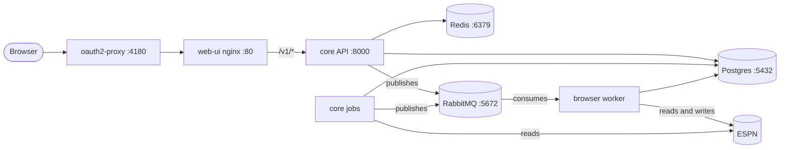

import Disclaimer from '@site/DISCLAIMER.md';

:::warning[Before you install]

<Disclaimer />

:::

This section takes you from nothing to a running stack: core, the browser worker and the web UI, backed by Postgres, Redis and RabbitMQ. Start on your machine with every ESPN write disabled. Move to Kubernetes once you trust what the bots would do.

## Which page do I need?

| You want to | Read |
|---|---|
| Run the services and their tests on your machine | [Local development](./local-development.mdx) |
| Load your league and see the first recommendations | [First run](./first-run.md) |
| Make sure nothing writes to ESPN | [Run with every write disabled](./dry-run.md) |
| Run the stack on your own cluster | [Self-host on Kubernetes](./kubernetes.md) |
| Look up an environment variable | [Configuration](./configuration.mdx) |

## What will I be running?

| Component | Repository | Runtime | Port |
|---|---|---|---|
| Core API and jobs | [fantasy-core-pipeline](/core/) | Python 3.11 | 8000 |
| Browser worker | [fantasy-browser-worker](/worker/) | Node 20 and Playwright Chromium | none; it consumes RabbitMQ |
| Web UI | [fantasy-web-ui](/ui/) | Node 22 to build; nginx to serve | 5173 in development, 80 in the image |
| Manifests | [fantasy-infra](/infra/) | Kustomize and Argo CD | — |
| Postgres, Redis, RabbitMQ | `dev/compose.yaml` locally; fantasy-infra on Kubernetes | Containers | 5432, 6379, 5672 (15672 for the RabbitMQ UI) |

On Kubernetes, oauth2-proxy signs you in with Google before anything reaches the UI. Locally there is no sign-in: the Vite dev server proxies `/v1` straight to the API. For how the pieces fit together, see [Architecture](/overview/architecture).

## In what order?

1. [Local development](./local-development.mdx): install each repo and start the dependencies.
2. [First run](./first-run.md): migrate, ingest, refresh and capture the ESPN session.
3. [Run with every write disabled](./dry-run.md): check the dry-run settings before you start the worker.
4. [Self-host on Kubernetes](./kubernetes.md), when you're ready.
