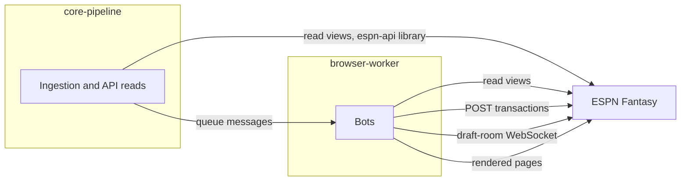
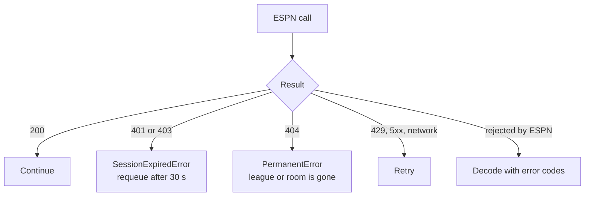

ESPN Fantasy is the system of record for your league and the target of every write. This page summarizes how the system uses it. The worker's [reverse-engineering notes](/worker/espn-reverse-engineering) hold the protocol detail.

:::warning[Unofficial endpoints and ESPN's terms]
ESPN publishes no fantasy API. The project uses endpoints seen in ESPN's own web app plus browser automation, so ESPN can change or block them at any time. Automating lineup changes, waivers, trades and drafts may conflict with ESPN's terms of use. You're responsible for compliance and use the project at your own risk. See the [disclaimer](/disclaimer).

The public-release audit decides the final wording of this notice.
:::

Core never writes to ESPN. It validates a request, then publishes a message that a worker bot turns into the ESPN call.

## What does it read?

| Reader | Method | Data | Where |
|---|---|---|---|
| Core ingestion | `espn-api` library, `mSettings`, `mRoster`, `mTeam` | League settings, teams, rosters | `sync_league` |
| Core ingestion | `kona_player_info` | Kicker and D/ST projections, ESPN player IDs | `sync_kicker_dst`, `sync_skill_position_crosswalk` |
| Core API | Same library, cached in Redis | Current week, standings, box scores | League dashboard and matchup services |
| Worker bots | Direct REST `view=` calls | Rosters, pending trades, league chat, draft state | `espn_api.js` |
| Worker draft bots | WebSocket | Live picks, turn notices, draft complete | Draft sync and clicker |

Each `view=` and its fields are listed in [Read views](/worker/espn/read-views). Cached reads in core expire after 60 to 300 seconds, and a verified write invalidates the league's cache.

## What does it write?

Every write except draft picks is one `POST` to ESPN's `transactions/` endpoint. Dry run, approval and read-back rules are in the [Safety model](../overview/safety-model.md).

| Action | Mechanism | Verification status | Worker page |
|---|---|---|---|
| Lineup and IR moves | REST transaction | Confirmed against a real save | [Lineup](/worker/bots/lineup) |
| Waiver and free-agent claims | REST transaction | Item shape partly unverified. FAAB bids aren't implemented. | [Waiver sniper](/worker/bots/waiver-sniper) |
| Trade proposals | Browser clicks, with a REST body used to cross-check | Submit request captured. See [Trades](/worker/espn/trades). | [Trade builder](/worker/bots/trade-builder) |
| Draft picks | `SELECT` frame on the draft-room socket | Confirmed. A DOM click fallback is unverified. | [Draft clicker](/worker/bots/draft-clicker) |

:::note
Core marks an action *accepted* when it queues the message. It marks it *verified* only after a fresh ESPN read shows the change.
:::

## How does authentication work?

ESPN identifies you by two cookies, `espn_s2` and `SWID`. They're your own session credentials, copied from a logged-in browser.

| Surface | Needs | Used by |
|---|---|---|
| REST reads and writes, draft WebSocket | The two cookies | Most bots, core ingestion |
| Rendered pages | A full interactive login saved as browser session state | Trade builder, draft-room DOM fallback |

- **No scripted login.** ESPN's login page is protected against automation. A person logs in, and the credentials are stored in [OpenBao](./openbao.md).
- **Manual renewal.** Cookies expire without warning. Renewing them is a manual step, described in [Session and auth](/worker/espn/session-and-auth#when-cookies-expire).
- **Early warning.** The `espn-session-healthcheck` CronJob runs Mondays at 06:00 UTC and fails when the roster page stops rendering.

## What can go wrong?

| Failure | Behavior |
|---|---|
| Expired cookies | The message returns to the queue after 30 seconds and succeeds once you refresh credentials. |
| League or room not found | Treated as permanent and dropped, so it can't loop. |
| Rate limiting | There's no ESPN-specific limiter. Volume stays low because one league's actions are infrequent and the queue handles one message per worker at a time. |
| Locked lineup | The lineup bot refuses to submit. |
| Unclear outcome after a trade click | The bot reads pending trades. If that can't settle it, the bot stops for a person. |
| ESPN changes a request or selector | The bot fails closed. Update the worker, then retry. |

ESPN's rejection codes are decoded in [Error codes](/worker/espn/error-codes).

## Where is the code?

| Area | Repo and path |
|---|---|
| League and projection ingestion | `fantasy-core-pipeline`, `src/ingestion/` |
| Read cache, dashboards | `fantasy-core-pipeline`, `src/services/` |
| ESPN REST client, auth, bots | `fantasy-browser-worker`, `src/bots/` |
| Credentials in the cluster | `fantasy-infra`, `overlays/production/` |

## Related

- [Safety model](../overview/safety-model.md)
- [ESPN reverse-engineering notes](/worker/espn-reverse-engineering)
- [Session health check](/worker/bots/session-health)
