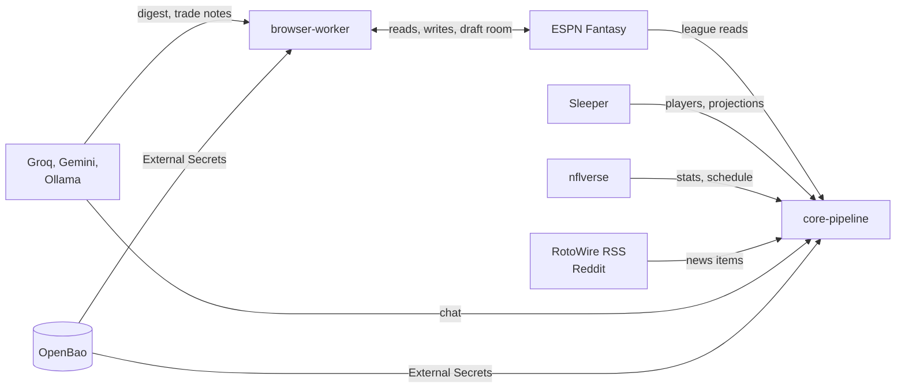

Fantasy Project talks to a handful of outside systems. Use this page to find which one a feature depends on, how it authenticates and what breaks when it's down.

:::warning[Unofficial and best-effort]
ESPN has no public fantasy API. The project uses undocumented endpoints and browser automation, which may conflict with ESPN's terms of use. Read the [disclaimer](/disclaimer) before you run it. Other sources (Sleeper, nflverse, RotoWire, Reddit) are public data feeds that can also change or throttle without notice.
:::

## What does each integration do?

| System | Used for | Auth | Cadence | Page |
|---|---|---|---|---|
| ESPN Fantasy | League reads, lineup, waiver, trade and draft writes | `espn_s2` and `SWID` session cookies | Reads on demand and weekly. Writes on a trigger. | [ESPN Fantasy](./espn.md) |
| Sleeper | Player master, injury status, weekly projections | None | Every 10 min on game days, daily | [Sleeper](./sleeper.md) |
| nflverse | Play-by-play, usage metrics, schedule | None | Weekly after games finish | [nflverse](./nflverse.md) |
| LLM providers | Chat, rumor digest, trade notes | API keys (Groq, Gemini). None for Ollama. | Per request, plus daily digest | [LLM providers](./llm-providers.md) |
| RotoWire and Reddit | News and chatter for rumor signals | None (RSS), app-only OAuth (Reddit) | Every 30 min | [Rumor feeds](./rumor-feeds.md) |
| OpenBao | Stores and delivers every credential above | Kubernetes auth, through External Secrets | Hourly sync | [OpenBao](./openbao.md) |

RabbitMQ is also external to each service but internal to the system. See the [queue contract explorer](/reference/queues).

## How do failures differ?

| Source | If it's down | The system |
|---|---|---|
| ESPN | Reads and writes fail | Retries a short, fixed time for expired sessions. Refuses to guess when an outcome is unclear. |
| Sleeper | No new injury or projection data | Keeps the last stored values. The next run catches up. |
| nflverse | Metrics for the week are missing | Writes nothing partial. A rerun fills the week. |
| LLM | Chat or digest text is unavailable | Falls through the provider chain. Scoring and decisions don't depend on it. |
| Rumor feeds | Fewer rumor signals | Skips the source for that run. |
| OpenBao | Secret changes don't land | Existing Kubernetes Secrets keep working. |
