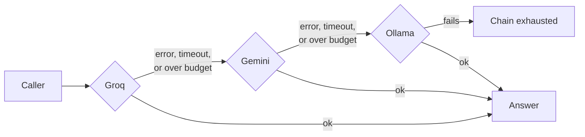
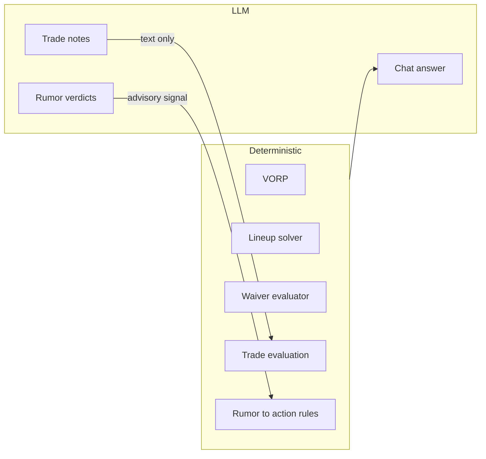

LLMs write text and interpret news. They never score players or decide a move. Core and the worker each have an `llm_client` that tries providers in order until one answers.

:::tip[The short version]
- Default chain: **Groq, then Gemini, then Ollama**. Each gets one attempt per call.
- Four features use LLMs: chat, rumor digest, trade notes and trade negotiation.
- Lineups, waivers, VORP and trade evaluation are computed deterministically.
:::

## How does the fallback chain work?

| Behavior | Detail |
|---|---|
| Order | `LLM_PROVIDER_PRIORITY`, a comma-separated list of `provider:model`. |
| Attempts | One per provider. There are no retries inside a provider. |
| Skipped when | The provider is unknown, has no API key, or is over its local rate budget. |
| Timeouts | 15 s for Groq and Gemini. 100 s for Ollama, which can scale up from zero. |
| Local budgets | A sliding 60 s window per process. Defaults: Groq 30 requests, Gemini 15. Set `GROQ_RPM_LIMIT` or `GEMINI_RPM_LIMIT` to change them. |
| Exhausted | Raises `LlmProviderChainExhaustedError`. The chat endpoint returns HTTP 503. |
| Telemetry | Each attempt records provider, model, call site, latency and error type in `llm_call_metrics`. |

The two clients ship slightly different default models. Set `LLM_PROVIDER_PRIORITY` explicitly if you need both to match.

| Provider | Auth | Notes |
|---|---|---|
| Groq | `GROQ_API_KEY` | Default first choice |
| Gemini | `GEMINI_API_KEY` | Second choice |
| Ollama | None | Runs in the cluster and starts on demand through a KEDA proxy |

Keys come from [OpenBao](./openbao.md) as environment variables. Local development can fall back to the `bao` CLI.

## Which features use an LLM?

| Feature | Runs in | Call site | When |
|---|---|---|---|
| Chat answers | Core API, `POST /query` | `chat_query` | On request |
| Rumor digest | Worker, `rumor_digest_bot.js` | `rumor_digest` | Daily 11:00 America/Chicago |
| Trade proposal notes | Worker, `trade_proposal.js` | `trade_proposal_packages`, `trade_proposal_pitch` | Trade scan, Wednesday and Friday 13:00 |
| Trade negotiation | Worker, `trade_bot.js` | `trade_negotiation` | Incoming-trade handling |

- **Chat** removes Ollama from its chain, because the endpoint is synchronous and a cold start can take about 90 seconds. Override with `CHAT_LLM_PROVIDER_PRIORITY`.
- **Rumor digest** is all-or-nothing. If any chunk fails, nothing is stored and the next run retries. See [Rumor digest](/worker/bots/rumor-digest).
- **Trade features** only draft and stage text. A person approves every offer. See the [Safety model](../overview/safety-model.md).

## Where do prompts end and logic begin?

| Prompt | Lives in |
|---|---|
| Chat system prompt | `fantasy-core-pipeline`, `src/services/chat_service.py`. It tells the model to answer only from the supplied JSON context. |
| Digest, trade proposal and negotiation prompts | `fantasy-browser-worker`, `src/bots/` |

The model's output is advisory. A rumor verdict is only an input to `rumor_action_service`, and a trade note never changes the evaluated terms.

## Configuration

| Variable | Purpose |
|---|---|
| `LLM_PROVIDER_PRIORITY`, `CHAT_LLM_PROVIDER_PRIORITY` | Chain order |
| `GROQ_API_KEY`, `GEMINI_API_KEY` | Provider credentials |
| `GROQ_RPM_LIMIT`, `GEMINI_RPM_LIMIT` | Local request budgets |
| `LLM_REQUEST_TIMEOUT_SECONDS`, `OLLAMA_REQUEST_TIMEOUT_SECONDS` | Timeouts |
| `LLM_HISTORY_CAPTURE_CONTENT`, `LLM_CONTENT_RETENTION_DAYS` | Whether to keep prompt text for the Activity page, and for how long |

## Where is the code?

`fantasy-core-pipeline`: `src/llm_client.py`, `src/services/chat_service.py`. `fantasy-browser-worker`: `src/lib/llm_client.js`, `src/bots/`.
