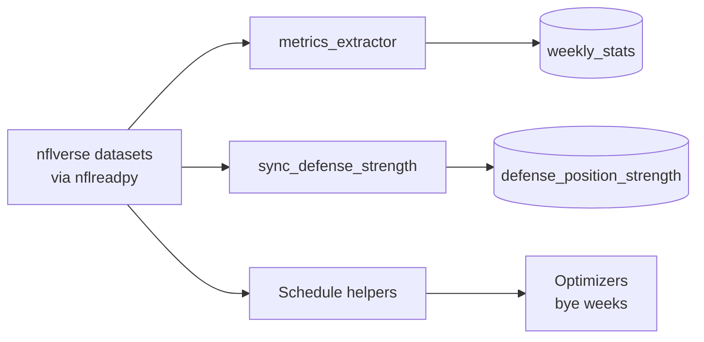

nflverse publishes open NFL data. The system reads it through the `nflreadpy` package to build usage metrics, find completed weeks and look up byes and betting lines. No account or key is needed.

## What does it provide?

| Dataset | Used for |
|---|---|
| Play-by-play | Target, rush and high-value-touch shares and other usage metrics |
| Schedules | Which games are final, bye weeks, spread, total and implied team total |
| Snap counts and participation | Snap share and route rate |
| Next Gen Stats | Separation, air yards, time to throw |
| FTN charting | Contested-ball rate, pressure and pass-block metrics |
| Depth charts | Depth rank and change |
| Player stats | Last season's points allowed by position, for optional matchup weighting |

Usage columns land in `weekly_stats`. See the [data model](/core/data-model).

## When does a week's data land?

nflverse publishes each week's data after the games finish, and schedule scores and play-by-play arrive separately. The system doesn't assume a time. It checks completeness before it writes.

- `fantasy-weekly-ingestor` runs Tuesday at 16:00 America/Chicago, leaving time for Monday-night data.
- `metrics_extractor` processes the last **completed** week, meaning every game is final in the schedule.
- It first confirms play-by-play covers every final game. If not, it fails and writes nothing for that week.

See [Ingestion](/core/ingestion#how-does-metrics_extractor-pick-a-week) for the full table of outcomes.

## What can go wrong?

| Situation | Result |
|---|---|
| Play-by-play is missing a final game | `IncompletePlayByPlayError`, exit 1, no partial write. Rerun later. |
| Schedule can't load or is empty | The Job fails. |
| A supplementary feed fails | Its columns stay NULL and the run continues. |
| Participation data is unavailable for the in-progress season | `route_rate` is NULL. |
| Preseason, no completed week | Exit 0, nothing written. |

To backfill a week, rerun `metrics_extractor` with `--year` and `--week`. The upsert is idempotent.

`sync_defense_strength` isn't scheduled. Run it by hand only if you enable `MATCHUP_WEIGHTING_ENABLED`.

## Where is the code?

`fantasy-core-pipeline`: `src/ingestion/metrics_extractor.py`, `sync_defense_strength.py`, `src/nfl_schedule.py`.
