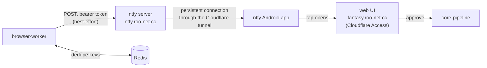

The browser worker sends phone push notifications through a self-hosted [ntfy](https://docs.ntfy.sh) server. It sends them only for things that need you: a failed run, an expired ESPN session, or a trade to review. Each push is a short summary. Tapping it opens the matching page of the web UI, and you approve anything there.

## Which events send a push?

| Event | Sent when | Priority | Tap opens |
|---|---|---|---|
| Bot run failed | Any instrumented bot run ends in failure | High | `/activity/runs/<run id>` |
| ESPN session expired | The session healthcheck fails (replaces the generic failure push) | Urgent, bypasses Do Not Disturb | `/settings` |
| Trade ready for approval | A proposal or counter-offer is staged as `awaiting_approval` | High | `/trades?offer=<offer key>` |
| New incoming trade offer | The trade inbox refresh stores an offer for the first time | High | `/inbox?offer=<ESPN transaction id>` |

A deep-linked page scrolls to the matching card and outlines it. If the card isn't there (already handled, hidden or expired), the page shows its normal list.

## Why ntfy?

| Option | Why not |
|---|---|
| AWS SNS mobile push | Still delivers through Firebase, so it needs a custom app as well as a new AWS dependency. |
| Discord webhook | Plain webhooks can't carry interactive buttons. Real buttons need a bot with a public interactions endpoint. |
| Custom Android app | Weeks of work (app, Firebase, device registry, sideloading) for a single user. |

ntfy already has an Android app, runs in the homelab, and takes a single HTTP POST per push.

## How is it secured?

- **Server:** reachable at `ntfy.roo-net.cc` through the Cloudflare tunnel, without Cloudflare Access, because the Android app can't do a browser login. Instead, ntfy's own auth denies all anonymous reads and writes.
- **Tokens:** the phone uses a read-only user. The worker uses a write-only token stored in OpenBao at `secret/fantasy/ntfy`.
- **Approvals:** a push carries only links, never an action. Approving still goes through the web UI, which Cloudflare Access protects.

## What happens when something fails?

| Situation | Effect |
|---|---|
| ntfy is down or rejects the push | The worker logs a warning and carries on. Sending never fails a bot. |
| `NTFY_URL` or `NTFY_TOKEN` is unset | Nothing is sent. This is the default for local runs and before the token is provisioned. |
| A bot keeps failing with the same error | One push per bot and error per hour. Each offer is announced once per 24 hours. |
| Redis is unreachable | The push is sent anyway: a duplicate is better than a missed alert. |
| The phone's connection drops | ntfy keeps 48 hours of messages and replays them when the app reconnects. |

## Related

- Worker configuration and event code: the browser-worker README, "Phone notifications (ntfy)".
- Server setup (users, tokens, tunnel hostname, phone app): homelab-deployment's README, "ntfy: phone push notifications".
- [OpenBao](./openbao.md) for how the worker's token reaches the pod.
