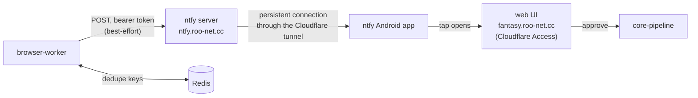

The browser worker sends phone push notifications through a self-hosted [ntfy](https://docs.ntfy.sh) server. It sends them only for things that need you: a failed run, an expired ESPN session, or a trade to review. Each push is a short summary. Tapping it opens the matching page of the web UI, and you approve anything there.



## Which events send a push?

| Event | Sent when | Priority | Tap opens |
|---|---|---|---|
| Bot run failed | Any instrumented bot run ends in failure | High | `/activity/runs/<run id>` |
| ESPN session expired | The session healthcheck fails (replaces the generic failure push) | Urgent, bypasses Do Not Disturb | `/settings` |
| Trade ready for approval | A proposal or counter-offer is staged as `awaiting_approval` | High | `/trades?offer=<offer key>` |
| New incoming trade offer | The trade inbox refresh stores an offer for the first time | High | `/inbox?offer=<ESPN transaction id>` |

A deep-linked page scrolls to the matching card and outlines it. If the card isn't there (already handled, hidden or expired), the page shows its normal list.

## How do I set up my phone?

:::info[Prerequisites]
- An Android phone with the ntfy app from Google Play or F-Droid.
- The `phone` user's password, stored in OpenBao: `bao kv get -field=password secret/fantasy/ntfy-phone`.
:::

1. Open ntfy, then go to **Settings → Manage users → Add user**. Enter the service URL `https://ntfy.roo-net.cc`, the username `phone` and the password from OpenBao, then save.
2. On the main screen, tap **+** to subscribe. Enter the topic `fantasy`.
3. Check **Use another server** and enter `https://ntfy.roo-net.cc`.
4. Check **Instant delivery**, then tap **Subscribe**. Without it, a self-hosted server only gets periodic polling on Android, so pushes can arrive many minutes late.
5. When Android asks, allow notifications and let ntfy ignore battery optimization. Instant delivery holds one connection open in the background, and battery savers kill it.
6. Optional: to let urgent pushes (an expired ESPN session) through Do Not Disturb, open the ntfy app's notification settings in Android and allow the highest-priority channel to override Do Not Disturb.

**Verify:** the subscription shows recent messages, such as the "ntfy is set up" test push, since the server keeps 48 hours of history. To send a fresh test from the server:

```bash
kubectl exec deploy/ntfy -- ntfy publish --token "$(bao kv get -field=token secret/fantasy/ntfy)" \
  --title "Test" https://ntfy.roo-net.cc/fantasy "Phone setup works."
```

| Problem | Fix |
|---|---|
| "Unauthorized" when subscribing | The user from step 1 is missing or its URL doesn't match the subscription's server exactly. |
| Pushes arrive late or in bursts | Instant delivery is off, or battery optimization is stopping ntfy. Redo steps 4 and 5. |
| Tapping a push shows a Cloudflare login | Expected the first time: `fantasy.roo-net.cc` sits behind Cloudflare Access. Sign in once in the phone's browser. |

## Why ntfy?

| Option | Why not |
|---|---|
| AWS SNS mobile push | Still delivers through Firebase, so it needs a custom app as well as a new AWS dependency. |
| Discord webhook | Plain webhooks can't carry interactive buttons. Real buttons need a bot with a public interactions endpoint. |
| Custom Android app | Weeks of work (app, Firebase, device registry, sideloading) for a single user. |

ntfy already has an Android app, runs in the homelab, and takes a single HTTP POST per push.

## How is it secured?

- **Server:** reachable at `ntfy.roo-net.cc` through the Cloudflare tunnel, without Cloudflare Access, because the Android app can't do a browser login. Instead, ntfy's own auth denies all anonymous reads and writes.
- **Tokens:** the phone uses a read-only user. The worker uses a write-only token stored in OpenBao at `secret/fantasy/ntfy`.
- **Approvals:** a push carries only links, never an action. Approving still goes through the web UI, which Cloudflare Access protects.

## What happens when something fails?

| Situation | Effect |
|---|---|
| ntfy is down or rejects the push | The worker logs a warning and carries on. Sending never fails a bot. |
| `NTFY_URL` or `NTFY_TOKEN` is unset | Nothing is sent. This is the default for local runs and before the token is provisioned. |
| A bot keeps failing with the same error | One push per bot and error per hour. Each offer is announced once per 24 hours. |
| Redis is unreachable | The push is sent anyway: a duplicate is better than a missed alert. |
| The phone's connection drops | ntfy keeps 48 hours of messages and replays them when the app reconnects. |

## Related

- Worker configuration and event code: the browser-worker README, "Phone notifications (ntfy)".
- Server setup (users, tokens, tunnel hostname, phone app): homelab-deployment's README, "ntfy: phone push notifications".
- [OpenBao](./openbao.md) for how the worker's token reaches the pod.
