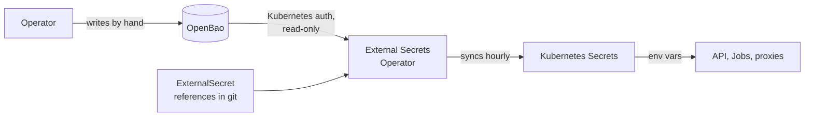

OpenBao stores every credential the system uses. External Secrets Operator copies them into Kubernetes Secrets, and workloads read those as environment variables. No credential is committed to git. This page covers the concept. The [infra Secrets runbook](/infra/secrets) covers verification and rotation.

## How do secrets get from OpenBao to a pod?

| Step | What happens |
|---|---|
| Store | An operator writes each value to OpenBao by hand. Nothing automated writes secrets. |
| Declare | `ExternalSecret` objects in `fantasy-infra` name a store, a remote key and a target Secret. They hold references only. |
| Authenticate | External Secrets logs in with its own Kubernetes ServiceAccount token, through a read-only role. No long-lived OpenBao token sits in a Secret. |
| Sync | Each `ExternalSecret` refreshes every hour and writes an ordinary Kubernetes Secret. |
| Consume | Pods reference the Secret as environment variables, so manifests never mention OpenBao. |

A few Secrets are composed by templates, such as the broker connection URL and the registry pull credential.

## Which secrets exist?

| Category | Used by |
|---|---|
| ESPN session cookies | Core API and ingestion, browser worker, session healthcheck |
| Database credentials, read-write and read-only | Postgres, API, CronJobs, worker, Grafana datasource |
| RabbitMQ credentials | Broker, API, worker, CronJobs, KEDA |
| LLM provider keys | Core API (chat), rumor digest |
| Trigger API key | API, web UI, scheduled action callers |
| OIDC proxy credentials | oauth2-proxy |
| Registry pull and git write-back credentials | Image pulls, Argo CD Image Updater |

The ESPN cookies are your own session credentials. See [ESPN Fantasy](./espn.md#how-does-authentication-work).

## How does refresh work?

- **Delay.** A changed value reaches the cluster within an hour of the OpenBao write.
- **Running pods.** Environment variables are read at container start. Restart a long-lived pod to pick up a change. CronJob and worker Jobs pick it up on their next run.
- **ESPN cookies.** Renewal is manual because ESPN's login can't be automated. The Monday healthcheck warns when they've expired, but they can expire mid-week. Refresh them before a draft.

## What fails when OpenBao does?

| Situation | Effect |
|---|---|
| OpenBao is sealed or down | Existing Kubernetes Secrets keep working. Rotations and new secrets don't land until it's available. |
| Auth role or policy broken | Same, and the `ExternalSecret` reports a sync error. |
| A source key is missing | The target Secret is never created, and pods that need it can't start. |
| Credential changed but behavior didn't | A running pod still holds the old value. Restart it. |

OpenBao runs as a single node and needs a manual unseal after a restart. Back up its storage snapshot.

## Related

- [Architecture](../overview/architecture.md#how-does-code-reach-the-cluster)
- [Secrets runbook](/infra/secrets)
- [No secrets in docs](/contributing/docs-style-guide#no-secrets-or-personal-data)
