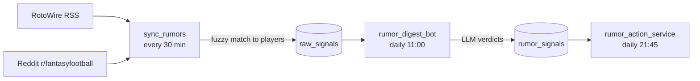

Two public sources feed the rumor signals: RotoWire's NFL news RSS and the r/fantasyfootball subreddit. Core only fetches and stores items. An LLM interprets them later in the worker.

## What does each source provide?

| Source | Access | Filters | On failure |
|---|---|---|---|
| RotoWire NFL news RSS | Unauthenticated feed | None | 3 tries, then an empty list |
| Reddit new posts | App-only OAuth with `REDDIT_CLIENT_ID`, `REDDIT_CLIENT_SECRET` and `REDDIT_USER_AGENT` | Minimum score (`REDDIT_MIN_SCORE`, default 20) and maximum age (`REDDIT_MAX_POST_AGE_HOURS`, default 72) | Empty list, including when credentials are missing |

Reddit reads up to 10 pages of 100 posts and remembers the newest post it saw, so each run only handles new ones.

## How are items matched and stored?

1. Each item's text is fuzzy-matched to a player name (`rapidfuzz`, confidence cutoff 90).
2. Matched and unmatched items are stored in `raw_signals`. Unmatched ones have no player.
3. Rows are deduplicated by source and item ID, with a content hash.

`fantasy-rumor-syncer` runs every 30 minutes, guarded by a Redis lock.

## What happens next?

The worker's rumor digest turns new rows into per-player sentiment and a suggested action. Core's rumor-action trigger then applies deterministic rules. See [LLM providers](./llm-providers.md) and [Rumor digest](/worker/bots/rumor-digest).

:::note
Google OAuth appears in core only for the MCP server's sign-in. It isn't a data source.
:::

## Rate limits and failures

Neither source has a client-side limiter. The 30-minute cadence, the Reddit score and age filters, and the watermark keep volume low. Each source fails soft, so a bad run just yields fewer signals. Reddit's API terms apply to your credentials.

## Where is the code?

`fantasy-core-pipeline`: `src/ingestion/sync_rumors.py`. `fantasy-browser-worker`: `src/bots/rumor_digest_bot.js`.
