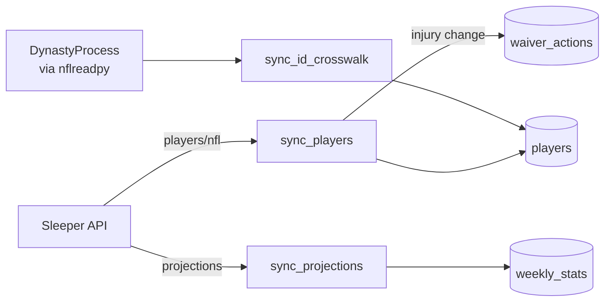

Sleeper supplies the player master, injury statuses and weekly projections. It needs no account or API key. Its player ID is the system's primary key for players.

## What does it provide?

| Data | Endpoint | Written to | Used for |
|---|---|---|---|
| Player master: name, position, team, status, injury status | `api.sleeper.app/v1/players/nfl` | `players` | Eligibility, the injury filter, alerts |
| Weekly projected points for QB, RB, WR and TE | `api.sleeper.com/projections/nfl/{season}/{week}` | `weekly_stats.projected_points` | VORP and the optimizers |

- **Positions kept:** QB, RB, WR, TE, K and DEF. Sleeper's `DEF` is stored as `D/ST`.
- **Scoring assumption:** projections read the full-PPR point field. Other formats need a code change.
- **Gaps:** Sleeper has no kicker or D/ST projections. Those come from [ESPN](./espn.md).

## How do injury changes flow?

`sync_players` compares each fetch with the stored rows and writes only players whose status changed. When a rostered player moves to Questionable, Doubtful or Out, it publishes an `INJURY_STATUS_CHANGE` message to `waiver_actions`.

- The database write and the publish share one transaction. If the publish fails, the write rolls back and the next run sees the change again.
- The lineup optimizer excludes **Out** players. Questionable and Doubtful players stay eligible.

## How are Sleeper and ESPN IDs matched?

Sleeper and ESPN IDs overlap numerically but identify different players. A crosswalk maps one to the other.

| Step | Source |
|---|---|
| `sync_id_crosswalk` | The DynastyProcess ID table, loaded through nflreadpy. It sets `espn_id` and `gsis_id` for most skill players. |
| `sync_skill_position_crosswalk` | Matches the remaining QB, RB, WR and TE players to ESPN by name and team. |
| `sync_kicker_dst` | Sets IDs for kickers and D/ST from ESPN. |

Every message bound for ESPN carries ESPN IDs. Core rejects a Sleeper ID with a 422. See the [architecture](../overview/architecture.md) and [Ingestion](/core/ingestion) for run order.

## When does it run?

| Job | Schedule (America/Chicago) |
|---|---|
| `fantasy-rapid-status-syncer` | Every 10 min on Thursday, Sunday and Monday |
| `fantasy-draft-prep-refresher` | Daily 18:00, including projections |

A Redis lock limits the player sync to one real fetch per 24 hours. Pass `--force` to override it.

## Rate limits and failures

Sleeper's API is unauthenticated and the client has no rate limiter. The daily gate and the schedule keep request volume low.

| Failure | Result |
|---|---|
| Player fetch fails after 3 tries | The sync exits quietly and keeps stored data. |
| Projections fetch fails | The Job fails and the next run retries. |
| A position class comes back empty | The sync raises rather than saving a partial player set. |
| The run crashes mid-sync | The "in progress" lock expires after 5 minutes. |

## Where is the code?

`fantasy-core-pipeline`: `src/ingestion/sync_players.py`, `sync_projections.py`, `sync_id_crosswalk.py`.
