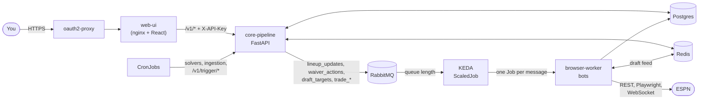
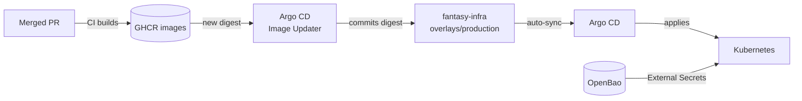

The system decides roster moves in one service and carries them out against ESPN in another. Between them sit a RabbitMQ bus and Postgres, which records each action and its outcome. Use this page to find which component owns a step. Use [End-to-end flows](./flows/index.md) to follow one action through the system.

:::tip[The short version]
- **Core decides and publishes.** `fantasy-core-pipeline` is the only service that publishes ESPN actions to RabbitMQ.
- **The worker acts and verifies.** `fantasy-browser-worker` consumes queues, writes to ESPN, then re-reads ESPN to confirm the change.
- **A person approves every trade.** No trade offer or response reaches ESPN without a human approving the exact terms. See the [Safety model](./safety-model.md).
:::

## What are the components?

| Component | Repo | Role |
|---|---|---|
| Web UI | `fantasy-web-ui` | React console for lineups, waivers, trades, the inbox, activity and draft day. nginx serves it and proxies `/v1/*` to core. |
| oauth2-proxy | `fantasy-infra` | Signs you in before any UI page or API call. The API itself doesn't check user identity. See [Authentication](/ui/auth). |
| Core API | `fantasy-core-pipeline` | FastAPI control plane. It reads data for the UI, scores trades, records actions and publishes them to RabbitMQ. See the [API reference](/core/api-reference). |
| Ingestion and solvers | `fantasy-core-pipeline` | Python modules run by CronJobs. They sync players, projections and scores, compute VORP, and pick lineups and waiver claims. See [Decision pipelines](/core/decision-pipelines). |
| Browser worker | `fantasy-browser-worker` | Node.js bots that act on ESPN through its REST API, a Playwright browser or the draft-room WebSocket. See [Browser worker](/worker/). |
| LLM chain | `fantasy-browser-worker` | Groq, then Gemini, then a self-hosted Ollama. The chain drafts trade packages, pitches and rumor digests. LLM output never reaches ESPN without human approval. |
| Infrastructure | `fantasy-infra` | Kustomize manifests for every service, store, CronJob, dashboard and alert. |

## Where is state kept?

| Store | Holds | Main writers |
|---|---|---|
| Postgres (TimescaleDB) | Players, projections, `weekly_stats` VORP, `league_rosters`, `draft_picks`, rumor signals | Core ingestion |
| Postgres: activity tables | `activity_actions`, `activity_outbox`, `activity_events`: each queued action, its pending message and its timeline | Core API, worker |
| Postgres: audit tables | `bot_decisions` (why core published) and `execution_log` (what the worker did, trade inbox rows, trade claims) | Core API, worker |
| Redis | Draft-day pick stream, draft board, per-pick pause flags, draft-sync health | Draft sync, draft listener, core API |
| RabbitMQ | Durable work queues, one per action type | Core publishes, worker consumes |

Grafana reads Postgres through a read-only `grafana_reader` role, never the read-write `bot_admin` role. Table definitions are in the [Data model](/core/data-model).

## Which queues connect core and the worker?

| Queue | Published by | Consumed by | Flow |
|---|---|---|---|
| `lineup_updates` | `POST /v1/trigger/lineup` | Lineup bot | [Lineup](./flows/lineup.md) |
| `waiver_actions` | `POST /v1/trigger/waiver`; player sync injury alerts | Waiver sniper | [Waivers](./flows/waivers.md) |
| `draft_targets` | `POST /v1/trigger/draft-pick` | Draft clicker | [Draft day](./flows/draft-day.md) |
| `trade_submissions` | `POST /v1/trade/offers/{offer_key}/approve` | Trade builder | [Outgoing trades](./flows/outgoing-trades.md) |
| `trade_responses` | `POST /v1/trade/incoming/{id}/decision` | Trade response | [Incoming trades](./flows/incoming-trades.md) |
| `trade_negotiations` | `POST /v1/trade/incoming/{id}/counter` | Trade negotiation | [Incoming trades](./flows/incoming-trades.md) |
| `trade_evaluations`, `trade_proposals`, `llm_requests` | No scheduled producer, or the worker itself | Trade bot, async LLM | Not part of a scheduled flow |

The broker pre-declares `lineup_updates`, `waiver_actions` and `draft_targets` with dead-letter queues. Field-level contracts are in [Queue publishing](/core/queue-publishing) and [Message contracts](/worker/message-contracts).

:::warning[Player ids come from two namespaces]
`players.player_id` is Sleeper's id. ESPN ids are a separate, numerically overlapping namespace, crosswalked through `players.espn_id`. Every message bound for ESPN carries ESPN ids, and core rejects a Sleeper id with a 422. The trade evaluation and negotiation queues are the exception: they carry core's internal ids.
:::

## How does a queued message become a running bot?

The worker is not a long-running service. KEDA watches each queue's length and starts one Kubernetes Job per waiting message, up to three at once. Each Job runs `src/index.js`, takes one message at a time and exits after 120 seconds idle. On draft day an overlay keeps one worker warm.

Details, including acknowledgement and retry rules, are in [How bots run](/worker/how-bots-run).

## What runs on a schedule?

Every CronJob uses `America/Chicago` time except the session check, which uses UTC.

| CronJob | Schedule | Runs | Feeds |
|---|---|---|---|
| `fantasy-weekly-ingestor` | Tue 16:00 | `sync_league` | Rosters and league settings |
| `fantasy-sync-actual-scores` | Tue 17:05, plus a Fri 10:00 reconcile | `sync_actual_scores` | Actual points for scoring and backtests |
| `fantasy-draft-prep-refresher` | Daily 18:00 | `sync_projections`, `sync_kicker_dst`, `vorp_matrix` | Upcoming-week projections and VORP |
| `fantasy-lineup-optimizer` | Tue 19:15 | `lineup_solver` | [Lineup flow](./flows/lineup.md) |
| `fantasy-weekly-waiver-trigger` | Tue 20:30 | `waiver_evaluator` | [Waiver flow](./flows/waivers.md) |
| `fantasy-rumor-syncer` | Every 30 min | `sync_rumors` | Rumor signals |
| `fantasy-rumor-action-trigger` | Daily 21:45 | `rumor_action_service` | Rumor-driven lineup and waiver triggers |
| `fantasy-rapid-status-syncer` | Every 10 min, Thu, Sun and Mon | `sync_players` | Injury statuses and `waiver_actions` alerts |
| `fantasy-stale-draft-job-sweeper` | Every 15 min | `sweep_stale_draft_jobs` | Cleans up leftover draft Jobs |
| `rumor-digest-bot` | Daily 11:00 | `rumor_digest_bot.js` | LLM rumor digest |
| `trade-inbox` | Every 2 h, 08:00–22:00 | `trade_inbox.js --refresh` | [Incoming trades](./flows/incoming-trades.md) |
| `trade-scan` | Wed and Fri 13:00 | `trade_scan.js --stage` | [Outgoing trades](./flows/outgoing-trades.md) |
| `espn-session-healthcheck` | Mon 06:00 UTC | `check_espn_session.js` | Early warning that ESPN cookies have expired |

The Tuesday jobs form a chain: ingest, score, refresh VORP, then optimize the lineup and waivers. Each later job starts after the earlier one's deadline.

## How does code reach the cluster?

| Step | Detail |
|---|---|
| Build | Each service repo's CI pushes an image to GitHub Container Registry. |
| Image Updater | Watches GHCR and commits each new digest to the `images:` list in `overlays/production/kustomization.yaml`, as `chore(images): update … [argocd-image-updater]`. |
| Argo CD | Syncs `overlays/production` automatically on every push. There's no manual `kubectl apply`. |
| Draft Jobs | Core spawns draft Jobs at runtime from `DRAFT_SYNC_IMAGE` and `BROWSER_WORKER_IMAGE`. Kustomize copies both from the pinned Deployment and ScaledJob images, so they update together. |
| Secrets | External Secrets materializes ESPN cookies, database passwords and API keys from OpenBao. No credential is committed. |
| Draft day | The `overlays/draft-day` overlay adds CPU and memory headroom and a warm worker. |

A config change, such as flipping `AUTO_PUBLISH_IR_MOVES`, is a reviewed PR to `fantasy-infra`. See [Unattended IR publication](/infra/auto-publish-ir-moves).

## How do I see what happened?

| Signal | Where | Use it to |
|---|---|---|
| Traces | OpenTelemetry to Tempo. Queue messages carry a `traceparent`, so a worker span joins the API's trace. | Follow one action across core and the worker. |
| Logs | Loki. Worker lines carry `trackingId` and `trace_id`. | Read a bot run. See [Telemetry](/worker/telemetry). |
| Dashboards | Grafana, provisioned from `fantasy-infra` ConfigMaps: bot decisions, execution log, draft pipeline, CronJob health, traces | Watch the system at a glance. |
| Alerts | Grafana alert rules for failed or missed CronJobs and rumor-action outcomes | Get told when a schedule breaks. See [CronJob alerts](/infra/cronjob-alerts). |
| Activity | `GET /v1/activity/actions` and the UI's Activity page | Check whether an action was delivered and verified. See [Activity submissions](/core/activity-api). |

`tracking_id` is the human-facing id for one action. Look it up in Activity, then search Loki for it.

## Known fragility

| Risk | Why it matters |
|---|---|
| ESPN's protocol is reverse-engineered | ESPN can change endpoints, selectors or the draft WebSocket without notice. Bots fail closed, but a change stops that action until someone updates the worker. See [ESPN reverse-engineering notes](/worker/espn-reverse-engineering). |
| ESPN session cookies expire | Every write needs valid `espn_s2` and `SWID` cookies. The Monday session check gives early warning. |
| Write routes trust the network | `/v1/trigger/*` and the trade inbox writes need `X-API-Key`. Other routes, including outgoing trade approval, rely on oauth2-proxy and the cluster boundary. |
| RabbitMQ user provisioning | The broker image doesn't create users from environment variables once definitions are loaded. An initContainer renders the user into the definitions on every boot. |
| Kubernetes calls from the API | The draft endpoints call the Kubernetes API directly. The UI wraps its calls in timeouts because a degraded control plane may never respond. |

## Related

- [End-to-end flows](./flows/index.md)
- [Safety model](./safety-model.md)
- [Decision pipelines](/core/decision-pipelines)
- [How bots run](/worker/how-bots-run)
- [fantasy-infra README](https://github.com/cvillarr23/fantasy-infra#readme)
