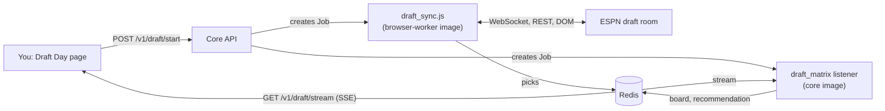
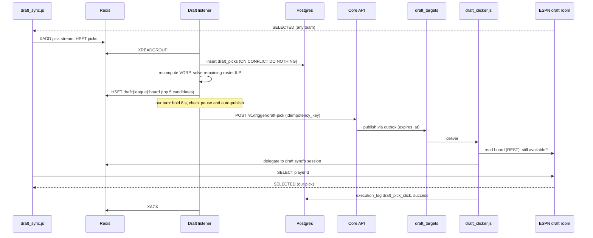

On draft day two Jobs run for the length of the draft. Draft sync watches the ESPN draft room and streams every pick to Redis. The draft listener recomputes the best pick after each one, and on our turn it can publish a pick for the worker to make. You can watch, pause or take over from the Draft Day page.

## What starts the draft pipeline?

Practice drafts use the same pieces. `POST /v1/draft/practice/sync-job` points draft sync at a mock room, and a `practice` pick defaults to a real submit in that room.

## How does a pick travel?

The clicker hands the pick to the running draft sync because ESPN allows one draft-room session per team. A second connection would evict the first. If delegation fails, the clicker connects directly and falls back to a browser click.

## What is involved?

| Item | Value |
|---|---|
| Redis | Pick stream, picks hash, `draft:{league}:board`, `draft:{league}:pause:{pick}`, `draft:{league}:health`, `draft_commands:{league}` and the rejection channel `draft_pick_rejected:{league}` |
| Queue | `draft_targets`, broker-declared, dead-letters to `draft_targets.dlq` |
| Tables | `draft_picks`, `activity_actions`, `activity_outbox`, `execution_log` |
| Idempotency key | `<league_id>:<pick_number>:<espn_id>`. Released 15 min after the action finishes. |
| Freshness | The route returns 409 if the pick is filled or `expires_at` has passed. The worker skips an expired target with outcome `expired`. |
| `DRY_RUN` default | **Dry run** for a live draft. A dry run still writes `skipped_dry_run` so the status shows it. |

:::warning[Pick stream key mismatch]
Draft sync now writes picks to the season-scoped stream `draft_picks:{leagueId}:{seasonId}`. The core listener and its cleanup still use `draft_picks:{leagueId}`. Until [fantasy-core-pipeline#149](https://github.com/cvillarr23/fantasy-core-pipeline/issues/149) lands, check that the listener is receiving picks before relying on auto-publish.
:::

## What can you control?

| Control | Effect |
|---|---|
| **Auto-publish picks** switch | Off means nothing is sent automatically. Recommendations still update. |
| Hold next auto-pick (`POST /v1/draft/pause`) | Skips auto-publish for that pick only |
| **Draft this player**, or a manual pick | Queues a pick for the current pick number |
| Circuit breaker | Three failed publications in a row turn auto-publish off. It can re-enable on the next pick, unless you turned it off yourself. |

## What limits auto-publish?

| Limit | Default |
|---|---|
| Hold before publishing | 8 s, so you can pause |
| Pick clock | 90 s, measured from the upstream pick event |
| Safety margin | 5 s |
| Minimum window | 10 s. The hold shrinks to fit the clock. |
| Transient failure | Retry every 2 s within the clock |
| ESPN rejects the pick | The clicker publishes a rejection. The listener moves to the next candidate within the same clock. |

Uncertainty is not rejection. If the outcome is unclear, the listener doesn't pick another player.

## Read more

- [Draft matrix](/core/decision-pipelines/draft): candidate selection and the pick clock.
- [Draft sync](/worker/bots/draft-sync) and [Draft clicker](/worker/bots/draft-clicker)
- [Draft Day page](/ui/user-guide/draft-day)
