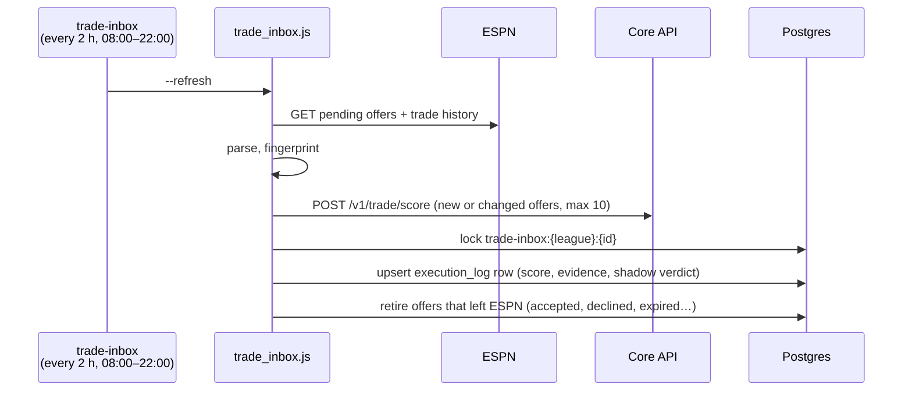
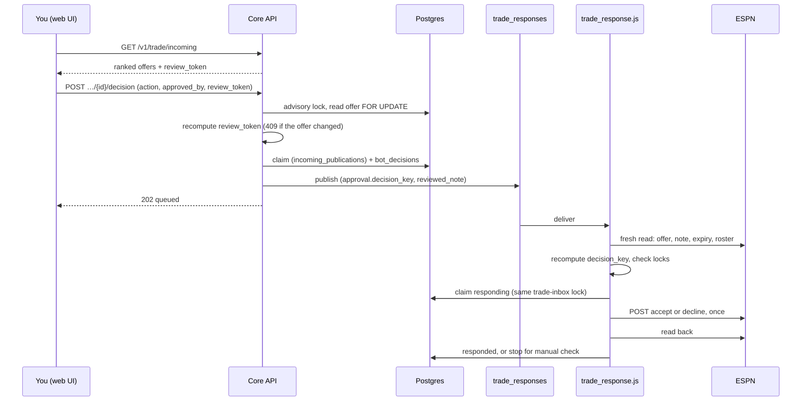
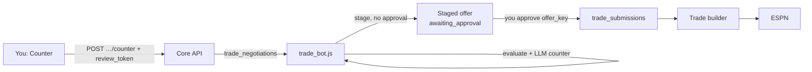

Every two hours the trade inbox reads the offers other managers have sent you and scores each one. It stores one ranked row per offer. You review an offer in the UI, then accept, decline or counter. Core checks that the offer hasn't changed since you reviewed it, and the worker checks again against ESPN before it answers.

## How is the inbox refreshed?

The refresh never writes to ESPN and uses no LLM. If core is down, the last score is kept and marked stale.

## How does a decision reach ESPN?

## What keys protect it?

| Key | Built from | Checked by | Stops |
|---|---|---|---|
| `review_token` | League, season, team, transaction, proposer, fingerprint, sorted player ids and items, and the proposer's note | Core, under the offer lock, before any claim | Acting on an offer that changed after you read it |
| `decision_key` | League, season, team, transaction, action, fingerprint and your comment | Core's claim key; the worker recomputes it from a fresh ESPN read | Replays, and an approval reused for a different action |
| `reviewed_note` | The exact proposer note you saw | The worker, against ESPN's current note | A silent edit to the note between review and send |
| Advisory lock `trade-inbox:{league}:{id}` | Offer identity | Core publish, worker refresh, worker response | An accept and a decline both going out, or a refresh landing mid-decision |

The full token and key formulas are in the [Incoming trade API reference](/core/decision-pipelines/incoming-trade-api#review-token).

## What must be true to answer?

| Check | Who |
|---|---|
| Offer is open, parsed and more than 5 minutes from expiry | Core and worker |
| For accept: a current score whose fingerprint matches, and no roster-limit overage | Core and worker |
| `DRY_RUN=false` and `TRADE_RESPONSE_ENABLED=true` | Worker |
| The action is listed in `VERIFIED_TRADE_RESPONSE_ACTIONS`, and `PENDING_TRADE_SHAPE_VERIFIED` is true | Worker |
| No other response to this offer is claimed, in flight, unknown or rejected | Core and worker |

With any worker lock closed, the bot records `response_blocked` and the body it would have sent.

## How does a counter work?

A counter doesn't send anything to ESPN directly. It starts the negotiation bot, which stages a counter-offer for the [outgoing approval](./outgoing-trades.md) path.

A thread allows at most three of our counters. The fourth is refused.

## How do I retry a stuck response?

Core never republishes on its own. A rejected response, or one whose outcome is unknown, stays blocked until you call `POST …/{id}/decision/retry`.

| Previous state | Retry needs |
|---|---|
| `rejected` | `of_claim_id` naming the blocking response |
| `response_unknown` | Also `verified_not_answered: true`, after a person checks ESPN |
| `responding` or `responded` | Never retried |

## Read more

- [Incoming trade inbox](/core/decision-pipelines/incoming-trades): ranking and shadow policy.
- [Incoming trade API reference](/core/decision-pipelines/incoming-trade-api): endpoints, states and recovery.
- [Trade inbox](/worker/bots/trade-inbox), [Trade response](/worker/bots/trade-response) and [Trade evaluation and negotiation](/worker/bots/trade-evaluation-and-negotiation)
- [Inbox page](/ui/user-guide/inbox)
