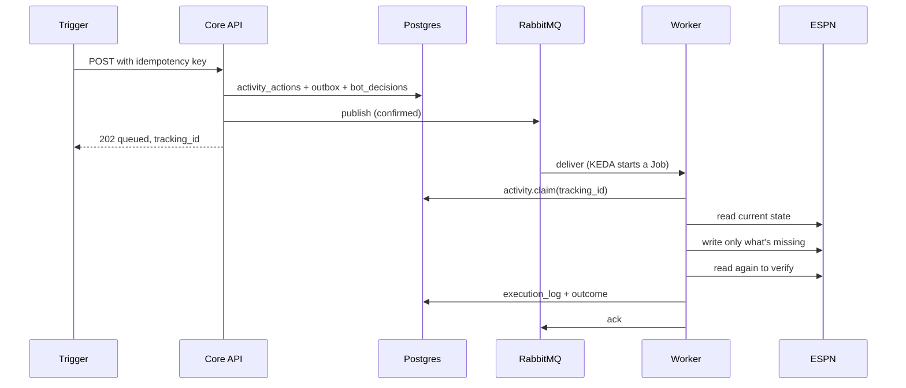
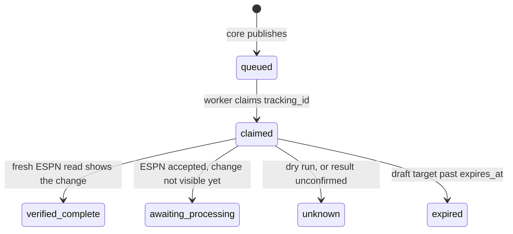

Each page in this section follows one kind of action from its trigger to a verified ESPN result. Every flow shares the lifecycle below. The flow pages cover what differs: the trigger, the queue, the keys and the checks.

| Flow | Trigger | Queue | Human approval? |
|---|---|---|---|
| [Lineup](./lineup.md) | Tuesday optimizer, UI, rumor actions | `lineup_updates` | No |
| [Waivers and IR](./waivers.md) | Tuesday waiver evaluator, UI, rumor actions | `waiver_actions` (plus `lineup_updates` for IR) | No. IR + add is off unless `AUTO_PUBLISH_IR_MOVES` is on. |
| [Outgoing trades](./outgoing-trades.md) | Wednesday and Friday trade scan | `trade_submissions` | Yes, per offer |
| [Incoming trades](./incoming-trades.md) | Trade inbox refresh every 2 h | `trade_responses`, `trade_negotiations` | Yes, per response |
| [Draft day](./draft-day.md) | ESPN draft room picks | `draft_targets` | Optional: pause, or turn off auto-publish |

## What does every action go through?

| Stage | What happens | Where to read more |
|---|---|---|
| Trigger | A CronJob, the UI or another service calls core. Callers send an idempotency key. | [Queue publishing](/core/queue-publishing#how-does-idempotency-work) |
| Record | Core saves the action, the message and the decision evidence in one transaction. A repeat key returns `duplicate` with the original `tracking_id`. | [Activity submissions](/core/activity-api) |
| Publish | Lineup, waiver and draft messages go through the outbox, which the activity runner retries if the broker was down. Trade messages are claimed in `execution_log` first, then published directly. | [Queue publishing](/core/queue-publishing) |
| Execute | KEDA starts a worker Job. The worker claims the `tracking_id`, so two pods can't run the same action. | [How bots run](/worker/how-bots-run) |
| Verify | The worker re-reads ESPN and records the outcome. | [How do I know a write worked?](/worker/how-bots-run#how-do-i-know-a-write-worked) |

:::tip[A `202` is not an ESPN change]
`queued` or `approved` means core handed the message to RabbitMQ. Only the worker's outcome, `verified_complete` or `awaiting_processing`, says something changed on ESPN.
:::

## Which outcome means what?

The worker writes one of these to `activity_actions.outcome`. A failed execution, such as a `PermanentError` or a stop for manual verification, shows separately as execution state `failed`.

## Related

- [Architecture](../architecture.md)
- [Safety model](../safety-model.md)
- [Decision pipelines](/core/decision-pipelines)
