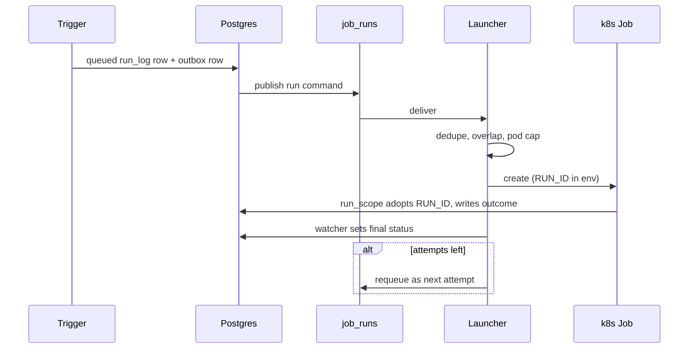
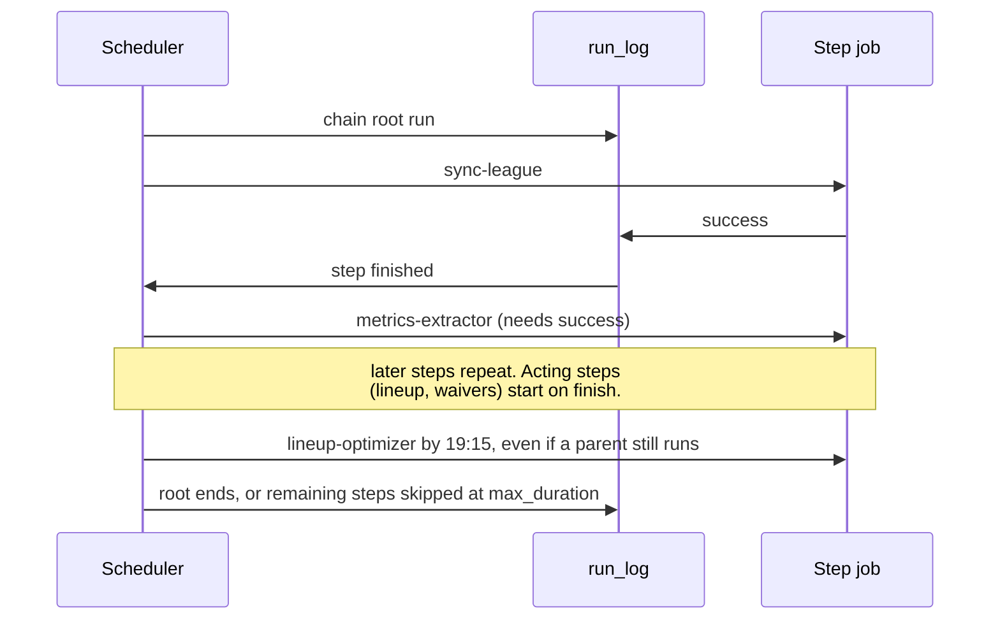
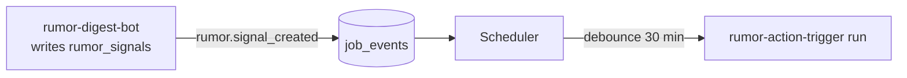

Every scheduled or on-demand job follows this path. The terms, catalog fields and limits are in the [Job launcher concepts](../job-launcher.md) page. This page follows one run, then one chain.

## How does one run travel?

| Stage | What happens |
|---|---|
| Trigger | A schedule slot, chain step, event, or an API call from the UI, CLI or MCP. |
| Record | The `queued` row and an outbox row commit in one transaction, then the command is published. The queue and the table can't drift apart. |
| Admit | The consumer drops a repeated dedupe key and refuses a run that breaks `overlap`, a pause or the pod cap. |
| Launch | The consumer creates the k8s Job and passes `RUN_ID`, `RUN_TRIGGER` and `RUN_PARENT_ID`. |
| Report | The job's outermost `run_scope` adopts `RUN_ID`. The worker's `src/db/run_log.js` follows the same rule. |
| Finalize | The watcher sets `success`, `failure` or `timeout`, and requeues a failed run while attempts remain. |

:::tip[A `queued` run is not a started job]
`queued` means the launcher accepted the command. Check `running` and the final status in the Jobs page or `python -m src.cli jobs status <run_id>`.
:::

## How does the Tuesday chain run?

`tuesday-weekly` starts at 16:00 Chicago. The scheduler creates one root run, then starts each step when its parents allow.

| Situation | Result |
|---|---|
| `sync-league` fails | The chain stops: `metrics-extractor` needs `success`. |
| `projections-refresh` fails | `lineup-optimizer` still runs, because its edge is `finish`. |
| A parent is still running at 19:15 | `lineup-optimizer` starts anyway, from its `latest` time. |
| The launcher was down at 16:00 | The slot fires late if it is inside the 2-hour `catch_up` window. |
| The chain passes 8 hours | Remaining steps end `skipped` and the `max_duration` alert fires. |

See the [generated chain diagrams](/infra/schedules) for the current steps.

## How does an event start a run?

Events within one 30-minute window share a dedupe key, so they start one run. If a run is already in flight, `overlap: queue` waits for it instead of skipping. The 21:45 schedule still fires if the broker loses an event. If the launcher was down, it handles queued events on restart. An event older than its 30-minute `debounce` ends `skipped (expired)` and starts nothing, so only recent events start a run.

## Related

- [Job launcher concepts](../job-launcher.md)
- [Flows overview](./index.md)
- [Job alerts](/infra/cronjob-alerts)
- [Rumor actions](/core/decision-pipelines/rumor-actions)
