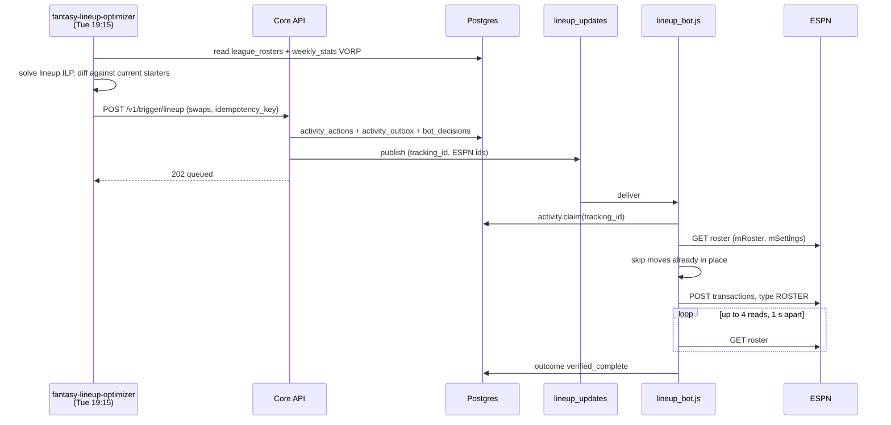

Every Tuesday the lineup solver picks the starters with the highest total VORP and sends the swaps to ESPN as one roster transaction. The UI and rumor actions use the same trigger for manual and event-driven moves.

## What triggers it?

| Trigger | Path |
|---|---|
| `fantasy-lineup-optimizer` CronJob, Tuesday 19:15 Chicago | `python -m src.optimization.lineup_solver` calls `POST /v1/trigger/lineup` |
| Lineup page in the UI | nginx adds `X-API-Key` and forwards to the same route. The UI sends a random idempotency key per submission. |
| Rumor actions | `bench_watch` signals call the same route. See [Rumor actions](/core/decision-pipelines/rumor-actions). |

## What is involved?

| Item | Value |
|---|---|
| Queue | `lineup_updates`, broker-declared, dead-letters to `lineup_updates.dlq` |
| Tables | `weekly_stats`, `league_rosters` (inputs); `activity_actions`, `activity_outbox`, `activity_events`, `bot_decisions`, `execution_log` (record) |
| Idempotency key | `lineup-<team>-<hash>`: SHA-256 of the CronJob's Job name, team, season and week, and the sorted swaps. Released 30 min after the action finishes. |
| Worker claim | `activity.claim(tracking_id)` under a Postgres advisory lock |
| ESPN write | `POST …/transactions/` with `type: "ROSTER"`, one `LINEUP` item per move |
| Verification | Every moved player sits in its intended slot on a fresh roster read |
| `DRY_RUN` default | **Live.** Set `DRY_RUN=true` to plan without writing. |

The Job name in the key means each new Job publishes once, while pod retries inside that Job dedupe.

## What can stop it?

| Situation | Result |
|---|---|
| Missing target-week metrics and no fresh prior weeks | Solver raises `InsufficientLineupInputError`. Nothing is published. |
| No better lineup | Empty swaps. Nothing is published. |
| Lineup locked on ESPN | `PermanentError`. The week's optimization no longer applies. |
| A player in two swaps, an unknown slot or a bad id | `PermanentError`, dead-lettered |
| Verification fails after four reads | Requeued. The retry finds the moves in place and completes. |
| Expired ESPN cookies | Requeued after 30 s |

## Read more

- [Lineup optimization](/core/decision-pipelines/lineup-optimization): how the solver chooses starters.
- [Lineup bot](/worker/bots/lineup): the ESPN request and failure modes.
- [Lineup page](/ui/user-guide/lineup): the manual path.
