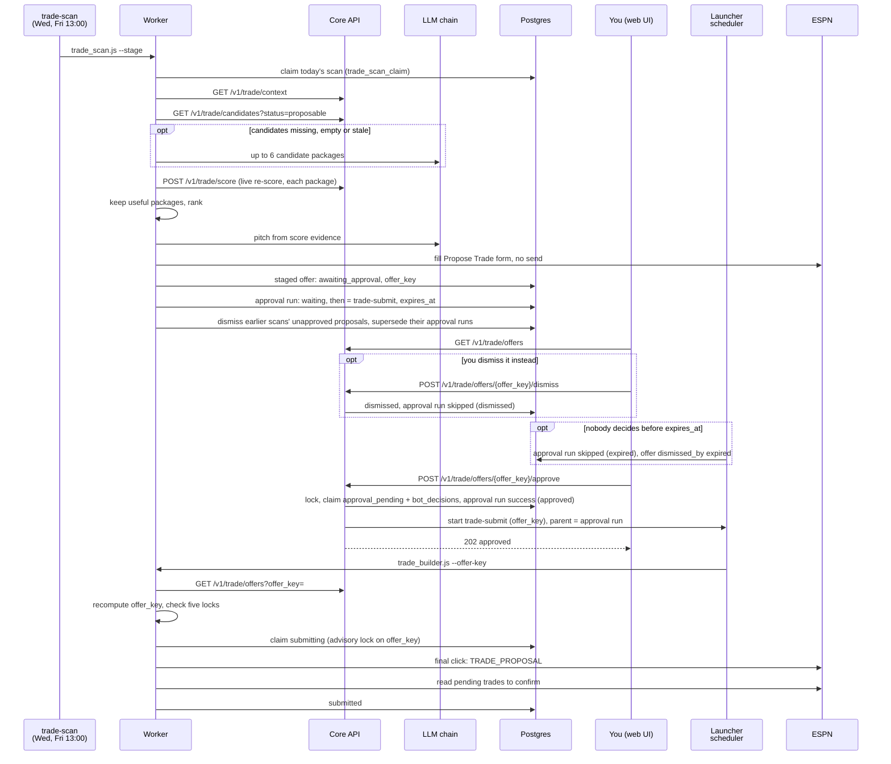
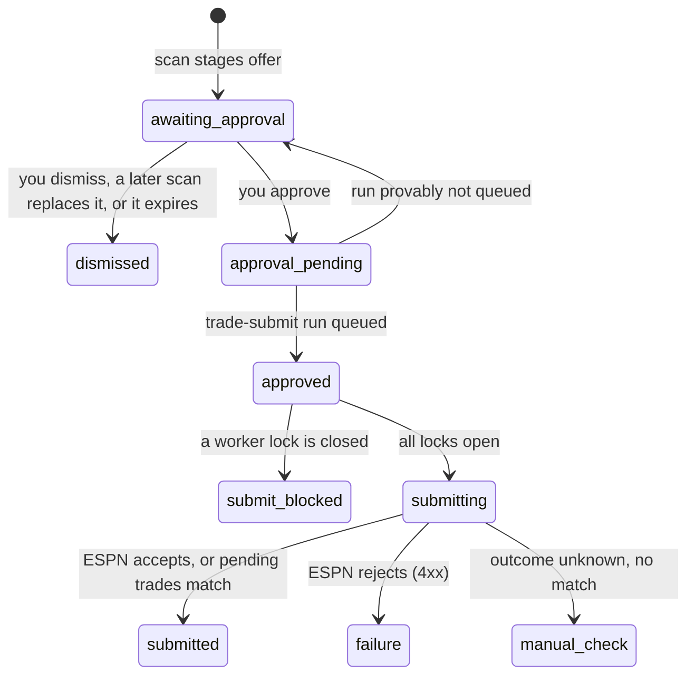
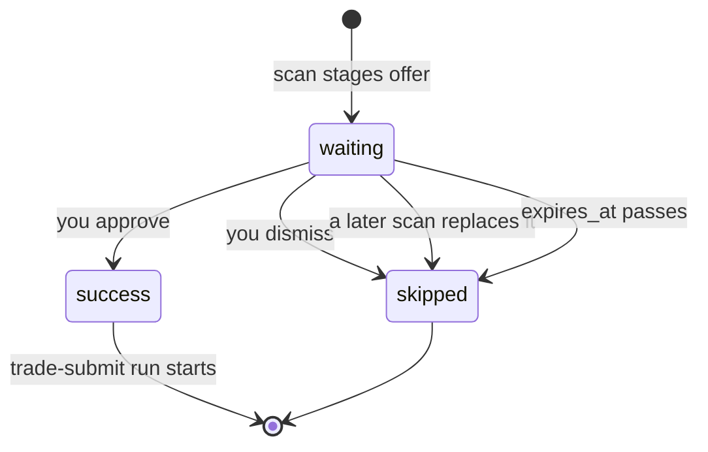

Every day, the core `trade_candidates` job enumerates and scores every 1-for-1, 2-for-1 and 1-for-2 trade across the league. It runs again just before each scan. Twice a week the trade scan takes the best proposable candidates, up to three per team, re-scores each one live, and stages the best as unsent offers. When the candidate set is missing, empty, malformed or more than 36 hours old, the scan falls back to asking an LLM for packages. In both cases the LLM writes the pitch from score evidence, and nothing goes to the other manager until you approve that exact offer. Each staged proposal is also an [approval run](../job-launcher.md#approval-runs) that shows as **Waiting for you** on the Runs tab. A scan that finishes without error dismisses every proposal an earlier scan staged that you haven't approved, so the list only ever shows the latest batch. A proposal you leave alone expires at the next scan, or after 72 hours if that is sooner. You can also dismiss one yourself from its card. Approving sends the offer as a `trade-submit` launcher run, so the send has a run row, an alert and a place in the `espn-session` group. The Trades page browses the same candidate set in its trade finder.

## Which stages hold the offer?

## What is the approval run?

Each staged offer has an approval run, a `run_log` row that waits for you. The worker's scan writes it straight to the database, because worker pods hold no API key. Its `then` is a `trade-submit` run with the offer's `offer_key`.

| Event | Approval run | Offer row |
|---|---|---|
| You approve | `success`, `approved`. The launcher starts `trade-submit`, parented to the approval run. | `approval_pending`, then `approved` |
| You dismiss | `skipped`, `dismissed` | `dismissed` |
| A later scan replaces it, or you approve an edited copy | `skipped`, `superseded` | `superseded` or `dismissed` |
| `expires_at` passes | `skipped`, `expired` | `dismissed`, with `dismissed_by` set to `expired` |

An approval expires at the next `trade-scan` slot or after 72 hours, whichever is sooner. A Friday offer is gone by Monday afternoon, not Wednesday. An expired offer leaves the Trades page, so you can't approve a stale one.

The Trades page is still where you approve. The generic `POST /v1/runs/{id}/approve` refuses a trade approval with `409`, because the trade route also edits the message, recomputes the `offer_key` and writes the `bot_decisions` audit in one transaction. The Runs tab shows the run as **Waiting for you** with an **Open** link to the offer.

An offer staged before approval runs existed has no approval run. Approving it starts `trade-submit` directly, as before.

The `trade-submit` run is a launcher job: worker image, `acts: true`, in the `espn-session` group so it never overlaps a scan or inbox run on the same ESPN session, `max_attempts: 1` and a 10-minute deadline. Its dedupe key is `trade-submit@<approval id>` for an offer with an approval run, and `trade-submit@<offer_key>` for a legacy offer without one. Either way there is one run per approval or offer, however often it is approved. Dismissals, replacements and expiries are quiet. A `trade-submit` failure alerts like any other run.

## What is involved?

| Item | Value |
|---|---|
| Trigger | `trade-scan` launcher job, Wednesday and Friday 13:00 Chicago. Regular-season weeks 1–18 only. |
| Run | `trade-submit` launcher job, param `offer_key`. The approve route starts it, with the staging scan's run as its parent (`counter_offer.scan_run_id`). The old `trade_submissions` queue row is gone: nothing publishes there and its KEDA trigger is removed. |
| Tables | `execution_log` (scan claim, staged offer with `proposal-evaluation-v1` evidence, submit claim); `run_log` (scan, approval and send runs); `bot_decisions` (approval audit) |
| Scan key | One attempt per league, team and Chicago calendar date, under an advisory lock. There are no automatic retries, because a new pitch would need a new approval. |
| Approval key | `offer_key`: SHA-256 over league, season, both teams, sorted player ids, the note and the related transaction. Editing any of these needs a new approval. |
| Duplicate approval | Returns `200` with the original receipt and doesn't start a second run. |
| ESPN write | Playwright fills the form. A guard blocks every non-GET ESPN request until the final click. |

## What must be true to send?

| Lock | Open when |
|---|---|
| `TRADE_DRY_RUN` | Explicitly `false`, or unset with `DRY_RUN` explicitly `false` |
| `TRADE_SUBMIT_ENABLED` | `true`, `1` or `yes` |
| Approval | The message's `offer_key` equals the key recomputed from the offer |
| Selectors | Every submit selector is marked verified in `espn_selectors.json` |
| Counter linkage | For a counter only: `COUNTER_LINKAGE_VERIFIED` is set |

With any lock closed, the builder ticks the boxes, checks them, takes a screenshot and stops at `submit_blocked`.

## What if the result is unclear?

| Situation | Result |
|---|---|
| ESPN returns 5xx or 429, or no response | The builder reads ESPN's pending trades. An exact match settles it as `submitted`. |
| No match | `PermanentError`. A person checks ESPN. The bot never clicks again on a guess. |
| The launcher run can't be queued | If core proves nothing was queued, the offer returns to `awaiting_approval`. If it can't tell, the approval stays `approval_pending` and approving again resumes it. |
| `trade-submit` fails | It never retries. Check the run on the Runs tab and ESPN's pending trades before approving again. |
| Core can't score any package | Nothing is staged. An unscored offer is never staged. |

## Read more

- [Outgoing offers and evaluation](/core/decision-pipelines/outgoing-trades): package rules and the approval state machine.
- [Trade scoring](/core/decision-pipelines/trade-scoring): G*, C* and coverage.
- [Trade proposal and scan](/worker/bots/trade-proposal-and-scan) and [Trade builder](/worker/bots/trade-builder)
- [Trades page](/ui/user-guide/trades): where you approve.
- [Approval runs](../job-launcher.md#approval-runs): the launcher concept behind the waiting status.
