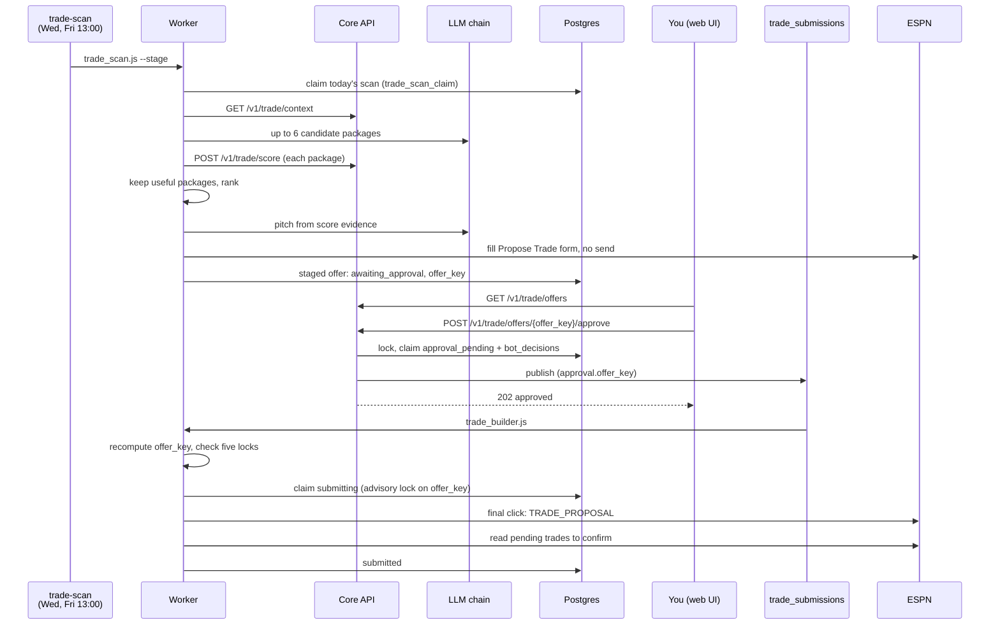
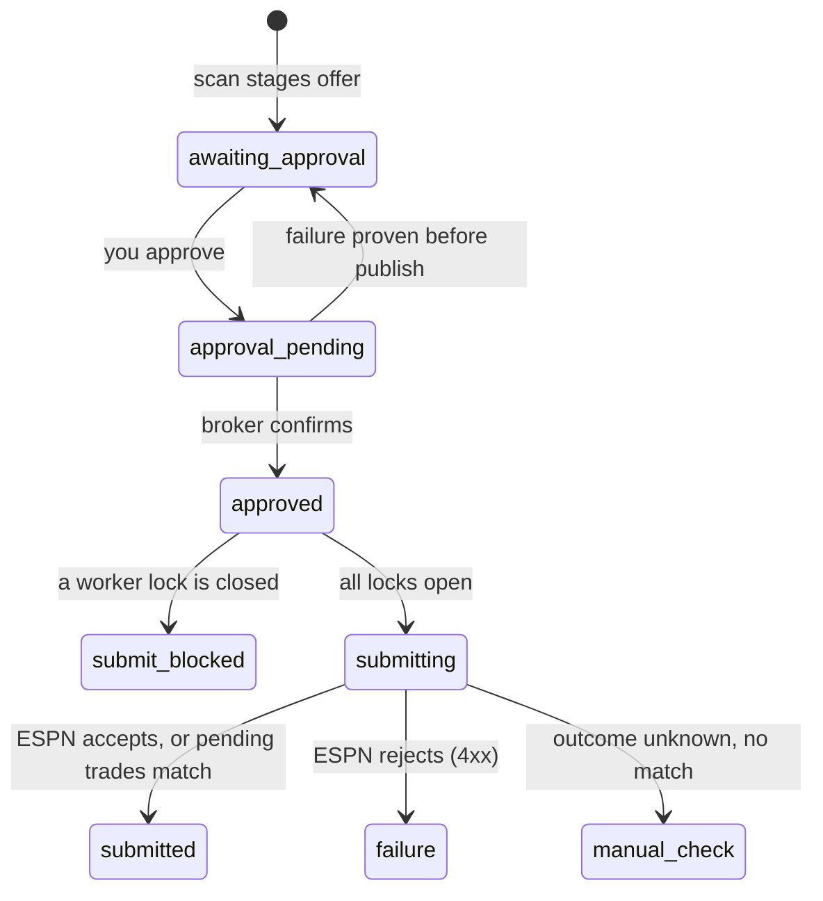

Twice a week the trade scan looks for a team that is weak where we are strong. An LLM suggests packages, and core scores each one. The worker stages the best package as an unsent offer, and nothing goes to the other manager until you approve that exact offer.

## Which stages hold the offer?

## What is involved?

| Item | Value |
|---|---|
| Trigger | `trade-scan` CronJob, Wednesday and Friday 13:00 Chicago. Regular-season weeks 1–18 only. |
| Queue | `trade_submissions`. The approve route publishes directly, without the outbox. |
| Tables | `execution_log` (scan claim, staged offer with `proposal-evaluation-v1` evidence, submit claim); `bot_decisions` (approval audit) |
| Scan key | One attempt per league, team and Chicago calendar date, under an advisory lock. There are no automatic retries, because a new pitch would need a new approval. |
| Approval key | `offer_key`: SHA-256 over league, season, both teams, sorted player ids, the note and the related transaction. Editing any of these needs a new approval. |
| Duplicate approval | Returns `200` with the original receipt and doesn't publish again. |
| ESPN write | Playwright fills the form. A guard blocks every non-GET ESPN request until the final click. |

## What must be true to send?

| Lock | Open when |
|---|---|
| `DRY_RUN` | Explicitly `false` |
| `TRADE_SUBMIT_ENABLED` | `true`, `1` or `yes` |
| Approval | The message's `offer_key` equals the key recomputed from the offer |
| Selectors | Every submit selector is marked verified in `espn_selectors.json` |
| Counter linkage | For a counter only: `COUNTER_LINKAGE_VERIFIED` is set |

With any lock closed, the builder ticks the boxes, checks them, takes a screenshot and stops at `submit_blocked`.

## What if the result is unclear?

| Situation | Result |
|---|---|
| ESPN returns 5xx or 429, or no response | The builder reads ESPN's pending trades. An exact match settles it as `submitted`. |
| No match | `PermanentError`. A person checks ESPN. The bot never clicks again on a guess. |
| Core publish outcome unknown | The approval stays `approval_pending` and blocks new approvals until someone reconciles it by hand. |
| Core can't score any package | Nothing is staged. An unscored offer is never staged. |

## Read more

- [Outgoing offers and evaluation](/core/decision-pipelines/outgoing-trades): package rules and the approval state machine.
- [Trade scoring](/core/decision-pipelines/trade-scoring): G*, C* and coverage.
- [Trade proposal and scan](/worker/bots/trade-proposal-and-scan) and [Trade builder](/worker/bots/trade-builder)
- [Trades page](/ui/user-guide/trades): where you approve.
