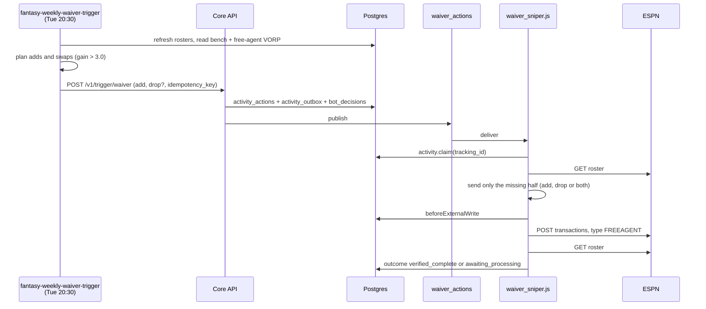
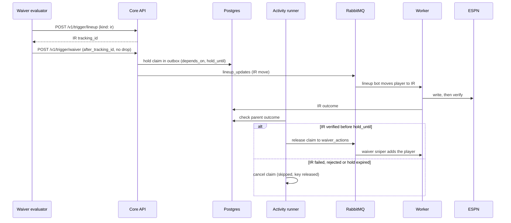

Every Tuesday the waiver evaluator compares the bench with free agents and claims the ones that clear its margin. When an injured player can move to IR, it can also chain an IR move ahead of an add-only claim. That chain is off unless `AUTO_PUBLISH_IR_MOVES` is on.

## How does a plain claim travel?

A claim in a waiver period stays queued on ESPN until waivers process. The worker records `awaiting_processing`, not a failure.

## How does IR + add chain?

The add waits in the outbox, held until the IR move it depends on is verified on ESPN.

## What triggers it?

| Trigger | Path |
|---|---|
| `fantasy-weekly-waiver-trigger` CronJob, Tuesday 20:30 Chicago | `python -m src.optimization.waiver_evaluator` |
| `fantasy-rumor-action-trigger` CronJob, daily 21:45 Chicago | `boost_waiver_priority` signals. See [Rumor actions](/core/decision-pipelines/rumor-actions). |
| Waivers and Move overview pages in the UI | `POST /v1/trigger/waiver` through nginx |
| `fantasy-rapid-status-syncer` | Publishes `INJURY_STATUS_CHANGE` alerts straight to `waiver_actions`. These are alerts, not claims, and carry Sleeper ids. |

## What is involved?

| Item | Value |
|---|---|
| Queues | `waiver_actions`; `lineup_updates` for the IR half |
| Tables | `activity_actions`, `activity_outbox` (`depends_on`, hold deadline), `activity_events` (`held_for_dependency`, `dependency_verified`, `dependency_failed`), `bot_decisions` |
| Idempotency key | `waiver-<team>-<hash>`: SHA-256 of team, season, week, add, drop and the chained IR player. No Job name, so any re-run in the same waiver week dedupes. Released 7 days after the action finishes. |
| Hold | `ACTIVITY_DEPENDENCY_HOLD_SECONDS`, default 3600 |
| ESPN write | `POST …/transactions/` with `type: "FREEAGENT"` and `ADD`, `DROP` or both |
| `DRY_RUN` default | **Dry run.** A boolean `dry_run` in the message overrides it. The UI's confirm dialog always sends one; automated claims omit it and keep the worker's default. |

## What gates the IR chain?

| Gate | Effect when closed |
|---|---|
| `AUTO_PUBLISH_IR_MOVES` not `1`, `true` or `yes` | IR + add is logged as a suggestion. Ordinary swaps still publish. |
| Current IR occupant ineligible or unknown status | The unattended chain is blocked. |
| Missing season, week or IR `tracking_id` | The add isn't sent. |
| Rumor action saved earlier | The flag is re-checked at delivery. |

The flag lives in the shared `fantasy-league-config` ConfigMap and is `"false"` in production. See [Unattended IR publication](/infra/auto-publish-ir-moves) for how to turn it on.

## Read more

- [Waivers](/core/decision-pipelines/waivers): drop candidates, IR capacity and margins.
- [Queue publishing: held claims](/core/queue-publishing#how-does-a-claim-wait-for-an-ir-move)
- [Waiver sniper](/worker/bots/waiver-sniper) and [Lineup bot](/worker/bots/lineup)
- [Waivers page](/ui/user-guide/waivers)
