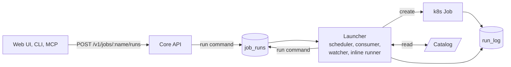
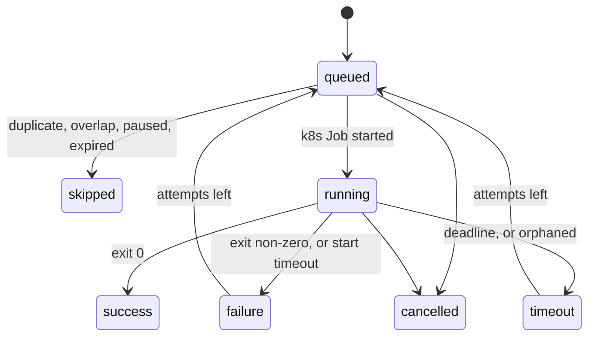
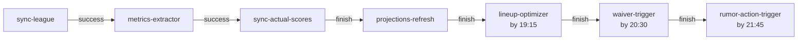

One launcher starts every job in the system: ingestion, solvers and the scheduled bots. A schedule, a chain, an event, the web UI, the CLI or an MCP tool each send the same run command, and the launcher turns it into a Kubernetes Job. Read this page for the vocabulary. [Job launcher flow](./flows/job-launcher.md) follows one run from trigger to result.

:::tip[The short version]
- **One entry point.** Every trigger sends a run command to the `job_runs` queue. No CronJobs remain.
- **One record.** Each run is a row in `run_log`, from `queued` to a final status.
- **Every stage has a limit.** A run can wait, start, run and finish only inside the limits [below](#limits).
:::

## Terms

| Term | Meaning |
|---|---|
| Job | A definition in the catalog, such as `lineup-optimizer`: a command, an image profile and rules. |
| Run | One execution of a job. One `run_log` row. |
| k8s Job | The Kubernetes object that executes a run. A retry creates a new one. |
| Catalog | The `fantasy-job-catalog` ConfigMap that lists every job and chain. |
| Trigger | What asked for a run: `schedule`, `chain`, `event`, `manual`, `cli` or `mcp`. |
| Chain | A named workflow of job steps with dependencies, such as `tuesday-weekly`. |
| Event | A fact, such as `rumor.signal_created`, that can start runs. |

## Components

The launcher is one process, `python -m src.launcher` in the core image, with one replica. It reads the catalog at startup.

| Part | Does |
|---|---|
| Scheduler | Fires schedules and chain steps, applies pauses, and turns events into runs. |
| Consumer | Takes run commands, drops duplicates, enforces overlap and the pod cap, and creates the k8s Job. |
| Watcher | Finalizes runs, retries failures, and enforces start and run timeouts and cancellation. |
| Inline runner | Runs tiny jobs in the launcher process instead of a pod. No catalog job uses it yet. |

The [Architecture](./architecture.md) page shows where the launcher sits among the services.

## Jobs and the catalog

The catalog lives in `fantasy-infra` as `base/launcher/catalog.yaml`. Core validates it, and infra CI checks it against core's exported schema.

| Field | Rule |
|---|---|
| `profile` | Image and secrets: `core` runs the core image, `worker` runs the browser-worker image. |
| `params` | The allowlist of parameters an on-demand run may set, such as `week` or `dry_run`. |
| `overlap` | `forbid` refuses a second concurrent run. `queue` waits for the first to finish. |
| `max_attempts` | Launcher-owned retries. Kubernetes `backoffLimit` is always 0. |
| `deadline` | How long a run may execute. Capped at 2 hours. |
| `acts` | The job writes to ESPN. The UI asks for confirmation, and you can pause it. |
| `alert` | Severity of the Grafana alert on a failed run: `warning` or `critical`. |
| `schedules` | Cron expressions with a time zone and a `catch_up` window. |
| `on_event` | Event keys that start the job, each with a `debounce`. |

The generated [schedule inventory](/infra/schedules) lists every job, its schedule and its command.

What does the catalog reserve for later?

`class: service`, `group`, `fan_out` and `approval` parse but are rejected until implemented. The [ADR](/infra/adr/unified-job-launcher) lists them under v2.

## Runs

A run moves through these statuses. Every final status frees the run's overlap and cap slot.

| Name | Format | Example |
|---|---|---|
| Job | Lowercase, hyphenated catalog key | `lineup-optimizer` |
| Run id | UUID. The pod receives it as `RUN_ID`, with `RUN_TRIGGER` and `RUN_PARENT_ID`. | `3f9a1c0b-7d2e-4a51-9c68-0e5b2d4f8a13` |
| k8s Job | `<job>-<first 12 hex of run id>-a<attempt>`, trimmed to 63 characters | `lineup-optimizer-3f9a1c0b7d2e-a1` |
| Chain step | The job name, scoped by `chain_root_id` | `tuesday-weekly` / `waiver-trigger` |

The pod's outermost `run_scope` adopts `RUN_ID`. Subprocesses and nested scopes become child rows, so one run can show its parts.

## Triggers

| Trigger | Started by | Dedupe key | Overlap, cap or pause blocks it |
|---|---|---|---|
| `schedule` | A catalog cron slot | `job@slot` | Skipped, unless `catch_up` allows a late start |
| `chain` | A chain step becoming ready | `job@chain_root` | Waits, up to the step's `latest` time plus 30 minutes |
| `event` | A subscribed event | `job@key@debounce_window` | Skipped, or queued if the job sets `overlap: queue` |
| `manual`, `cli`, `mcp` | The Jobs page, `python -m src.cli jobs run`, or the `run_job` tool | A fresh UUID | A busy job refuses it at once under `overlap: forbid`. A full pod cap, or `overlap: queue`, makes it wait up to 30 minutes. |

A repeated dedupe key creates no second run. This is why a launcher restart can't double-fire a slot.

The UI, CLI and MCP share the same operations: list jobs, run, check status, cancel, and pause or resume. Pausing stops new runs from starting and leaves runs already started alone.

## Chains

A chain is a set of steps with `after` dependencies. Each dependency says whether the next step needs the earlier one to succeed or only to finish.

`tuesday-weekly` fires Tuesday 16:00 Chicago in the regular season, with a 2-hour catch-up window and an 8-hour `max_duration`.

| Edge or field | Meaning |
|---|---|
| `on: success` | The next step runs only if this one succeeded. Data steps use it. |
| `on: finish` | The next step runs whatever the outcome. Steps that act on ESPN use it. |
| `latest` | The step starts by this time even if its parent is still running. |
| `max_duration` | Past it, the remaining steps are `skipped`. |

The generated [chain diagrams](/infra/schedules) always match the catalog. Use them, not this page, for the current order.

## Events

An event is a fact published to the `job_events` topic. A job subscribes with `on_event` and a `debounce`, and the launcher turns each matching event into a run.

| Event | Emitted by | Subscribed by |
|---|---|---|
| `rumor.signal_created` | `rumor-digest-bot`, after it writes `rumor_signals` | `rumor-action-trigger`, debounce 30 minutes, `overlap: queue` |
| `trade.offer_received` | `trade-inbox`, when a new offer arrives | No job yet |

The launcher judges an event by its own time. If the launcher was down and handles an event older than its `debounce`, the event is recorded as `skipped (expired)` and starts nothing. A run an event does start expires one `debounce` after the event.

An event run reads VORP from the previous evening, so a signal with no qualifying move stays held until the next settled run instead of being dropped. The schedule stays as the fallback, because a broker failure loses an event. See [Rumor actions](/core/decision-pipelines/rumor-actions) and [Queue publishing](/core/queue-publishing#how-do-events-start-runs).

:::note[Injury alerts stay direct]
`sync_players` publishes injury alerts straight to `waiver_actions`. That queue carries work items, not events, so the alert path skips the launcher.
:::

## Limits

Every stage has a hard limit, and every limit ends in a `run_log` status.

| Stage | Limit | Enforced by | Ends as |
|---|---|---|---|
| Waiting in `job_runs` | 6-hour message TTL | RabbitMQ | Dead-letter queue, alert |
| Queued, pod cap full | Manual 30 min. Schedule: `catch_up`. Chain: `latest` plus 30 min. | Consumer | `skipped`, reason `expired` |
| Pod pending | 10 min | Watcher | `failure`, reason `start_timeout`. The k8s Job is deleted. |
| Running | Job `deadline`, at most 2 hours | `activeDeadlineSeconds` and watcher | `timeout` |
| Lost track | Deadline plus 10 min, checked every minute | Watcher | `timeout`, reason `orphaned` |
| Inline run | Same deadline. SIGTERM, then SIGKILL after 30 s. | Inline runner | `timeout` |
| Whole chain | `max_duration` | Scheduler | Remaining steps `skipped` |
| Finished k8s Job | 1 day | Kubernetes TTL | Removed |

At most two pods run at once across all jobs.

## Monitoring

Grafana SQL alerts read `run_log` and route to ntfy. They fire on:

- a launcher heartbeat older than 5 minutes;
- a `failure`, `timeout` or `skipped` run on a job with `alert: warning` or `critical`. Skips from a pause, a chain step that never started, a chain timeout or a chain that already ended stay quiet, and so do the `overlap` and `expired` skips of event runs on a job that also has a schedule or a chain step. A job that only has `on_event` still alerts on those, since nothing else would run it;
- any message in `job_runs.dlq`;
- a chain past its `max_duration`.

See [Job alerts](/infra/cronjob-alerts) for the rule names and how to triage each one.

## Related

- [Job launcher flow](./flows/job-launcher.md)
- [Architecture](./architecture.md)
- [ADR 0001: Unified job launcher](/infra/adr/unified-job-launcher)
- [Schedules](/infra/schedules)
- [How bots run](/worker/how-bots-run)
