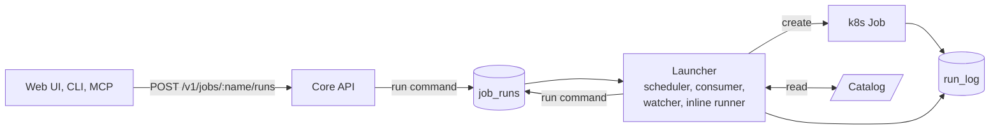
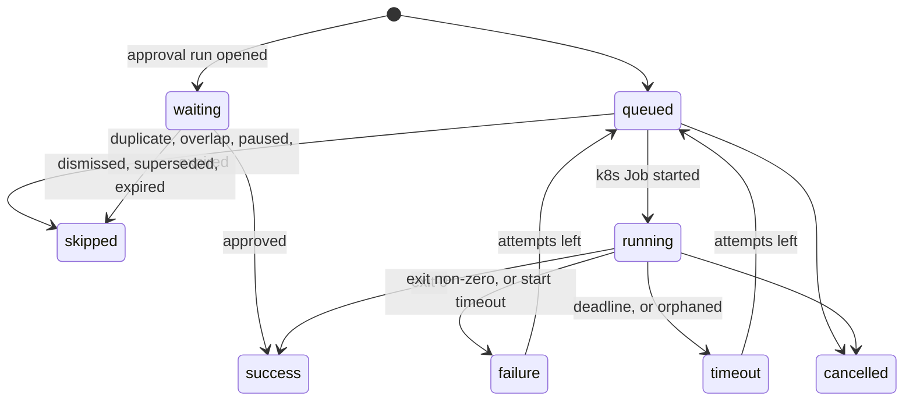
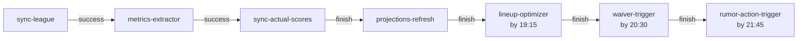
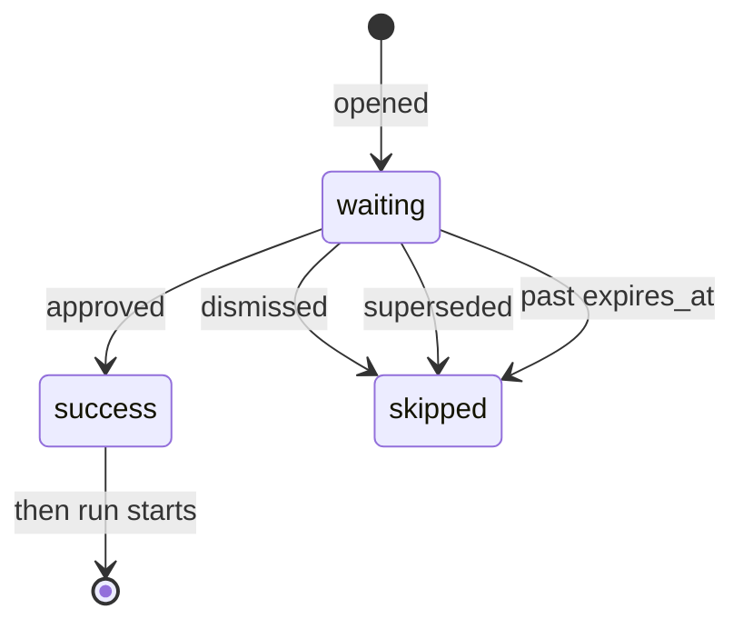
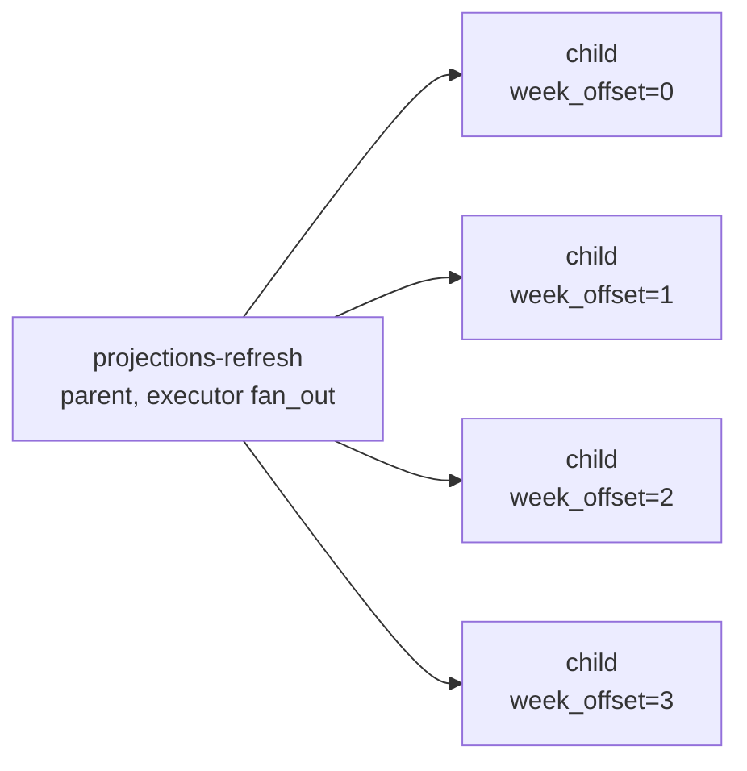

One launcher starts every job in the system: ingestion, solvers and the scheduled bots. A schedule, a chain, an event, the web UI, the CLI or an MCP tool each send the same run command, and the launcher turns it into a Kubernetes Job. Read this page for the vocabulary. [Job launcher flow](./flows/job-launcher.md) follows one run from trigger to result.

:::tip[The short version]
- **One entry point.** Every trigger sends a run command to the `job_runs` queue. No CronJobs remain.
- **One record.** Each run is a row in `run_log`, from `queued` to a final status.
- **Every stage has a limit.** A run can wait, start, run and finish only inside the limits [below](#limits).
:::

## Terms

| Term | Meaning |
|---|---|
| Job | A definition in the catalog, such as `lineup-optimizer`: a command, an image profile and rules. |
| Run | One execution of a job. One `run_log` row. |
| k8s Job | The Kubernetes object that executes a run. A retry creates a new one. |
| Catalog | The `fantasy-job-catalog` ConfigMap that lists every job and chain. |
| Trigger | What asked for a run: `schedule`, `chain`, `event`, `manual`, `cli` or `mcp`. |
| Chain | A named workflow of job steps with dependencies, such as `tuesday-weekly`. |
| Fan-out | A run split into parallel child runs, one per value of a job param. |
| Event | A fact, such as `rumor.signal_created`, that can start runs. |
| Approval run | A run that waits for a person and launches nothing. Approving it can start another run. See [Approval runs](#approval-runs). |

## Components

The launcher is one process, `python -m src.launcher` in the core image, with one replica. It reads the catalog at startup.

| Part | Does |
|---|---|
| Scheduler | Fires schedules and chain steps, publishes fan-out children, applies pauses, and turns events into runs. |
| Consumer | Takes run commands, drops duplicates, enforces overlap and the pod cap, and creates the k8s Job. It claims a fan-out parent without launching anything. |
| Watcher | Finalizes runs, retries failures, and enforces start and run timeouts and cancellation. |
| Inline runner | Runs tiny jobs in the launcher process instead of a pod. No catalog job uses it yet. |

The [Architecture](./architecture.md) page shows where the launcher sits among the services.

## Jobs and the catalog

The catalog lives in `fantasy-infra` as `base/launcher/catalog.yaml`. Core validates it, and infra CI checks it against core's exported schema.

| Field | Rule |
|---|---|
| `profile` | Image and secrets: `core` runs the core image, `worker` runs the browser-worker image. |
| `params` | The allowlist of parameters an on-demand run may set, such as `week` or `dry_run`. |
| `overlap` | `forbid` refuses a second concurrent run. `queue` waits for the first to finish. |
| `max_attempts` | Launcher-owned retries. Kubernetes `backoffLimit` is always 0. |
| `deadline` | How long a run may execute. Capped at 2 hours, or 8 hours for a `class: service` job. |
| `acts` | The job writes to ESPN. The UI asks for confirmation, and you can pause it. |
| `alert` | Severity of the Grafana alert on a failed run: `warning` or `critical`. |
| `schedules` | Cron expressions with a time zone and a `catch_up` window. |
| `on_event` | Event keys that start the job, each with a `debounce`. |
| `fan_out` | `{param, values}`: split each run into one child per value. See [Fan-out](#fan-out). |
| `class` | `batch` (default) or `service`, a run that lasts hours. See [Service jobs](#service-jobs). |
| `param_env` | Params passed to the pod as env vars instead of CLI flags, such as `room_url: DRAFT_ROOM_URL`. |
| `health` | `{key, grace}`, service jobs only: a Redis heartbeat key built from the run's params. See [Service jobs](#service-jobs). |
| `group` | A concurrency group from the catalog's `groups`, which caps how many of its jobs run at once. A full group makes runs wait. |

The generated [schedule inventory](/infra/schedules) lists every job, its schedule and its command.

Chain steps add one more field, `approval`. See [Approval runs](#approval-runs).

## Runs

A run moves through these statuses. Every final status frees the run's overlap and cap slot.

| Name | Format | Example |
|---|---|---|
| Job | Lowercase, hyphenated catalog key | `lineup-optimizer` |
| Run id | UUID. The pod receives it as `RUN_ID`, with `RUN_TRIGGER` and `RUN_PARENT_ID`. | `3f9a1c0b-7d2e-4a51-9c68-0e5b2d4f8a13` |
| k8s Job | `<job>-<first 12 hex of run id>-a<attempt>`, trimmed to 63 characters | `lineup-optimizer-3f9a1c0b7d2e-a1` |
| Chain step | The job name, scoped by `chain_root_id` | `tuesday-weekly` / `waiver-trigger` |

`waiting` is only for [approval runs](#approval-runs). A waiting run is neither queued nor running, so it holds no pod slot, overlap slot or group slot.

The pod's outermost `run_scope` adopts `RUN_ID`. Subprocesses and nested scopes become child rows, so one run can show its parts.

## Triggers

| Trigger | Started by | Dedupe key | Overlap, cap or pause blocks it |
|---|---|---|---|
| `schedule` | A catalog cron slot | `job@slot` | Skipped, unless `catch_up` allows a late start |
| `chain` | A chain step becoming ready | `job@chain_root` | Waits, up to the step's `latest` time plus 30 minutes |
| `event` | A subscribed event | `job@key@debounce_window` | Skipped, or queued if the job sets `overlap: queue` |
| `approval` | A run asking for approval, or a chain's `approval:` step | `approval@<run id>#<key>`, or `step@<chain root>` for a step | Nothing blocks it. It takes no slot. |
| `manual`, `cli`, `mcp` | The Jobs page, `python -m src.cli jobs run`, or the `run_job` tool | A fresh UUID | A busy job refuses it at once under `overlap: forbid`. A full pod cap, or `overlap: queue`, makes it wait up to 30 minutes. |

A repeated dedupe key creates no second run. This is why a launcher restart can't double-fire a slot.

The UI, CLI and MCP share the same operations: list jobs, run, check status, cancel, and pause or resume. Pausing stops new runs from starting and leaves runs already started alone.

## Chains

A chain is a set of steps with `after` dependencies. Each dependency says whether the next step needs the earlier one to succeed or only to finish.

`tuesday-weekly` fires Tuesday 16:00 Chicago in the regular season, with a 2-hour catch-up window and an 8-hour `max_duration`.

| Edge or field | Meaning |
|---|---|
| `on: success` | The next step runs only if this one succeeded. Data steps use it. |
| `on: finish` | The next step runs whatever the outcome. Steps that act on ESPN use it. |
| `latest` | The step starts by this time even if its parent is still running. |
| `max_duration` | Past it, the remaining steps are `skipped`. |
| `approval` | The step waits for a person instead of running a job. See [Approval runs](#approval-runs). |

The generated [chain diagrams](/infra/schedules) always match the catalog. Use them, not this page, for the current order.

## Approval runs

An approval run lets a person gate a run. It is a `run_log` row with executor `approval` and status `waiting`. It launches nothing, so it holds no pod, overlap or group slot, however long it waits. An approved one can start a run of its own, such as `trade-submit`.

| Outcome | Status, `end_reason` | What follows |
|---|---|---|
| Approved | `success`, `approved` | The launcher starts the approval's `then` run, if it has one. |
| Dismissed | `skipped`, `dismissed` | Nothing. |
| A newer approval replaces it | `skipped`, `superseded` | Nothing. |
| Past `expires_at` | `skipped`, `expired` | Nothing. The scheduler's expiry sweep ends it. |

The approver is recorded as `requested_by`. Approving and dismissing are ordinary writes, guarded like a manual run of an `acts: true` job.

There are two ways to open one.

| | A running process asks | A chain `approval:` step |
|---|---|---|
| How | `POST /v1/runs/{run_id}/approvals` with `key`, `title`, optional `then`, `link` and `expires_at` | `steps.<name>: {approval: {timeout, title}, after: [...]}` |
| Who opens it | The process, while its run is `running`. A run that isn't running is refused. | The scheduler, once the step's `after` edges are met |
| Dedupe key | `approval@<run id>#<key>` | `<step>@<chain root id>` |
| Gates | `then: {job, params}`, validated against the catalog when the approval opens | Nothing. The step's own status is the gate. |
| Expiry | `expires_at`, default 24 hours, at most 7 days | `timeout`, but never past the chain's `max_duration` |
| Approved | Starts `then` as a manual run by the approver, parented to the approval | The step is `success`, so its `on: success` edges run |
| Dismissed or expired | Nothing starts | The step is `skipped`, so its `on: success` edges skip |

A process can open many approvals under different keys. The trade scan opens one per staged offer.

The `then` run's dedupe key is `<job>@<approval id>`, so approving twice, or the scheduler retrying a start that failed after the approval committed, starts it once. The run carries no chain root, because the chain that asked may have ended long before.

A chain step's decline is a person's decision, not a failure. A chain whose only unsuccessful steps were declined, or skipped because a step was declined, still ends `success`. An approval step can't share a name with a catalog job.

`POST /v1/runs/{id}/approve` and `/dismiss` decide any approval run, except one whose `then` job a domain route owns. They refuse a `trade-submit` approval with `409`, because the Trades page's approve route also edits the message, recomputes the `offer_key` and writes the audit row in one transaction. See [Outgoing trades](./flows/outgoing-trades.md).

The web UI shows a waiting run as **Waiting for you**. The run detail has an **Open** link to the approval's `link`, and a chain step shows as a waiting node in the graph. The Jobs page counts waiting approvals. A chain step's approval has **Approve** and **Dismiss** buttons. A trade approval links to the Trades page instead.

## Fan-out

A job with `fan_out: {param, values}` splits each run that leaves `param` unset into one child run per value. The run that leaves it unset is the parent. `projections-refresh` uses `fan_out: {param: week_offset, values: [0, 1, 2, 3]}`, so each week of the horizon refreshes in its own pod.

| Part | Rule |
|---|---|
| Parent | The consumer claims it with executor `fan_out` and launches nothing, so it takes no pod slot. It is never retried. |
| Children | The scheduler publishes one per value. Each gets the parent's params plus `param=value`, the parent's trigger and chain root, and the parent as `parent_run_id`. |
| Child dedupe key | `job@<parent run id>#param=value` |
| Running | Children are ordinary runs. The pod cap bounds how many run at once, and each retries by `max_attempts`. |
| Parent result | `success` once no child is pending, or `failure` with reason `fan_out_failed` if any child didn't succeed. |
| Ended parent | A child still queued after its parent ended, such as after a cancel, is `skipped` with reason `fan_out_ended`. Cancelling a parent cancels its queued and running children. |
| In a chain | The parent is the step, so its status decides the edges after it. |
| Param set | A run that sets `param` itself, such as a manual `week_offset=2`, is one ordinary run. |

## Service jobs

A `class: service` job runs for hours, not minutes. The four draft jobs use it: `draft-listener` and `draft-connector` for the live draft, and `practice-draft-listener` and `practice-draft-connector` for a practice room. The draft endpoints request and cancel their runs; the API itself can only read k8s Jobs.

| Rule | Service job |
|---|---|
| Pod cap | Never waits on it and doesn't count toward it |
| Deadline | Capped by `max_service_deadline`, 8 hours |
| Executor | Pod only, and no fan-out |
| Stopping | 5-second termination grace. The watcher checks for cancelled runs every 5 seconds, so a stop doesn't wait for the 60-second pass. |
| Health | With `health`, the watcher ends a `running` run whose Redis key has been missing past `grace` as `timeout`, reason `unhealthy`. A Redis error leaves the run alone. |

The practice jobs watch the connector's `draft:{league_id}:health` heartbeat with a 10-minute grace, so an abandoned practice room ends on its own. The live jobs have no health key: only `/v1/draft/stop` or the deadline ends them.

## Events

An event is a fact published to the `job_events` topic. A job subscribes with `on_event` and a `debounce`, and the launcher turns each matching event into a run.

| Event | Emitted by | Subscribed by |
|---|---|---|
| `rumor.signal_created` | `rumor-digest-bot`, after it writes `rumor_signals` | `rumor-action-trigger`, debounce 30 minutes, `overlap: queue` |
| `trade.offer_received` | `trade-inbox`, when a new offer arrives | No job yet |

The launcher judges an event by its own time. If the launcher was down and handles an event older than its `debounce`, the event is recorded as `skipped (expired)` and starts nothing. A run an event does start expires one `debounce` after the event.

An event run reads VORP from the previous evening, so a signal with no qualifying move stays held until the next settled run instead of being dropped. The schedule stays as the fallback, because a broker failure loses an event. See [Rumor actions](/core/decision-pipelines/rumor-actions) and [Queue publishing](/core/queue-publishing#how-do-events-start-runs).

:::note[Injury alerts stay direct]
`sync_players` publishes injury alerts straight to `waiver_actions`. That queue carries work items, not events, so the alert path skips the launcher.
:::

## Limits

Every stage has a hard limit, and every limit ends in a `run_log` status.

| Stage | Limit | Enforced by | Ends as |
|---|---|---|---|
| Waiting in `job_runs` | 6-hour message TTL | RabbitMQ | Dead-letter queue, alert |
| Queued, pod cap full | Manual 30 min. Schedule: `catch_up`. Chain: `latest` plus 30 min. | Consumer | `skipped`, reason `expired` |
| Pod pending | 10 min | Watcher | `failure`, reason `start_timeout`. The k8s Job is deleted. |
| Running | Job `deadline`, at most 2 hours, or 8 for a service job | `activeDeadlineSeconds` and watcher | `timeout` |
| Service heartbeat | `health.grace` after the key goes missing | Watcher | `timeout`, reason `unhealthy` |
| Lost track | Deadline plus 10 min, checked every minute | Watcher | `timeout`, reason `orphaned` |
| Inline run | Same deadline. SIGTERM, then SIGKILL after 30 s. | Inline runner | `timeout` |
| Whole chain | `max_duration` | Scheduler | Remaining steps `skipped` |
| Waiting for approval | `expires_at`. A chain step's is capped by `max_duration`. | Scheduler | `skipped`, reason `expired` |
| Finished k8s Job | 1 day | Kubernetes TTL | Removed |

At most two pods run at once across all jobs, counting the KEDA browser worker's Jobs. Service jobs are outside this cap.

## Monitoring

Grafana SQL alerts read `run_log` and route to ntfy. They fire on:

- a launcher heartbeat older than 5 minutes;
- a `failure`, `timeout` or `skipped` run on a job with `alert: warning` or `critical`. Skips from a pause, an approval a person dismissed or a newer one replaced, an approval that expired unanswered, a chain step that never started, a chain timeout, a chain that already ended or a fan-out that already ended stay quiet. So does a fan-out parent's `fan_out_failed`, since the failed child alerts on its own row, and so do the `overlap` and `expired` skips of event runs on a job that also has a schedule or a chain step. A job that only has `on_event` still alerts on those, since nothing else would run it;
- any message in `job_runs.dlq`;
- a chain past its `max_duration`.

See [Job alerts](/infra/cronjob-alerts) for the rule names and how to triage each one.

## Related

- [Job launcher flow](./flows/job-launcher.md)
- [Architecture](./architecture.md)
- [ADR 0001: Unified job launcher](/infra/adr/unified-job-launcher)
- [Schedules](/infra/schedules)
- [How bots run](/worker/how-bots-run)
