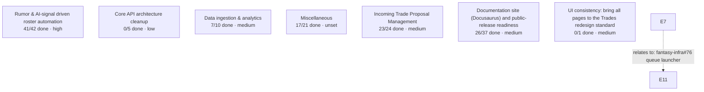

:::note

Generated from live GitHub state by `scripts/gen_project_map.py` (run it and commit the output whenever epics change -- this is a snapshot, not auto-refreshing).

:::



| Epic | Members | Priority |
|---|---|---|
| [Rumor & AI-signal driven roster automation](https://github.com/cvillarr23/fantasy-project/issues/3) | 41/42 | high |
| [Core API architecture cleanup](https://github.com/cvillarr23/fantasy-project/issues/5) | 0/5 | low |
| [Data ingestion & analytics](https://github.com/cvillarr23/fantasy-project/issues/6) | 7/10 | medium |
| [Miscellaneous](https://github.com/cvillarr23/fantasy-project/issues/10) | 17/21 | unset |
| [Incoming Trade Proposal Management](https://github.com/cvillarr23/fantasy-project/issues/12) | 23/24 | medium |
| [Documentation site (Docusaurus) and public-release readiness](https://github.com/cvillarr23/fantasy-project/issues/19) | 26/37 | medium |
| [UI consistency: bring all pages to the Trades redesign standard](https://github.com/cvillarr23/fantasy-project/issues/73) | 0/1 | medium |

Cross-epic dependencies are wired via native GitHub `blocked-by`, not shown in the diagram above except where noted -- query them directly:
```
gh api graphql -f query='{ repository(owner:"cvillarr23",name:"fantasy-project"){ issue(number:N){ blockedBy(first:10){ nodes { number title repository { name } } } } } }'
```
