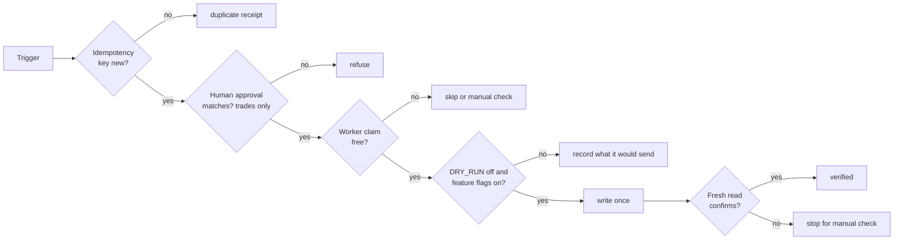

Every ESPN write changes a real league that other managers share, and most writes can't be undone. The system layers several independent checks so no single bug, replay or LLM answer can make an unintended change. Use this page to see which check stops what, and what to change to go live.

:::tip[The short version]
- Every bot except lineup defaults to **dry run**.
- Trades need a **human approval** bound to the exact terms, plus a separate enable flag per direction.
- An unclear outcome **stops for a person**. It's never retried blindly.
- Success means a **fresh ESPN read** shows the change, not that a request returned 200.
:::

## What does each bot do by default?

`DRY_RUN` goes live only on `0`, `false` or `no`. `TRADE_DRY_RUN` overrides it for the trade builder only, parsed the same way. Production sets no `DRY_RUN`, so each bot's default below applies, and sets `TRADE_DRY_RUN=false` so armed trade submissions can go live.

| Bot | Default | Also required for a live write |
|---|---|---|
| Lineup | **Live** | Nothing beyond the trigger's own checks |
| Waiver sniper | Dry run | `dry_run: false` in the message, which the UI's confirm dialog sends, or `DRY_RUN=false` |
| Draft clicker | Dry run | `DRY_RUN=false`. A `practice` message defaults to live in the practice room. |
| Trade builder | Dry run | `TRADE_DRY_RUN=false` (or `DRY_RUN=false` when `TRADE_DRY_RUN` is unset), `TRADE_SUBMIT_ENABLED`, a matching `offer_key` approval, verified selectors, and verified counter linkage for counters |
| Trade response | Dry run | `TRADE_RESPONSE_ENABLED`, a matching `decision_key` approval, a verified action and a verified pending-trade shape |
| Trade negotiation, trade scan | Never sends | They only stage offers for approval. |

With a gate closed, trade bots still fill or build the request and record exactly what they would have sent. You can review it before opening the gate.

## Where does a human approve?

| Action | You approve | Bound to | Checked by |
|---|---|---|---|
| Outgoing offer | `POST /v1/trade/offers/{offer_key}/approve` | `offer_key`: teams, players, note and related offer | Worker recomputes it from the offer |
| Accept or decline | `POST /v1/trade/incoming/{id}/decision` | `review_token` (the offer you read) and `decision_key` (the action you chose) | Core under the offer lock, then the worker against a fresh ESPN read |
| Counter | `POST /v1/trade/incoming/{id}/counter`, then approval of the staged offer | `review_token`, then `offer_key` | As above |
| Retry a stuck response | `POST …/decision/retry` | The blocking claim, plus `verified_not_answered` for an unknown outcome | Core and worker |
| Draft pick | Implicit: auto-publish on, not paused | Pick number and player | Listener before publishing |

`approved_by` is an audit label, not an authenticated identity. The sign-in through oauth2-proxy is the identity boundary.

## Which flags gate live behavior?

| Flag | Where | Default | Controls |
|---|---|---|---|
| `DRY_RUN` | Worker environment | Per bot, above | Every worker ESPN write |
| `TRADE_DRY_RUN` | Worker environment | Falls back to `DRY_RUN` | Trade builder submissions only. Production sets `"false"` on the worker ScaledJob. |
| `TRADE_SUBMIT_ENABLED` | Worker environment | Off | Sending outgoing offers |
| `TRADE_RESPONSE_ENABLED` | Worker environment | Off | Accepting or declining incoming offers |
| `AUTO_PUBLISH_IR_MOVES` | `fantasy-league-config` ConfigMap | `"false"` | Unattended IR move + add chains from the waiver evaluator and rumor actions |
| Verified-path constants | Worker code (`espn_api.js`) | Empty or false | Write paths not yet confirmed against ESPN's real requests: `VERIFIED_TRADE_RESPONSE_ACTIONS`, `PENDING_TRADE_SHAPE_VERIFIED` and `COUNTER_LINKAGE_VERIFIED` |
| Draft auto-publish | `draft_config.auto_publish_enabled`, toggled from the UI | On, with a circuit breaker | Whether the listener publishes picks without a click. A per-pick pause flag lives in Redis. |

The code-level flags are constants, so opening one takes a code change and a new worker image. Turning on `AUTO_PUBLISH_IR_MOVES` follows the [Unattended IR publication](/infra/auto-publish-ir-moves) runbook.

## Which errors are retried?

| Class | Examples | Result |
|---|---|---|
| `PermanentError` | Bad payload, stale or unknown id, lineup locked, ESPN 4xx, approval mismatch | Discarded. Broker-declared queues dead-letter it to `<queue>.dlq`. |
| `SessionExpiredError` | ESPN rejects the cookies | Requeued after 30 s. Trade responses treat it as permanent. |
| Transient `Error` | Network failure, ESPN 5xx or 429, failed verification | Requeued after 5 s |
| Claim held elsewhere | Another pod owns the `tracking_id` | Requeued after 1 s |
| Ambiguous write | A redelivery finds `external_write_started`, or 5 attempts have run | Execution `failed` with `manual_verification_required`. A person checks ESPN first. |

Core callers retry connection errors, timeouts and 5xx responses up to six times with the same idempotency key. They never retry a 4xx.

## Why re-read ESPN after every write?

ESPN's API is undocumented. A `200` doesn't prove the change landed, and a timeout doesn't prove it failed.

| Reason | Example |
|---|---|
| Responses don't prove state | A roster POST can succeed while a lock or eligibility rule leaves a player in place. |
| Changes can be delayed | A waiver claim queues until waivers process, so it's recorded as `awaiting_processing`. |
| Redeliveries must be safe | Each bot reads first and sends only what's missing, so a replayed message is a no-op. |
| Unknown outcomes must not double-send | After a timeout the trade builder and response bot look for the result in ESPN's pending trades and history. They never click again on a guess. |

## What stops a duplicate?

| Layer | Where | Key |
|---|---|---|
| Producer idempotency | Core, unique index on `activity_actions(league_id, kind, idempotency_key)` | Per-queue key with a release TTL |
| Trade claims | Core, under a Postgres advisory lock | `offer_key`, or the incoming `publication_key` |
| Action claim | Worker, `activity.claim` with an advisory lock per `tracking_id` | `tracking_id` |
| Trade execution claims | Worker, `execution_log` under an advisory lock | `offer_key`, `decision_key` |
| Read before write | Each bot | Current ESPN state |

## Related

- [End-to-end flows](./flows/index.md)
- [How bots run](/worker/how-bots-run)
- [Queue publishing](/core/queue-publishing)
- [ESPN reverse-engineering notes](/worker/espn-reverse-engineering)
