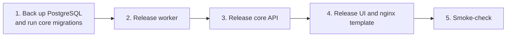

This page covers the coordinated change in `fantasy-web-ui`, `fantasy-core-pipeline` and `fantasy-browser-worker`. Use it to see what shipped, roll it out in order and understand how outcomes are verified.

## What it delivered

| Area | Behavior |
|---|---|
| Navigation | Lineup home, grouped desktop navigation and a mobile drawer. |
| Presentation | Shared palette and score presentation; mobile matchup cards and contained tables. |
| Week selection | Dynamic current week, explicit URL selection and a return to the current week. |
| Waivers | Cards identify the player being added and the player being dropped. |
| Move review | Compares current and resulting rosters and eligible starting lineups across four weeks or the remaining season. Shows injury, availability, bye and incomplete-data warnings. Waiver confirmation refreshes the preview before submitting. |
| Trades | Remain evaluations. This screen does not send trade offers. |
| Standings and rankings | League standings and NFL player fantasy point rankings use the league's ESPN scoring, with weekly and season totals and position, roster and player filters. |
| Activity | Retains submissions, events, execution state, separately verified external outcome and saved LLM sessions. Details link related sessions and allow a fresh status check. Chat sessions support follow-up with freshly computed roster context. |
| Queue work | Durable acceptance, outbox delivery and worker ownership by tracking ID. Scheduled worker entrypoints also record observable runs. |

:::warning[Worker completion is not an ESPN transaction]
A completed worker does not imply an ESPN transaction completed. See [How outcomes are verified](#how-outcomes-are-verified).
:::

## How do I roll it out?

Release in this order. The core migration must run before the new worker starts.

| Step | Action | Notes |
|---|---|---|
| 1 | Back up PostgreSQL with the existing operational procedure. Then run `python -m src.migrations` in the configured core environment. | Adds `activity_actions`, `activity_events`, `activity_outbox`, `activity_sessions` and `activity_reads`, plus their indexes. Imports up to 1,000 explicitly league-scoped historical execution records with unknown external outcomes. Unscoped history is not attributed to a league. |
| 2 | Release the worker with activity ownership and result recording. | Its database user needs access to the new tables and event sequence. Keep existing bot approval, dry-run and draft deadline settings. |
| 3 | Release the core API with durable submission handlers, activity and dashboard routes, and its background runner. | Needs the existing PostgreSQL, RabbitMQ, Redis and ESPN settings. Each API process attempts pending deliveries and reconciliation every 60 seconds. Outbox row locks stop concurrent publishers claiming the same row; worker tracking IDs protect against delivery ambiguity. |
| 4 | Release the UI and nginx template together. | The server-side bot-key proxy allowlist now includes lineup updates and draft picks as well as waiver submissions. |
| 5 | Smoke-check current week, standings, a move preview, saved chat and Activity with the configured league. | See [Smoke-check in a dry-run environment](#smoke-check-in-a-dry-run-environment). |

:::danger[Keep the bot key server-side]
Don't expose the bot key to browser configuration.
:::

### Smoke-check in a dry-run environment

1. Verify queued → worker events → skipped in a controlled dry-run environment.
2. Separately verify a permitted transaction's ESPN evidence.
3. Check broker-disconnection recovery.
4. Check repeated delivery with the same tracking ID.

### Roll back

:::note[Rollback]
The migration is additive, and a UI rollback is independent. During a backend rollback, retain the activity tables and pending outbox records.

Don't drain the outbox through an older worker that lacks tracking-ID ownership. Review pending actions before resuming an older transaction path.
:::

## How is data cached?

### Client

| Behavior | Detail |
|---|---|
| Ownership | Client query hooks own in-memory caching and clear on league, team or season configuration changes. |
| Transport | Stays uncached, so polling, cancellation and explicit refresh reach the network. |
| Reads | Active queries deduplicate reads, use page-specific freshness and refetch stale data on focus. |
| Refresh cadence | Current week every five minutes. Standings poll once a minute. Expensive player rankings refresh on demand. |
| Mutations | Not automatically retried. |
| Invalidation | Newly verified outcomes invalidate related roster, matchup, waiver, move-preview and league queries once per batch. |

### Core (Redis)

| Data | TTL |
|---|---|
| League standings and player leaders | 60 seconds |
| Current league context | 5 minutes |

- Per-key in-flight guards avoid blocking unrelated keys.
- Player ranking fetches have an elapsed-time budget and label partial coverage.
- Keys include league and request context. Successful reconciliation advances a league cache version.
- Redis failure falls back to the source, and errors are not cached.
- Worker-immediate confirmations may stay in server read caches until their short TTL expires.
- Move previews refresh directly and are not stored in this Redis cache.

## How outcomes are verified

### Projections

- Totals optimize eligible starting slots using ESPN projected fantasy points.
- Where ESPN has no projection, the service labels an estimate from up to three prior completed games. It does not turn VORP into points.
- Missing required data leaves totals unknown.
- Future injury changes and roster moves can't be predicted.

### Completion evidence

| Action | Verified when |
|---|---|
| Waiver | Both the addition and the requested drop appear in ESPN roster state. |
| Lineup | All requested changes appear. |
| Trade | Reconciliation checks both teams' resulting ownership. |
| Draft | Explicit confirmation evidence exists: a matching SELECTED result or draft-board verification. A generic successful click stays awaiting processing. |

A pending, rejected or cancelled transaction without authoritative transaction evidence remains unresolved. Generic queue success never marks it verified. Activity supports checking unresolved submissions again.

### Delivery and attention

- Delivery is recorded separately from worker ownership.
- Stale undelivered or unconsumed work appears in **Needs attention**.
- **Needs attention** filters failed or uncertain actions and approval-required work. LLM errors are visible in the LLM sessions tab.
- Poison outbox rows back off without blocking later deliveries.
- Draft delivery failures return 503, so the pick-clock caller can retry immediately.

### LLM history

| Setting | Behavior |
|---|---|
| Chat history | Records observable prompts, context, provider attempts, responses and errors, with credential redaction. Hidden reasoning is not collected. |
| Background LLM calls | Default to content hashes and sizes. Set `LLM_HISTORY_CAPTURE_CONTENT=true` to capture content. |
| Event size | Captured LLM events are capped at 16,000 characters. |
| Retention | Content defaults to 90 days (`LLM_CONTENT_RETENTION_DAYS`). Action history is retained. |
| Ordering | Worker observations run in order outside the provider hot path, with bounded database queries. |
| Access | Assumes the existing authenticated single-league deployment. Per-user read markers use trusted proxy identity headers, with a shared operator fallback when they're absent. |

:::info[What was validated]
Validation used mocked ESPN, broker and database boundaries and mocked browser API responses. No live ESPN transaction or production deployment was performed. Production PostgreSQL migration execution and live external reconciliation remain rollout checks.
:::

## Test coverage

| Repo | Result |
|---|---|
| UI | 25 tests, production TypeScript/Vite build, oxlint (existing React warnings remain). |
| Core | 1002 tests, including durable acceptance, broker failure, deadline checks, waiver reconciliation, projection constraints and credential redaction. |
| Worker | 566 tests, including duplicate ownership and best-effort outcome recording after external writes. |
| Browser | 14 routes at 320, 375, 768, 1024 and 1440px, with no page-wide overflow or runtime errors. Mobile drawer navigation also checked. |

Screenshots are in [`screenshots/ux-overhaul/`](https://github.com/cvillarr23/fantasy-project/tree/main/docs/overview/screenshots/ux-overhaul) and use synthetic fixture data.

Review corrections

- Live GET polling and explicit refresh bypass the transport cache. Caller cancellation is preserved.
- Lineup drafts are week-scoped. Submissions require the current week and retain their idempotency key after a timeout.
- Waivers support one addition with an optional drop. Fresh warnings and exact player identities are displayed before confirmation.
- Activity seeds existing completions without refetch storms, acknowledges read errors and stops polling terminal actions.
- Outbox failures record attempts and backoff. Reconciliation leases rows, excludes historical imports, shares one league read per season per tick and normalizes numbered and FLEX slots.
- Worker ownership uses a PostgreSQL session advisory lock. Failed or crashed jobs can retry when ownership is released.
- Pending waiver writes with uncertain outcomes require manual verification rather than a blind replay. Failures have a bounded retry count.
- Background LLM recording is configurable and bounded. Keyword `prompt=` calls have a regression test.
- Unrelated formatting-only changes were removed from the behavioral diffs.

Internal rollout, implementation and review notes belong in this project repository. Product repositories keep public-facing README, setup and developer reference material.
