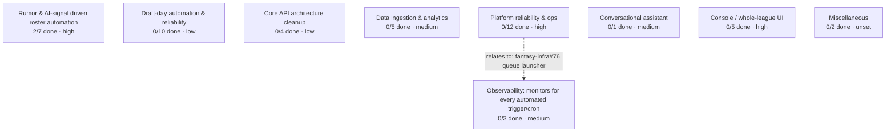

# Project Map

!!! note
    Generated from live GitHub state by `scripts/gen_project_map.py` (run it and commit the output whenever epics change -- this is a snapshot, not auto-refreshing).



| Epic | Members | Priority |
|---|---|---|
| [Rumor & AI-signal driven roster automation](https://github.com/cvillarr23/fantasy-project/issues/3) | 2/7 | high |
| [Draft-day automation & reliability](https://github.com/cvillarr23/fantasy-project/issues/4) | 0/10 | low |
| [Core API architecture cleanup](https://github.com/cvillarr23/fantasy-project/issues/5) | 0/4 | low |
| [Data ingestion & analytics](https://github.com/cvillarr23/fantasy-project/issues/6) | 0/5 | medium |
| [Platform reliability & ops](https://github.com/cvillarr23/fantasy-project/issues/7) | 0/12 | high |
| [Conversational assistant](https://github.com/cvillarr23/fantasy-project/issues/8) | 0/1 | medium |
| [Console / whole-league UI](https://github.com/cvillarr23/fantasy-project/issues/9) | 0/5 | high |
| [Miscellaneous](https://github.com/cvillarr23/fantasy-project/issues/10) | 0/2 | unset |
| [Observability: monitors for every automated trigger/cron](https://github.com/cvillarr23/fantasy-project/issues/11) | 0/3 | medium |

Cross-epic dependencies are wired via native GitHub `blocked-by`, not shown in the diagram above except where noted -- query them directly:
```
gh api graphql -f query='{ repository(owner:"cvillarr23",name:"fantasy-project"){ issue(number:N){ blockedBy(first:10){ nodes { number title repository { name } } } } } }'
```
