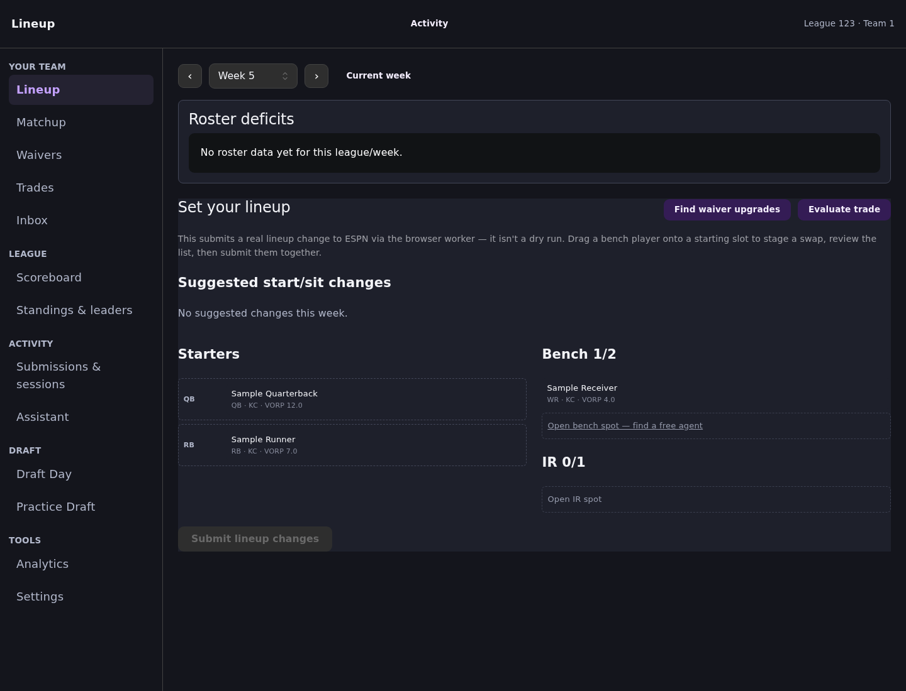
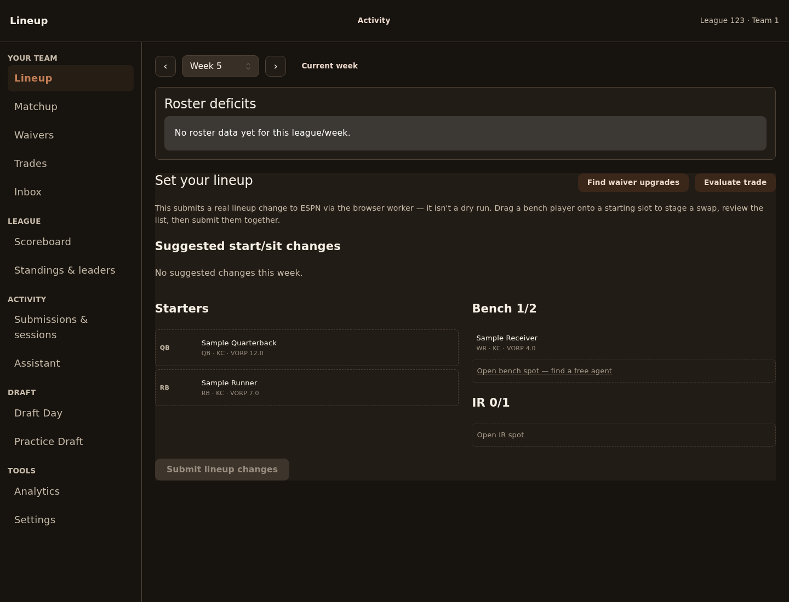
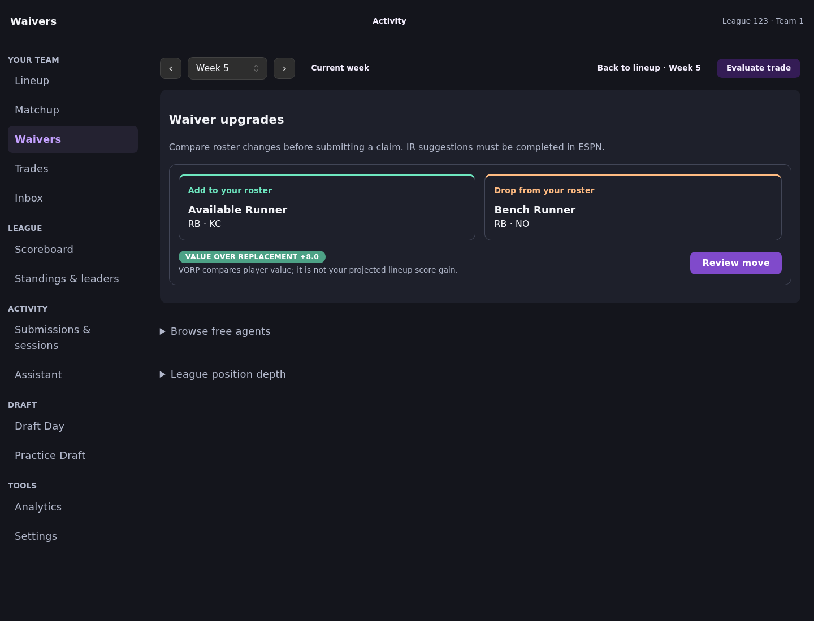
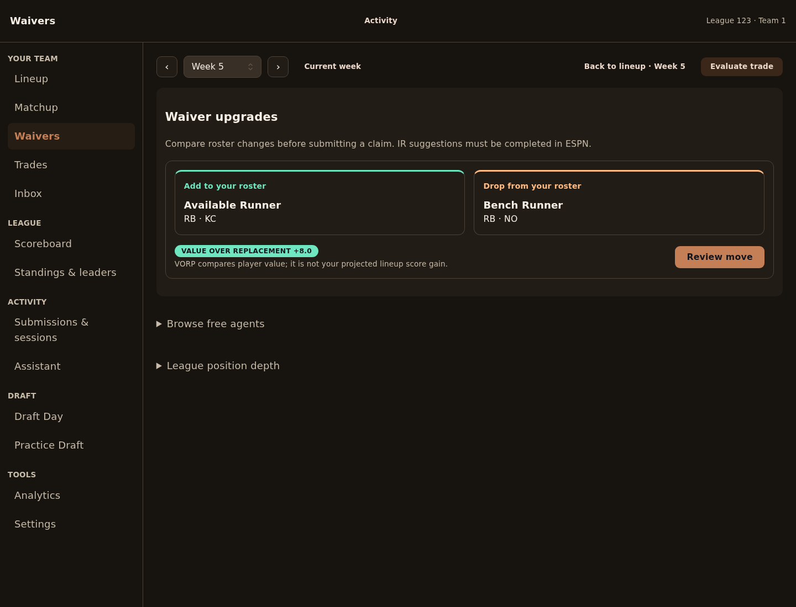
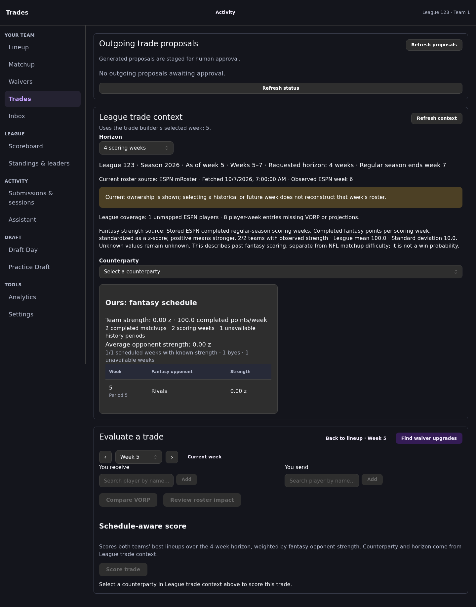
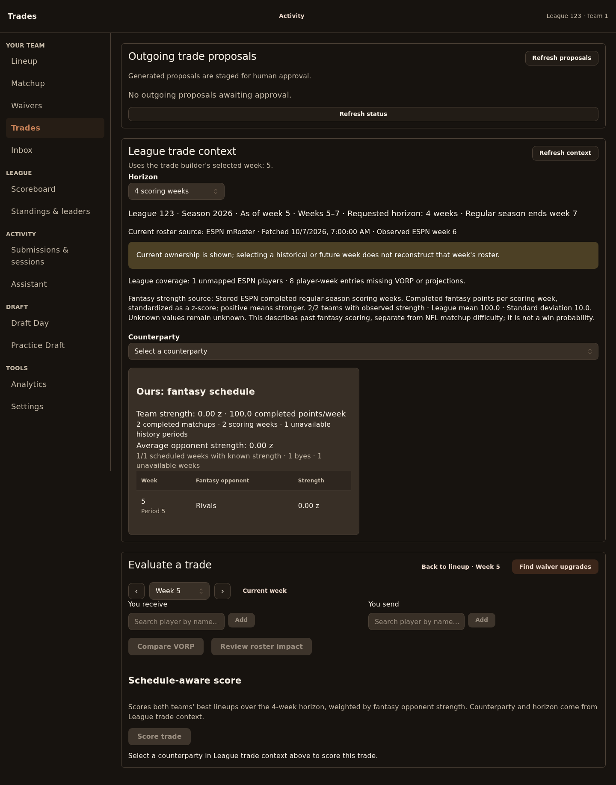
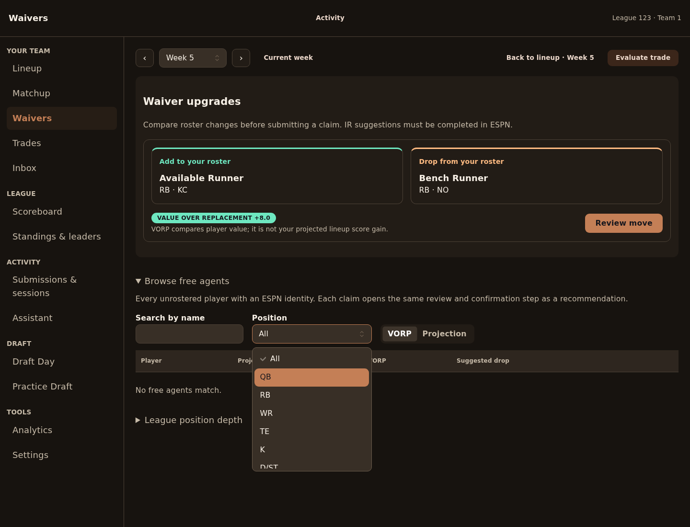
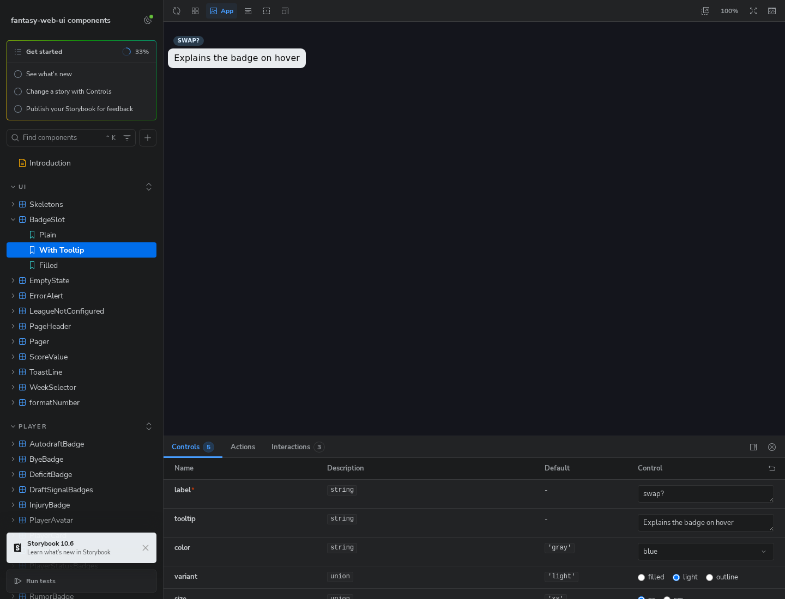
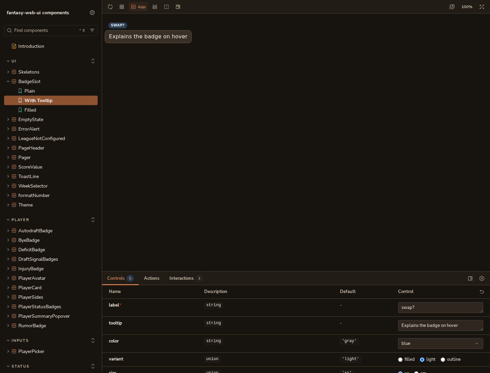

# Earth ground and clay primary

Visual evidence for [fantasy-web-ui#207](https://github.com/cvillarr23/fantasy-web-ui/issues/207), under [the Trades UX epic](https://github.com/cvillarr23/fantasy-project/issues/13).

Captured at 1440 × 1100 in headless Chromium with reduced motion. App pages use synthetic league, roster, waiver, and trade-context responses; no production league data or write requests are involved. Storybook shows the BadgeSlot tooltip story, including library chrome and controls. The before image uses the development manager, which also displays onboarding; the after image uses the production Storybook build.

| View | Before | After |
| --- | --- | --- |
| Lineup |  |  |
| Waivers |  |  |
| Trades |  |  |
| Waivers Select dropdown | — |  |
| Storybook |  |  |

The product design-system reference lives in `fantasy-web-ui/docs/design-system.md`. Page layouts and component APIs are unchanged; existing semantic projected, incoming, outgoing, warning, and error colors retain their base values.

The after images include the PM review fixes: distinct earth neutrals, solid muted text, and overlay surface/border tokens on dropdowns. The open Waivers Position dropdown includes a keyboard-highlighted option with dark text on clay and is also checked in Chromium for computed `#382f26` background and `#6b5c4c` border. Overlay clay ink is `#cd926f` (4.95:1); muted secondary text on the page ground is 9.78:1.
